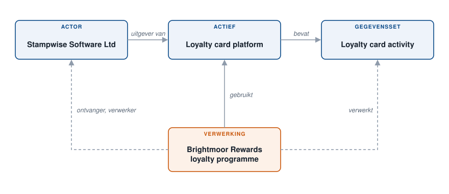

# Een gegevensstroom in kaart brengen

Brightmoor Retail Group voert een loyaliteitsprogramma uit. De gegevens van de leden staan in een loyaliteitskaartplatform dat door een externe leverancier wordt gepubliceerd. Dit voorbeeld brengt die stroom één keer in kaart in de **Referenties** en hergebruikt ze daarna in de verwerkingsactiviteit, zodat het register en de mapping consistent blijven. Zie [Gegevens in kaart brengen](../features/mapping/README.md) voor de methode.

<figure><figcaption>
De vier objecten en hun koppelingen
</figcaption></figure>

De koppelingen zijn de volgende:

* de **stakeholder** publiceert het **actief**;
* het **actief** bevat de **dataset**;
* de **verwerkingsactiviteit** gebruikt het actief, vermeldt de stakeholder als verwerker en verwerkt de dataset.

## 1. De leverancier aanmaken

Maak in **Data inventory** > **Referenties** > **Actoren** de stakeholder "Stampwise Software Ltd" aan, het bedrijf dat het platform publiceert. Het wordt in de verwerkingsactiviteit als verwerker vermeld. Zie [Actoren](../features/mapping/repositories/stakeholders.md).

## 2. Het actief aanmaken

Maak in **Referenties** > **Activa** het actief "Loyalty card platform" aan. Selecteer bij **Uitgever** "Stampwise Software Ltd". Zie [Activa](../features/mapping/repositories/assets.md).

## 3. De dataset aanmaken

Maak in **Referenties** > **Datasets** de dataset "Loyalty card activity" aan, met de gegevensvelden: kaartnummer, puntensaldo, aankoopgeschiedenis. Selecteer bij **Gerelateerde activa** "Loyalty card platform". Een dataset zonder actief is een wees: dankzij de koppeling vindt u alles wat een actief bevat. Zie [Datasets](../features/mapping/repositories/datasets.md).

## 4. De verwerkingsactiviteit opbouwen vanuit de mapping

Open de verwerkingsactiviteit "Brightmoor Rewards loyalty programme", of maak ze aan.

1. Klik in de sectie **Activa** op **Activa selecteren** en selecteer "Loyalty card platform".
2. Klik op de rij van het actief op **Gegevens synchroniseren**. Het venster **Informatie over bedrijfsmiddelen synchroniseren** toont wat Dastra uit de mapping kan kopiëren: de **Redacteur van de aanvraag om een verwerker toe te voegen**, de **Datasets die aan het item zijn gekoppeld** en de beveiligingsmaatregelen.
3. Vink **Alles selecteren** aan en klik op **Toevoegen**.

Dastra voegt "Stampwise Software Ltd" toe aan de sectie **Ontvangers**, in de categorie **Verwerkers**, en "Loyalty card activity" aan de sectie **Datasets**. Er wordt niets twee keer getypt. De rij van het actief toont nu **Gesynchroniseerd**. Zie [Activa](../features/ropa/activity/assets.md) en [Ontvangers](../features/ropa/activity/recipients/README.md).

## 5. Het resultaat lezen

* In de verwerkingsactiviteit toont **Ontvangers** de leverancier als verwerker. Vanuit het menu **...** opent **De gekoppelde actor bewerken** de stakeholder.
* In **Referenties** > **In kaart brengen** toont de grafiek **In kaart brengen van stromen tussen activa** het actief, de uitgever en de dataset ervan als verbonden knooppunten. Zie [Referenties](../features/mapping/repositories/README.md).

Wijzigt de leverancier, dan bewerkt u de stakeholder één keer. Wordt een tweede dataset aan het actief toegevoegd, dan toont de rij van het actief dat het sinds de laatste synchronisatie is gewijzigd: voer **Gegevens synchroniseren** opnieuw uit in elke verwerkingsactiviteit die het gebruikt.

<figure><figcaption>
De stroom op de grafiek In kaart brengen van stromen tussen activa
</figcaption></figure>
