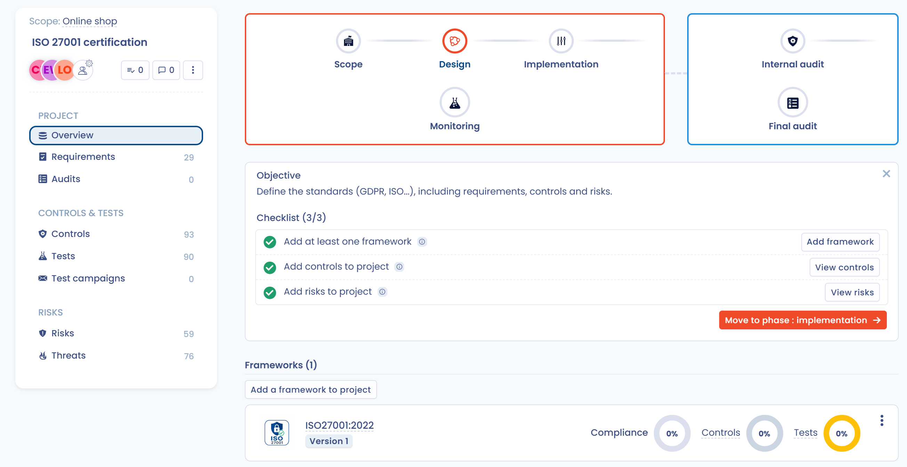

# ISO 27001-project

Brightmoor Retail Group wil ISO/IEC 27001-certificering voor zijn webshop. Emma Walsh, de functionaris voor gegevensbescherming, leidt het project en Liam O'Connor volgt het. Dit voorbeeld doorloopt de zes fasen van een complianceproject met de echte schermen en labels van de toepassing.

Dastra bereidt het werk voor en volgt het. Het certificaat zelf wordt buiten Dastra uitgegeven door een geaccrediteerde certificeringsinstelling.

## Het traject in een oogopslag

| Fase | Wat Brightmoor doet | Referentie |
| --- | --- | --- |
| **Perimeter** | Definieert een perimeter en maakt het project aan | [Perimeters](../features/compliance/scopes.md), [Projecten](../features/compliance/projects/README.md) |
| **Design** | Voegt het kader ISO 27001 toe en importeert de controles en risico's ervan | [Projectontwerp](../features/compliance/projects/design.md) |
| **Implementation** | Sluit controles uit die niet van toepassing zijn, wijst eigenaars toe, configureert tests | [Projectimplementatie](../features/compliance/projects/implement.md) |
| **Monitoring** | Voert een testcampagne uit en verzamelt bewijs | [Conformiteitsmonitoring](../features/compliance/projects/monitoring.md) |
| **Interne audit** | Auditeert het kader en meldt tekortkomingen | [Audits](../features/compliance/projects/audits.md) |
| **Eindaudit** | Legt de stand van de conformiteit vast vóór de certificering | [Audits](../features/compliance/projects/audits.md) |

## 1. Het kader voorbereiden

Een kader bevat de vereisten, controles, tests, risico's en bedreigingen van een norm. Brightmoor begint met het Dastra-sjabloon.

1. Open in het menu **Conformiteit** > **Bibliotheek** > **Kaders**.
2. Klik op **Een framework aanmaken** en kies daarna **Ingebouwde sjabloon**.
3. Zoek naar ISO 27001 en selecteer het sjabloon. Controleer in de details het aantal vereisten, controles, risico's en bedreigingen.
4. Bevestig de import.

Het kader staat nu in de bibliotheek en is bewerkbaar. Het aanmaken ervan gebruikt één kadercredit van het account (zie [Importeren en sjablonen van Dastra](../features/compliance/library/frameworks/import.md)).

## 2. De perimeter definiëren

De perimeter beantwoordt één vraag: welke organisatorische eenheden dekt het project? Brightmoor certificeert alleen de webshop.

1. Open **Conformiteit** > **Perimeters** en maak een perimeter met de naam "Online shop" aan.
2. Selecteer de organisatorische eenheden "Group IT" en "E-commerce". Een perimeter heeft minstens één eenheid nodig.

## 3. Het project aanmaken

1. Open **Conformiteit** > **Projecten**, daarna **Alle projecten**, en klik op **Een project aanmaken**.
2. Voer "ISO 27001 certification" in bij **Titel** en kies de **Perimeter** "Online shop". Klik op **Volgende**.
3. Voeg bij **Wijs gebruikers aan het project toe** Emma Walsh toe met de rol **Goedkeurder** en Liam O'Connor met de rol **Op de hoogte**. Klik op **Toevoegen**.

Het project opent op het overzicht ervan, in de fase **Perimeter**. De assistent bovenaan toont de **Checklist** van de fase en de knop **Move to phase** verschijnt wanneer elke stap is voltooid.

## 4. Fase Design: de controles importeren

Verplaats het project naar **Design** en volg de checklist.

1. Voeg het kader ISO 27001 aan het project toe. Behoud de versie die vooraf is geselecteerd bij **Te installeren versie**.
2. Importeer alle controles van het kader. De controles zijn standaard gemarkeerd als geïmplementeerd en hun tests worden gekoppeld met de status **Ontbrekend bewijs**.
3. Voeg de risico's van het kader aan het project toe. Ze vormen de basis van de initiële risicobeoordeling.

Voegt Brightmoor later een ander kader toe, zoals de AVG, dan detecteert Dastra de gemeenschappelijke controles en importeert ze slechts één keer (zie [Projectontwerp](../features/compliance/projects/design.md#4.-controles-delen-tussen-kaders)).

<figure><figcaption>
Het project in de fase Design
</figcaption></figure>

## 5. Fase Implementation: de controles werkelijkheid maken

1. Sluit de controles uit die niet van toepassing zijn. Brightmoor host alles in de cloud, dus controles over een eigen datacenter vallen buiten de perimeter. Stel op het tabblad **Controles** de **Status van de controle** in op **Excluded** en vul **Leg uit waarom deze controle moet worden uitgesloten** in. De motivering komt terecht in de verklaring van toepasselijkheid en in de audits.
2. Wijs eigenaars toe. Klik op het tabblad **Vereisten** op de gebruikersknop van een vereiste. Selecteer bij **Een eigenaar toewijzen aan alle controles en tests** de eigenaar en klik op **Valideren**. Sophie Becker neemt de vereisten voor toegangscontrole, Noah Martin de vereisten voor de operaties.
3. Configureer de tests. Stel voor elke test de procedure, de frequentie en de eigenaar in. Een test is handmatig, of geautomatiseerd via een connector (zie [Tests](../features/compliance/library/tests.md)).
4. Beoordeel de risico's. Stel op het tabblad **Risico's** de initiële en de resterende beoordeling van elk risico in en kies de behandeling ervan. De weergave **Cartography** toont de initiële, huidige en resterende matrices naast elkaar.

De checklist van de fase luidt **Configureer ten minste één controle**, **Configureer de geautomatiseerde tests**, **Evalueer alle risico's** en **Eigenaren toewijzen aan de tests**.

## 6. Fase Monitoring: het bewijs verzamelen

Verplaats het project naar **Monitoring**. Bewijs dat in een andere fase wordt toegevoegd, geeft een waarschuwing.

1. Open het tabblad **Testcampagnes** en klik op **Een testcampagne aanmaken**.
2. Voer het **Campagne label** "First evidence collection" in en selecteer alle tests die op bewijs wachten.
3. Controleer of elke test een eigenaar heeft. Is dat niet zo, dan waarschuwt Dastra u: gebruik **Bekijk tests zonder eigenaren**.
4. Start de campagne en klik op **Stuur de uitnodigingen** om de eigenaars te verwittigen, zo nodig met een bericht.

Elke eigenaar opent **Mijn tests**, leest de **Testprocedure**, voegt het bewijs toe met **Bewijs toevoegen** en klikt op **Test valideren**. Hetzelfde bestand kan als bewijs voor meerdere tests dienen.

Brightmoor volgt de indicatoren **Teststatus** en **Frisheid van de tests** op het overzicht. De checklist vraagt minstens 80% geslaagde tests vóór de volgende fase.

ISO/IEC 27001 vereist een verklaring van toepasselijkheid. Open op de kaderkaart het menu **⋯** en klik op **Exporteer de verklaring van toepasselijkheid**. Het XLSX-bestand toont elke controle met de toepasselijkheid, de motivering en de implementatiestatus ervan.

## 7. Interne audit

Verplaats het project naar **Interne audit**. ISO/IEC 27001 vereist interne audits met geplande tussenpozen.

1. Klik op het tabblad **Audits** op **Maak een nieuwe audit aan** en selecteer het kader ISO 27001.
2. Voer de **Naam** "ISO 27001 internal audit" in, kies Sophie Becker bij **Auditeurs**, stel **Fase van de audit** in op **Pre-audit** en vul **Startdatum** en **Deadline** in.
3. Laat **Definieer als actieve audit** ingeschakeld en klik daarna op **Valideren**.
4. Klik op **Audit aanvullen** en beoordeel elke vereiste als **Conform**, **Deels conform**, **Niet conform** of **Niet van toepassing**, met een **Opmerking**.
5. Is het bewijs van een test zwak, klik dan op **Fout melden**, kies de **Ernst** en beschrijf het probleem. Vink op het tabblad **Fouten in tests** de gemelde tests aan en klik op **De tests ongeldig maken** en daarna op **Re launch a test campaign**, zodat de eigenaars hun bewijs bijwerken.
6. Is elke vereiste beoordeeld, klik dan op **Finaliseer de audit** en schrijf de **Eindbeoordeling van de audit**.

<figure><figcaption>
Het dashboard van de interne audit
</figcaption></figure>

## 8. Eindaudit

Verplaats het project naar **Eindaudit** en maak een nieuwe audit aan met de fase van de audit **Eindaudit**. Beoordeel de vereisten opnieuw op basis van het verbeterde bewijs en rond de audit daarna af.

Het conformiteitspercentage per kader verschijnt op het projectoverzicht en onder **Conformiteit** > **Statistieken**. Brightmoor exporteert de audit om het bewijs aan de certificeringsinstelling te overhandigen en kan het project tonen in zijn Trust Center (zie [Uw Trust Center configureren](../features/trust-center/configuration/README.md)).
