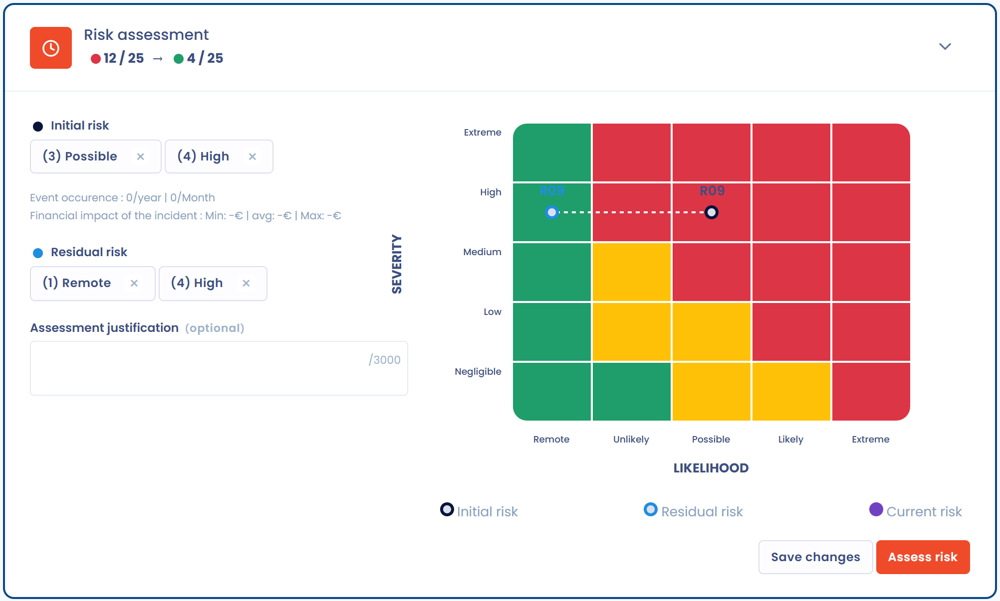
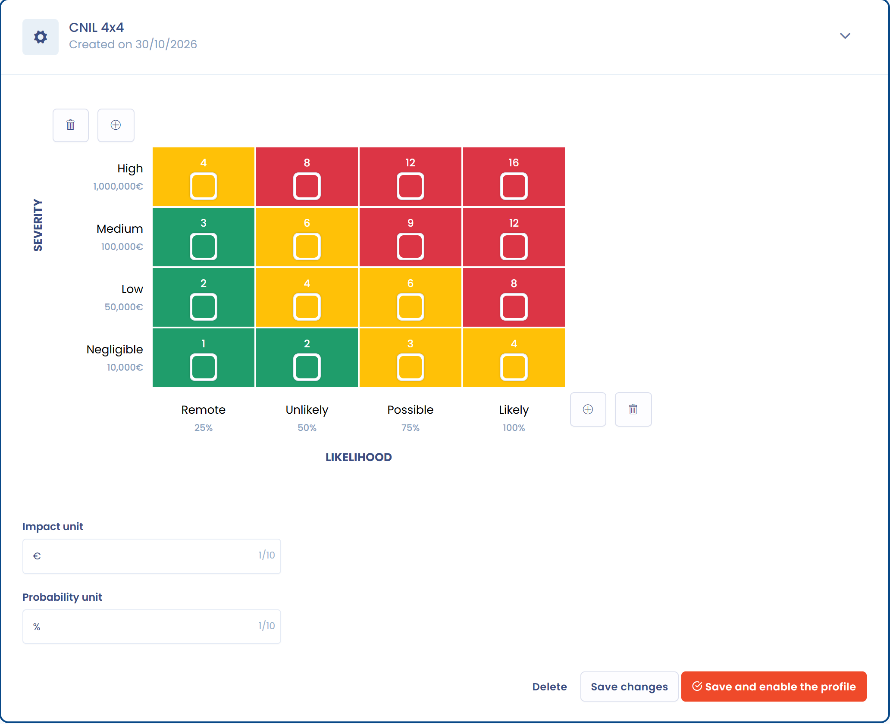

# Risicoscores

Dit voorbeeld berekent de score van een risico van Brightmoor Retail Group twee keer, op twee schalen, en berekent daarna de score van een datalek. De twee berekeningen verschillen: de score van een risico is een product, de score van een datalek is een som.

## Het risico

Brightmoor identificeert het risico "Loss of customer payment data" op de verwerkingsactiviteit "Online order management". In de sectie **Risicobeoordeling** kiest Emma Walsh, de functionaris voor gegevensbescherming, een **Ernst** en een **Waarschijnlijkheid** voor het initiële risico en daarna voor het restrisico zodra de controles zijn ingevoerd. Zie [2. Beoordelen](../features/risks/process/assess.md) voor het scherm.

De score van een risico is **ernst × waarschijnlijkheid**. De maximale score van een schaal is het product van de twee hoogste niveaus. Dastra toont de score als "score / maximum" en, in sommige weergaven, als percentage van het maximum.

## Op de standaardschaal 5×5

De standaardschaal, **Standaard risico-schaal**, heeft vijf niveaus voor elke as.

| Niveau | Ernst | Waarschijnlijkheid |
| --- | --- | --- |
| 1 | Verwaarloosbaar | Onwaarschijnlijk |
| 2 | Laag | Onwaarschijnlijk |
| 3 | Gemiddeld | Mogelijk |
| 4 | Hoog | Waarschijnlijk |
| 5 | Kritisch | Zeer waarschijnlijk |

Brightmoor beoordeelt het initiële risico met een **Hoog** niveau van ernst (4) en een **Mogelijk** niveau van waarschijnlijkheid (3). Kaartbetalingen worden door een externe aanbieder verwerkt, maar de bestellingsdatabase bevat de laatste cijfers en het factuuradres. Na de controles (versleuteling, toegangsbeoordelingen) daalt de resterende waarschijnlijkheid naar niveau 1 (**Onwaarschijnlijk**).

| Risico | Ernst | Waarschijnlijkheid | Berekening | Score | Percentage | Cel van de matrix |
| --- | --- | --- | --- | --- | --- | --- |
| Initieel | 4 | 3 | 4 × 3 | 12 / 25 | 48% | rood |
| Rest | 4 | 1 | 4 × 1 | 4 / 25 | 16% | groen |

<figure><figcaption>
Het risico op de standaardschaal
</figcaption></figure>

Het percentage is de score gedeeld door het maximum (25), afgerond. De kleur van de cel komt uit de matrix van de schaal: bij vijf niveaus is de rij de ernst, van boven geteld, en de kolom de waarschijnlijkheid.

Het huidige risico ligt daartussen. Na elk antwoord op een controlepunt herberekent Dastra het met deze formule: huidig risico = initieel risico − (initieel risico − restrisico) × remediëringspercentage. Bij een remediëringspercentage van 50% is het huidige risico 12 − (12 − 4) × 0,5 = 8. Zie [Effect op het huidige risico](../features/risks/process/monitor.md#effect-op-het-huidige-risico).

## Op de CNIL-schaal 4×4

Brightmoor besluit de schaal met vier niveaus van de CNIL-methode voor gegevensbeschermingseffectbeoordelingen te gebruiken. In **Instellingen voor werkruimte** > **Risicobeheer** wordt een schaal aangemaakt met het **Risico-schaalmodel** **4 niveaus - CNIL PIA** en ingeschakeld met **Activeer dit raster** (zie [De risicoschaal configureren](../features/risks/process/assess.md#de-risicoschaal-configureren)).

| Niveau | Ernst | Waarde | Waarschijnlijkheid | Waarde |
| --- | --- | --- | --- | --- |
| 1 | Negligible | 10.000 € | Remote | 25% |
| 2 | Low | 50.000 € | Unlikely | 50% |
| 3 | Medium | 100.000 € | Possible | 75% |
| 4 | High | 1.000.000 € | Likely | 100% |

<figure><figcaption>
De schaal 4 niveaus - CNIL PIA
</figcaption></figure>

De waarden zijn de standaardwaarden van het model. Ze kunnen worden bewerkt, net als de labels.

Dezelfde beoordeling, **Hoog** niveau van ernst (4) en **Mogelijk** niveau van waarschijnlijkheid (3), geeft nu:

| Risico | Ernst | Waarschijnlijkheid | Berekening | Score | Percentage | Cel van de matrix |
| --- | --- | --- | --- | --- | --- | --- |
| Initieel | 4 | 3 | 4 × 3 | 12 / 16 | 75% | rood |
| Rest | 4 | 1 | 4 × 1 | 4 / 16 | 25% | oranje |

De score is identiek, maar het maximum is lager, dus hetzelfde risico weegt zwaarder: 75% in plaats van 48%, en het restrisico is oranje in plaats van groen. Daarom vraagt Dastra om een bevestiging voordat een andere schaal wordt ingeschakeld wanneer er risico's bestaan, en daarom kiest u de schaal best vóór u uw eerste risico's invoert (zie de [FAQ](../features/risks/faq.md)).

## Een datalek

De module Incidenten gebruikt de risicoschalen niet. Antwoord in de stap **Risicoanalyse** van een datalek **Neen** op **Is er al een risicoanalyse uitgevoerd?** en kies daarna twee scores van 1 tot 4:

* **Identificatie van de betrokkenen**: hoe gemakkelijk personen uit de gegevens kunnen worden geïdentificeerd;
* **Impact op de betrokkenen**: de gevolgen voor hen.

De labels van de vier waarden zijn **1 - Verwaarloosbaar**, **2 - Beperkt**, **3 - Belangrijk** en **4 - Maximaal**. De score van het datalek is hun **som**, van 2 tot 8, en bepaalt het **Risiconiveau**:

| Som van de twee scores | Risiconiveau | Gevolg dat Dastra toont |
| --- | --- | --- |
| 2 en 3 | Verwaarloosbaar risico | Kennisgeving aan de toezichthoudende autoriteit en communicatie aan personen is niet nodig. |
| 4 en 5 | Reëel risico | Kennisgeving aan de toezichthoudende autoriteit verplicht |
| 6 tot 8 | Hoog risico | Kennisgeving aan de toezichthoudende autoriteit en communicatie aan de betrokken personen verplicht |

Brightmoor ontdekt dat een klantexport een paar uur leesbaar was in een verkeerd geconfigureerde opslagruimte. Ze bevat namen, e-mailadressen en bestelgeschiedenissen.

| Geval | Identificatie | Impact | Berekening | Score | Risiconiveau |
| --- | --- | --- | --- | --- | --- |
| Export van alleen bestelnummers | 2 | 1 | 2 + 1 | 3 | Verwaarloosbaar risico |
| Export van namen zonder contactgegevens | 3 | 1 | 3 + 1 | 4 | Reëel risico |
| Export van het klantenbestand | 4 | 2 | 4 + 2 | 6 | Hoog risico |

Voor het derde geval zou een product 4 × 2 = 8 geven, maar Dastra telt de scores op: 4 + 2 = 6. Dat is al een **Hoog risico**, dus de kennisgeving aan de toezichthoudende autoriteit en de communicatie aan de betrokkenen zijn verplicht. Zie [Een nieuwe inbreuk documenteren](../features/incidents/document-breach.md#stap-risicoanalyse) voor de stap en de teller van 72 uur.


Staat **Is er al een risicoanalyse uitgevoerd?** op **Ja**, dan voert u uw eigen analyse in en kiest u zelf het niveau bij **Conclusie van de risicoanalyse: geschat risiconiveau**. Het niveau dat u kiest, vervangt het berekende.

