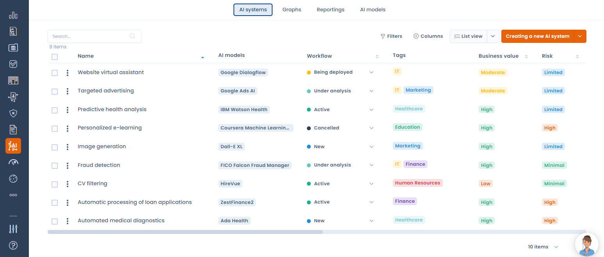

# AI-systemen

## Inleiding

Een AI-systeem staat voor het gebruik van persoonsgegevens met software die is ontwikkeld met een of meer technieken en benaderingen van kunstmatige intelligentie. Dit gebruik kan resultaten opleveren zoals content, voorspellingen, aanbevelingen of beslissingen die de omgevingen beïnvloeden waarmee het systeem interacteert.

> De [definitie van een AI-systeem van de OESO](https://www.oecd.org/content/dam/oecd/en/publications/reports/2024/03/explanatory-memorandum-on-the-updated-oecd-definition-of-an-ai-system_3c815e51/623da898-en.pdf) luidt: "An AI system is a machine-based system that, for explicit or implicit objectives, infers, from the input it receives, how to generate outputs such as predictions, content, recommendations, or decisions that can influence physical or virtual environments. Different AI systems vary in their levels of autonomy and adaptiveness after deployment."

Deze definitie moet de ontwikkeling en het gebruik van kunstmatige intelligentie kaderen en reguleren, zodat AI veilig en ethisch wordt gebruikt en de grondrechten van personen respecteert.

Om deze functie van Dastra te gebruiken, moet ze zijn opgenomen in uw abonnement.

## AI-governance in de wereld

Er bestaan momenteel meerdere kaders voor AI-governance in de wereld, zoals:

* EU AI Act
* ISO/IEC 42001, AI Management System
* NIST AI RMF (Verenigde Staten)
* Chinese regelgeving voor algoritmen en generatieve AI (Generative AI Measures)
* PIPL (China)
* CPRA ADMT (Californië)
* Colorado AI Act
* Brazilië PL 2338/2023
* Model AI Governance Framework van Singapore
* AI-beginselen van de OESO
* UNESCO-aanbeveling over de ethiek van AI
* Vrijwillige AI-gedragscode van Canada
* AI-richtlijnen van Japan, Korea en India

Elk kader heeft zijn eigen kenmerken. In de Europese Unie deelt de AI-verordening (AI Act) AI-systemen bijvoorbeeld in naargelang hun potentiële risiconiveau, van minimaal tot hoog risico. Ze legt transparantieverplichtingen op en stelt strenge eisen aan beveiliging en gegevensbeheer voor de meest kritieke systemen.

Naast de AI-verordening dekt Dastra nu de meeste internationale kaders voor AI-governance: de Chinese regelgeving (Algorithmic Recommendation Regulation, Generative AI Measures), de Colorado AI Act, de ADMT-vereisten in Californië, de belangrijkste niet-bindende nationale kaders (Verenigd Koninkrijk, Japan, Korea, India, Singapore) en wereldwijde normen zoals ISO/IEC 42001, de OESO en NIST AI RMF.


Meerdere landen (UK AI Bill, Canada AIDA, Australië, Brazilië enzovoort) werken hun toekomstige AI-wetten nog uit. Ook zolang die niet zijn aangenomen, steunen hun vereisten op een gemeenschappelijke basis die Dastra al standaard dekt: governance, transparantie, menselijk toezicht, risicobeheer en documentatie. Zodra nieuwe wetgeving officieel is, verwerken we die snel.


Weet u niet welk kader voor AI-governance voor uw organisatie geldt, beantwoord dan de [Global AI Regulatory Eligibility Questionnaire](https://www.dastra.eu/en/audit/referential/af0d4dcd-2f0a-47be-7337-08de2357ae70).

## AI-systemen in Dastra

<figure><figcaption>
Het register van AI-systemen in Dastra
</figcaption></figure>

Deze functie ondersteunt de naleving van AI-regelgeving zoals de EU AI Act. U stelt er een lijst op van alle AI-systemen in uw organisatie. Elk gebruik van gegevens met AI wordt zo gedefinieerd, beoordeeld, geanalyseerd en gedocumenteerd.

Op de volgende pagina's leest u hoe u een register van AI-systemen opzet en uw eigen repository van AI-modellen aanmaakt:


[Repository van AI-modellen](models.md)



[Een register van AI-systemen opzetten](record.md)



[Uw AI-systemen importeren](import.md)



[Risicoanalyse en bedrijfswaarde](risk-analysis.md)



[Transparantiebericht](transparency-notice.md)

