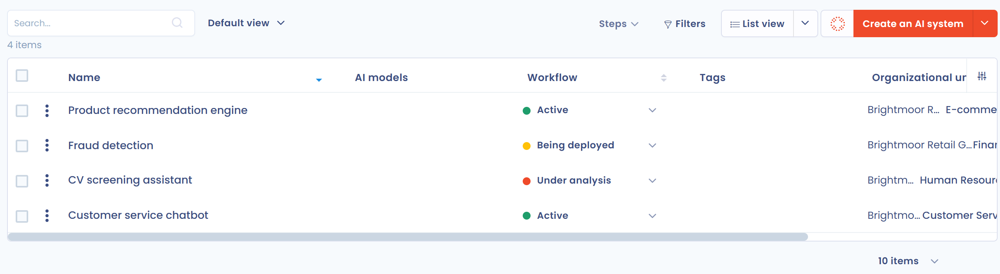

# AI-systemen

De module **AI-wet** van Dastra houdt een lijst bij van de AI-systemen die uw organisatie gebruikt of ontwikkelt, beoordeelt hun risiconiveau volgens de AI-verordening en bewaart de documentatie die uw naleving aantoont. Deze pagina is bedoeld voor functionarissen voor gegevensbescherming, juridische teams en projectteams die AI beheren.

<figure><figcaption>
Het register van AI-systemen
</figcaption></figure>

De module is beschikbaar als uw abonnement ze bevat.

## Wat een AI-systeem is volgens de AI-verordening

De Europese AI-verordening (**AI Act**, Verordening (EU) 2024/1689) definieert een AI-systeem in artikel 3, lid 1, als een op een machine gebaseerd systeem dat is ontworpen om met verschillende niveaus van autonomie te werken, dat na het inzetten ervan aanpassingsvermogen kan vertonen en dat, voor expliciete of impliciete doelstellingen, uit de input die het ontvangt afleidt hoe het resultaten kan genereren zoals:

* content (gegenereerde tekst, afbeeldingen, geluiden);
* voorspellingen (koopgedrag, kredietrisico);
* aanbevelingen (producten, marketingacties, beveiligingsmaatregelen);
* beslissingen (een lening toekennen of weigeren, sollicitaties sorteren).

Deze resultaten kunnen de fysieke of virtuele omgeving beïnvloeden waarmee het systeem interacteert.

## Waarom een register van AI-systemen bijhouden

### Aan de wettelijke verplichtingen voldoen

De AI-verordening vraagt organisaties hun AI-systemen te kennen, ze naar risiconiveau in te delen en ze te documenteren. Het register helpt u om:

* hoogrisicosystemen te identificeren, waarvoor strenge verplichtingen gelden (risicobeheer, gegevensbeheer, technische documentatie, menselijk toezicht, transparantie);
* van elk systeem een spoor te bewaren om uw naleving aan te tonen bij een inspectie of een audit;
* verboden praktijken, zoals sociale scoring, tijdig op te sporen.

### Governance en transparantie versterken

Met een register kunt u:

* de informatie over al uw AI-systemen centraliseren;
* de verantwoordelijke stakeholders identificeren (datawetenschappers, FG, bedrijfsteams);
* dezelfde informatie intern delen, wat het vertrouwen van gebruikers en medewerkers vergroot;
* de documentatie bijwerken wanneer een systeem verandert (nieuwe versie, nieuwe dataset, ander gebruik).

### AI-projecten beveiligen en investeringen prioriteren

Het register helpt u om:

* de bedrijfswaarde van elk systeem te beoordelen (productiviteit, prestaties, risicovermindering);
* die waarde af te wegen tegen het risiconiveau om uw projecten te prioriteren;
* te beslissen of u een systeem voortzet, wijzigt of stopzet wanneer de balans tussen risico en voordeel niet gunstig is.

## Risiconiveaus

De AI-verordening deelt AI-systemen in vier categorieën in:

1. **Minimaal risico**: geen significante impact, bijvoorbeeld een spamfilter.
2. **Beperkt risico**: transparantieverplichtingen, bijvoorbeeld een chatbot of gegenereerde content die als zodanig moet worden bekendgemaakt.
3. **Hoog risico**: impact op gezondheid, veiligheid of grondrechten, wat strikte naleving vereist, bijvoorbeeld het geautomatiseerd sorteren van sollicitaties of kredietscoring.
4. **Onaanvaardbaar risico**: verboden praktijken, bijvoorbeeld sociale scoring of subliminale manipulatie van personen.

Voor de details van elk niveau raadpleegt u [Risicoanalyse en bedrijfswaarde](risk-analysis.md).

## Wat de module doet

In Dastra kunt u:

* de AI-systemen opsommen die in uw organisatie worden gebruikt of ontwikkeld;
* hun risiconiveau beoordelen in overeenstemming met de AI-verordening;
* elk systeem documenteren met zijn assets, datasets, AI-modellen, gekoppelde verwerkingsactiviteiten en stakeholders;
* de bedrijfswaarde van elk systeem analyseren om uw AI-projecten af te stemmen op uw doelstellingen.

## Wat u in dit onderdeel leert

De volgende pagina's laten u zien hoe u:

* een register van uw AI-systemen opbouwt;
* een repository van AI-modellen aanmaakt en beheert;
* elk systeem documenteert om uw naleving aan te tonen bij een audit;
* de beoordeling van AI-risico's opneemt in uw processen voor gegevensbeheer en naleving.

## Waarde voor uw organisatie

De module helpt u uw wettelijke risico's te verminderen, uw AI-projecten te structureren en uw keuzes te verantwoorden tegenover klanten, partners en teams.

## In de module navigeren

Klik op **AI-wet** in de zijbalk. Het menu bevat de volgende onderdelen:

* **Register van AI-systemen**: de lijst van uw systemen, waarin u dossiers aanmaakt, importeert, exporteert en opent. Zie [Een register van AI-systemen opzetten](record.md) en [Uw AI-systemen importeren](import.md).
* **In kaart brengen**: de grafiek van de AI-systemen en de items waaraan ze zijn gekoppeld.
* **Rapportage**: de indicatoren van het register, namelijk systemen per risiconiveau, per bedrijfswaarde, per workflowstap, per organisatorische eenheid en per label, en nieuwe systemen.
* **AI-modellen**: de repository van de modellen die uw systemen gebruiken. Zie [Repository van AI-modellen](models.md).
* **Impactanalyses**: de vragenlijsten voor de impactbeoordeling die aan uw AI-systemen zijn gekoppeld. Dit onderdeel verschijnt als uw abonnement de module **Vragenlijsten** bevat en u toegang hebt tot vragenlijsten. Zie [Beoordeling van de gevolgen voor de grondrechten (FRIA)](fria.md).

Om het informatiebericht van een systeem op te stellen, raadpleegt u [Transparantiebericht](transparency-notice.md). Om uw AI-systemen op uw openbare portaal te publiceren, raadpleegt u [AI-systemen in het Trust Center](../trust-center/configuration/ai-systems.md).

## Aan de slag

Begin met [Een register van AI-systemen opzetten](record.md), of met [Uw AI-systemen importeren](import.md) als u al een lijst hebt.
