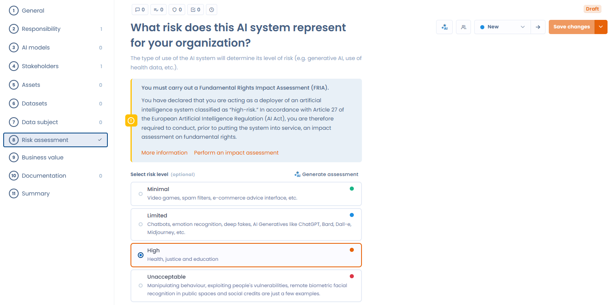
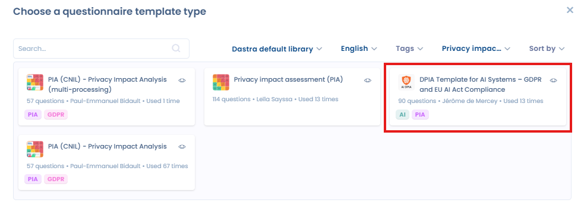

# Beoordeling van de gevolgen voor de grondrechten bij AI-systemen met een hoog risico

## Regelgevend kader

De Europese AI-verordening (AI Act) verplicht voor bepaalde AI-systemen een beoordeling van de gevolgen voor de grondrechten (Fundamental Rights Impact Assessment, FRIA).

Deze verplichting geldt wanneer het systeem is ingedeeld als hoog risico. De beoordeling moet worden uitgevoerd voordat het systeem in gebruik wordt genomen.

## Doel van de beoordeling

De beoordeling heeft als doel:

* de risico's te identificeren die het AI-systeem kan inhouden voor:
  * privacy
  * non-discriminatie
  * vrijheid van meningsuiting
  * vrijheid van vereniging
  * het vermoeden van onschuld
  * menselijke waardigheid
  * rechten van werknemers
* de ernst en de waarschijnlijkheid van deze risico's te beoordelen
* passende maatregelen om de risico's te beperken te bepalen


Deze beoordeling staat los van een DPIA (gegevensbeschermingseffectbeoordeling) onder de AVG, maar vult die aan.


## De effectbeoordeling uitvoeren

Wanneer u in Dastra een AI-systeem als hoog risico definieert, verschijnt een melding die u vraagt een effectbeoordeling uit te voeren.

<figure><figcaption></figcaption></figure>

Beschikt u over de module Vragenlijsten van Dastra, dan bevat deze melding de knop **Een impactbeoordeling uitvoeren**. Een klik daarop opent een venster met vragenlijsten.

Hebt u het sjabloon voor de effectbeoordeling geïnstalleerd, dan verschijnt het in dit venster. Anders klikt u op **Maak een sjabloon**, waarmee u naar de module Vragenlijsten gaat.

U kunt dan:

* uw eigen sjabloon aanmaken
* ons bestaande sjabloon importeren

Om ons kant-en-klare sjabloon te importeren, klikt u op **Maak een sjabloon** en daarna op **Geautomatiseerde audit**. U komt dan op een lijst met sjablonen. Selecteer in de filters **Sjablonen gemaakt door Dastra** en kies het type **Gegegevensefffectbeoordeling (Data Protection Impact Assessement)**. U kunt ook "DPIA Template for AI Systems - GDPR and EU AI Act Compliance" intypen in de zoekbalk.

<figure><figcaption></figcaption></figure>

U kunt nu uw effectbeoordeling uitvoeren.
