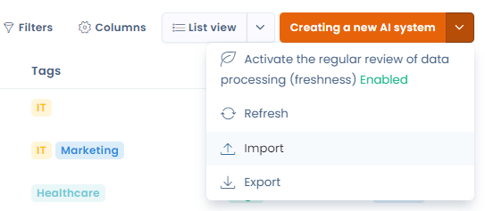

# Uw AI-systemen importeren

U importeert uw bestaande register rechtstreeks in Dastra, zodat u niet alles met de hand hoeft in te voeren.

Open hiervoor de lijstweergave **AI-systemen**. Open rechtsboven het keuzemenu naast de knop **Een nieuw AI-systeem creëren** en klik op **Importeren**. Er verschijnt een nieuwe pagina, waar u onderaan uw bestaande register toevoegt.

<figure><figcaption><p>Uw AI-systemen importeren</p></figcaption></figure>

Voor meer details volgt u de stappen op de pagina [Uw gegevens importeren (Excel, CSV)](../general/import.md).

## Importformaat voor AI-systemen in Dastra

Deze handleiding beschrijft het formaat dat het CSV-bestand voor het importeren van AI-systemen in Dastra moet hebben.

### Structuur van het CSV-bestand

Het bestand moet een koprij bevatten met de hieronder beschreven kolomnamen. Alle velden zijn optioneel, behalve `Label`: dat is verplicht.

### Tabel met importvelden


Velden van het type enum moeten precies de waarden gebruiken die onder "Toegestane waarden" staan.


| Kolom | Beschrijving | Type | Beperkingen | Toegestane waarden |
| --- | --- | --- | --- | --- |
| `Label` | Naam van het systeem | String | Verplicht, 1–120 tekens | Geen |
| `Ref` | Interne referentie | String | Optioneel, maximaal 50 tekens | Geen |
| `Description` | Beschrijving van het systeem | String | Optioneel, maximaal 4000 tekens | Geen |
| `State` | Status van het systeem | AiSystemState | Optioneel | Draft, Cancelled, Pending, Active |
| `RiskLevel` | Risiconiveau | AiSystemRiskLevel | Optioneel | Low, Medium, High, Unacceptable |
| `RiskLevelJustification` | Rechtvaardiging van het risiconiveau | String | Optioneel | Geen |
| `BenefitLevel` | Niveau van waarde of nut | AiSystemBenefitLevel | Optioneel | Low, Medium, High |
| `BenefitLevelJustification` | Rechtvaardiging van het waardeniveau | String | Optioneel | Geen |
| `DateArchived` | Archiveringsdatum | DateTime | Optioneel, formaat `DD-MM-YYYY` of `DD/MM/YYYY` | Geen |
| `DateCreation` | Aanmaakdatum | DateTime | Optioneel, hetzelfde formaat | Geen |
| `DateUpdate` | Datum van de laatste wijziging | DateTime | Optioneel, hetzelfde formaat | Geen |
| `DateDeployment` | Implementatiedatum | DateTime | Optioneel, hetzelfde formaat | Geen |
| `DateRetirement` | Datum van buitengebruikstelling | DateTime | Optioneel, hetzelfde formaat | Geen |
| `TransparencyNoticeDone` | Heeft een transparantiebericht | Boolean | Optioneel | true / false |
| `TransparencyNoticeHtml` | Transparantiebericht (HTML-inhoud) | String | Optioneel, maximaal 4000 tekens | Geen |

### Voorbeeld van een CSV-regel

Een volledig geldig voorbeeld:

```
"Internal ChatGPT","SYS-001","Internal documentation assistant model","Active","Medium","Moderate risks with responsible use","High","Very high business value","01/02/2024","15/01/2024","01/03/2024","20/03/2024","","false","<p>This AI system is used to assist employees in drafting internal documents.</p>"
```

### Sjabloon voor de CSV-koprij

U plakt deze regel rechtstreeks in een leeg `.csv`-bestand:

```
Label,Ref,Description,State,RiskLevel,RiskLevelJustification,BenefitLevel,BenefitLevelJustification,DateArchived,DateCreation,DateUpdate,DateDeployment,DateRetirement,TransparencyNoticeDone,TransparencyNoticeHtml
```
