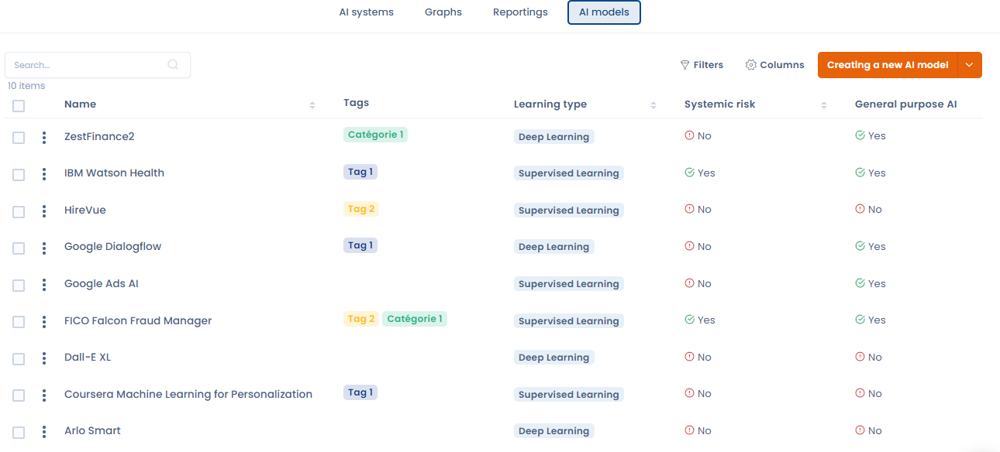
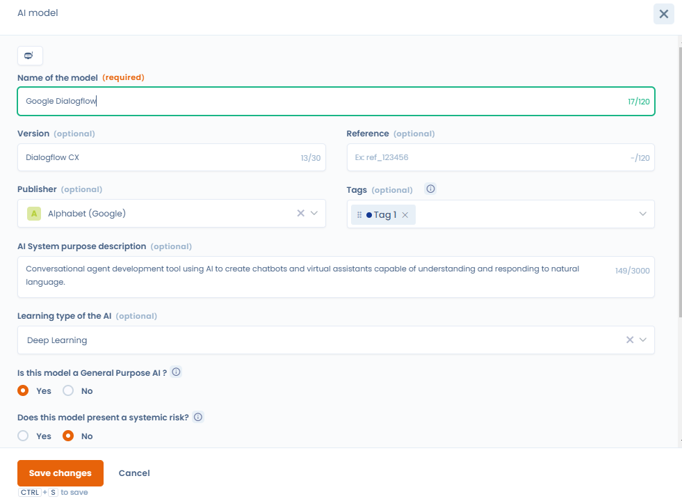
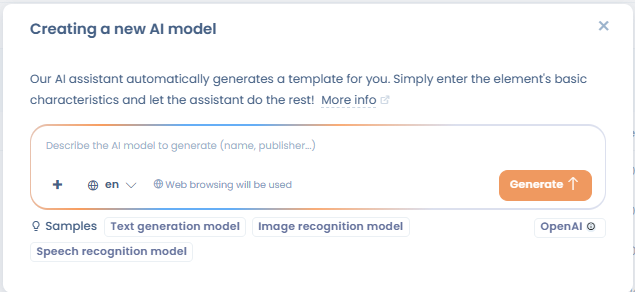
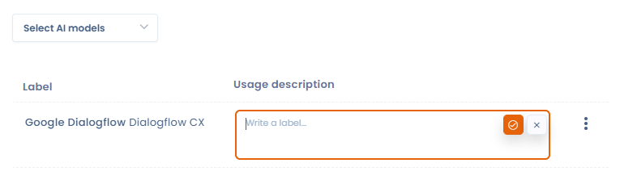

# Repository van AI-modellen

Voor elk AI-systeem dat u registreert, geeft u het AI-model of de AI-modellen op die worden gebruikt.

<figure><figcaption>
Repository van AI-modellen
</figcaption></figure>

## Definitie

Een model voor kunstmatige intelligentie is een computerprogramma dat is ontworpen om specifieke taken uit te voeren met technieken voor machinaal leren en gegevensanalyse. Een meer gedetailleerde definitie:

* Basis: een AI-model steunt op specifieke algoritmen en architecturen (zoals neurale netwerken voor deep learning) waarmee het van gegevens kan leren.
* Leren: het model wordt getraind door grote datasets te verwerken om patronen en verbanden te herkennen. Zo kan het voorspellingen doen of content genereren op basis van nieuwe gegevens die het ontvangt.
* Functie: het doel waarvoor het model wordt gebruikt, bijvoorbeeld beeldgeneratie voor het model MidJourney.
* Gebruik: deze modellen worden ingezet in uiteenlopende toepassingen, van chatbots en virtuele assistenten tot gegevensanalyse en contentcreatie, en bieden geautomatiseerde oplossingen voor veel domeinen.

## Uw repository van AI-modellen aanmaken met Dastra

Ga om een repository aan te maken naar het tabblad **AI-modellen**.

Klik daarna op de knop **Een nieuw AI-model creëren**. Er opent een venster waarin u de vereiste gegevens invult.

Geef in het veld voor de beschrijving zoveel mogelijk detail, met de kenmerken en de informatie die u over het model hebt.

<figure><figcaption>
Een nieuw AI-model registreren
</figcaption></figure>

U selecteert ook het **Leertype van de AI**. Het leertype van een AI-model verwijst naar de methode waarmee het model wordt getraind om zijn taken uit te voeren. Elk type past bij specifieke toepassingen en bepaalt hoe het model de opgedane kennis generaliseert. Er zijn er 4, en naast elk type staat een definitie die u helpt kiezen.

### Een AI-modeldossier genereren met de AI-assistent

Vanuit de lijst met AI-modellen genereert u met de AI-assistent automatisch een dossier voor een AI-model. Deze functie maakt in enkele seconden een volledig dossier aan op basis van een korte modelnaam of beschrijving. De assistent zoekt op het web en vult de relevante informatie in (architectuur, leertype, leverancier, mogelijkheden enzovoort).

Kies hiervoor in het aanmaakvenster van het model **Genereren met de IA**, voer de naam of een korte beschrijving van het model in en bevestig. Controleer het gegenereerde dossier voordat u het opslaat, want door AI gegenereerde content kan fouten bevatten.

<figure><figcaption>
Beschrijf het AI-model dat u wilt genereren (naam, uitgever enzovoort): het web wordt gebruikt om de informatie aan te vullen
</figcaption></figure>

## Koppeling tussen AI-systemen en modellen

Ga om een AI-systeem aan een model te koppelen naar het betreffende AI-systeem. In het tweede deel, **AI-modellen**, vindt u een selector waarmee u een of meer modellen kiest uit de modellen die in uw repository staan.

Selecteer de betreffende modellen en vul daarna het veld **Gebruiksbeschrijving** in. Dat legt uit hoe het model in het betreffende AI-systeem wordt gebruikt.

<figure><figcaption>
Een AI-systeem aan een model koppelen
</figcaption></figure>
