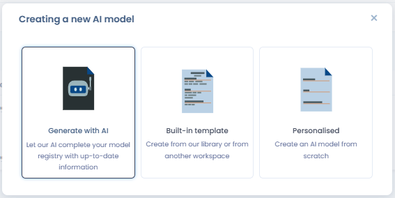
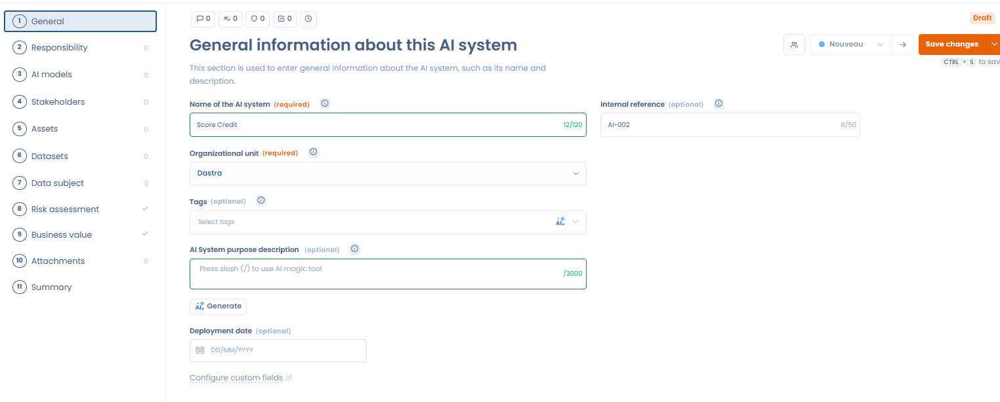

# Een register van AI-systemen opzetten

Om uw register van AI-systemen op te zetten, hebt u twee mogelijkheden:

* U hebt al een register dat u rechtstreeks in Dastra importeert (ga naar de volgende pagina: [Uw AI-systemen importeren](import.md)).
* U hebt er geen. In dat geval maakt u zelf een register aan.

## Een register van AI-systemen aanmaken

Klik op **Een nieuw AI-systeem creëren** om een AI-systeem toe te voegen. Een venster biedt drie manieren om het aan te maken:

<figure><figcaption>
Drie manieren om aan te maken: AI-generatie, ingebouwd sjabloon of leeg formulier
</figcaption></figure>

* **AI gegenereerd**: de AI-assistent genereert automatisch een volledig dossier op basis van een korte beschrijving (naam, uitgever, URL enzovoort). Hij gebruikt het web om de informatie aan te vullen.
* **Ingebouwde sjabloon**: kies uit de bibliotheek van AI-systemen van Dastra of uit een andere werkruimte.
* **Gepersonaliseerd**: maak een leeg dossier aan en vul elk veld zelf in.

### Een AI-systeem genereren met de AI-assistent

Selecteer **AI gegenereerd** en beschrijf daarna het systeem dat u wilt documenteren (naam, uitgever enzovoort). U kunt een bestand bijvoegen of een URL opgeven om de generatie te ondersteunen.

<figure><figcaption>
Beschrijf het AI-systeem dat u wilt genereren (naam, gebruikt AI-model enzovoort)
</figcaption></figure>

De assistent maakt een vooringevuld dossier (naam, beschrijving, leertype, systeemrisico, uitgever enzovoort) dat u kunt nalezen en valideren voordat u het opslaat.

<figure><figcaption>
Controleer het gegenereerde dossier voordat u het valideert: AI kan fouten maken
</figcaption></figure>


Automatisch door AI gegenereerde gegevens kunnen fouten bevatten. Controleer en corrigeer het voorgestelde dossier voordat u het in uw register opslaat.


Zodra u de vereiste gegevens hebt ingevoerd, gaat u naar een formulier met 10 stappen. Daarin beschrijft u het AI-systeem zo gedetailleerd mogelijk.

<figure><figcaption></figcaption></figure>

## De 11 stappen van het formulier van een AI-systeem

Hieronder staan de 11 stappen die u invult om een AI-systeem te documenteren.

### 1. Algemeen

Voer de basisgegevens van het AI-systeem in:

* de naam van het systeem
* een korte beschrijving van het doel en de werking ervan

### 2. Verantwoordelijkheid

Definieer uw rol en verantwoordelijkheden volgens de Europese AI-verordening (AI Act). Dezelfde organisatie kan meerdere rollen tegelijk hebben:

* **Leverancier**: ontwikkelt een AI-systeem en brengt het onder eigen naam of merk op de markt of neemt het in gebruik.
* **Déployeur**: gebruiksverantwoordelijke, gebruikt een AI-systeem onder eigen verantwoordelijkheid in het kader van beroepsactiviteiten.
* **Importeur**: voert een AI-systeem in vanuit een derde land om het op de EU-markt te brengen.
* **Distributeur**: maakt een AI-systeem beschikbaar op de EU-markt zonder leverancier of importeur te zijn.
* **Geautoriseerde vertegenwoordiger**: een natuurlijke of rechtspersoon in de EU die schriftelijk is gemachtigd door een leverancier die buiten de EU is gevestigd.
* **Fabrikant van producten**: als een AI-systeem is geïntegreerd in een product dat onder sectorale wetgeving valt (bijvoorbeeld medische hulpmiddelen), wordt de fabrikant van het product voor dat systeem als leverancier beschouwd.


Als er nog geen verantwoordelijkheid is gedefinieerd voor dit systeem, biedt Dastra een vragenlijst van 10 vragen aan om te bepalen welke rol of rollen voor uw organisatie gelden. Zodra de verantwoordelijkheden zijn vastgesteld, kan de AI-assistent automatisch een rechtvaardiging genereren.


#### Contextuele meldingen op basis van de aangegeven rol

Als u de rol **Déployeur** aangeeft, toont Dastra contextuele meldingen op basis van het risiconiveau van het systeem:

* Onaanvaardbaar risico: geeft u aan dat u gebruiksverantwoordelijke bent van een systeem met een onaanvaardbaar risico, dan herinnert een melding u eraan dat het gebruik van zo'n systeem volgens de AI-verordening verboden is.
* Hoog risico: geeft u aan dat u gebruiksverantwoordelijke bent van een systeem met een hoog risico, dan meldt een bericht in welke situaties een [beoordeling van de gevolgen voor de grondrechten (FRIA)](fria.md) verplicht is, en verwijst het u naar de betreffende vragenlijst.

### 3. AI-modellen

Geef het AI-model of de AI-modellen op die worden gebruikt om gegevens in dit systeem te verwerken.


Voor meer details raadpleegt u de repository van AI-modellen.


### 4. Belanghebbenden

Identificeer de belanghebbenden die betrokken zijn bij de invoering en het beheer van dit AI-systeem, met hun rollen (bijvoorbeeld data scientist, FG, product owner).

### 5. Activa

Voeg de activa toe die dit AI-systeem ondersteunen, zoals:

* infrastructuuronderdelen
* softwaretools
* API's
* documentatiemiddelen

### 6. Gegevenssets

Som de datasets op die aan dit AI-systeem zijn gekoppeld. Geef aan in welke van de volgende fasen ze worden gebruikt:

* **Opleiding** (training): de dataset waarmee het AI-model wordt getraind, zodat het patronen, verbanden of classificaties leert op basis van historische gegevens.
* **Geldigmaking** (validatie): een aparte dataset om de parameters van het model af te stellen en overfitting te voorkomen. Ze helpt de prestaties van het model tijdens de training te beoordelen en stuurt de aanpassingen voor een optimaal resultaat.
* Testen: een andere, aparte dataset om de eindprestaties van het getrainde en gevalideerde model te beoordelen vóór de ingebruikname. Ze geeft een onbevooroordeelde maat voor hoe het model presteert op nieuwe, ongeziene gegevens.
* Inferentie in productie: gegevens die het AI-systeem tijdens het eigenlijke gebruik verwerkt, wanneer het getrainde model in de praktijk voorspellingen, classificaties of beslissingen produceert.

Zorg ervoor dat het doel, de samenstelling en de koppeling met dit AI-systeem van elke dataset duidelijk zijn gedocumenteerd, voor transparantie en naleving.

### 7. Betrokkene

Geef de categorieën van betrokkenen op van wie het AI-systeem persoonsgegevens verwerkt (bijvoorbeeld klanten, werknemers, gebruikers).

### 8. Classificatie

Beoordeel het risiconiveau op basis van:

* de soorten verwerkte gegevens
* de verwerkingsactiviteiten
* de mogelijke gevolgen voor de rechten en vrijheden van personen

### 9. Bedrijfswaarde

Bepaal een score voor de bedrijfswaarde die de bijdrage van het systeem aan uw organisatie weergeeft, om:

* projecten met een hoge waarde prioriteit te geven
* AI-initiatieven af te stemmen op strategische doelstellingen

### 10. Bijlagen

Voeg relevante documenten en informatiebladen toe, zoals:

* gebruikersberichten
* technische handleidingen
* conformiteitsbeoordelingen (bijvoorbeeld DPIA's)

### 11. Samenvatting

Bekijk een overzicht van alle informatie die u voor dit AI-systeem hebt ingevoerd, vóór de definitieve validatie en registratie.

## Gekoppelde verwerkingsactiviteiten en synchronisatie van gegevens

Op het tabblad **Verwerkingen van gegevens** van een dossier van een AI-systeem koppelt u een of meer verwerkingsactiviteiten uit uw AVG-register aan dat systeem. Deze koppeling houdt uw verwerkingsregister en uw register van AI-systemen consistent.

## Een eerdere versie herstellen

Het paneel **Historisch** van het dossier van een AI-systeem bewaart elke aanmaak en elke wijziging. U herstelt een eerdere versie rechtstreeks vanuit dit paneel.

<figure><figcaption>
Elke versie in de activiteitsgeschiedenis biedt een knop om te herstellen
</figcaption></figure>

Bij elke vermelding in de geschiedenis staat een knop om te herstellen, zichtbaar voor gebruikers met schrijfrechten. Na bevestiging maakt Dastra een nieuw AI-systeem aan op basis van de gegevens van de gekozen versie. De naam krijgt het achtervoegsel "- restored version - [datum]" en u gaat naar dit nieuwe dossier. Het oorspronkelijke AI-systeem blijft ongewijzigd.

<figure><figcaption>
De herstelde versie verschijnt als nieuw AI-systeem met het achtervoegsel "- restored version - [datum]"
</figcaption></figure>
