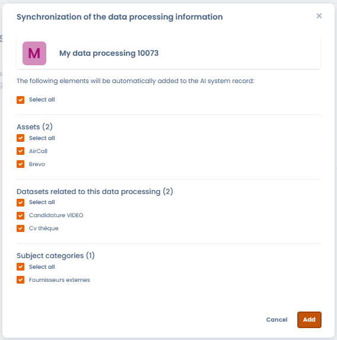

# Een register van AI-systemen opzetten

Om uw register van AI-systemen op te zetten, hebt u twee mogelijkheden:

* U hebt al een register: importeer het rechtstreeks in Dastra. Zie [Uw AI-systemen importeren](import.md).
* U hebt er geen: maak de AI-systemen een voor een aan, zoals hieronder beschreven.

## Een AI-systeem aanmaken

Klik in de zijbalk op **AI-wet** en daarna op **Register van AI-systemen**. Klik vervolgens op **Een nieuw AI-systeem creëren**. Een venster biedt drie manieren om het aan te maken:

<figure><figcaption>
Drie manieren om aan te maken: AI-assistent, sjabloon of leeg formulier
</figcaption></figure>

* **AI gegenereerd**: de AI-assistent genereert een dossier op basis van een korte beschrijving van het systeem (naam, uitgever, URL enzovoort). Hij gebruikt het web om de informatie aan te vullen.
* **Ingebouwde sjabloon**: kies een systeem uit de bibliotheek van AI-systemen van Dastra of uit een andere werkruimte.
* **Gepersonaliseerd**: maak een leeg dossier aan en vul elk veld zelf in. Voer de naam van het systeem en de organisatorische eenheid in.

De knop met het AI-pictogram, links van de knop **Een nieuw AI-systeem creëren**, start de generatie door de AI-assistent rechtstreeks.

### Een AI-systeem genereren met de AI-assistent

Selecteer **AI gegenereerd** en beschrijf daarna het systeem dat u wilt documenteren (naam, uitgever enzovoort). U kunt een bestand bijvoegen of een URL opgeven om de generatie te ondersteunen.

<figure><figcaption>
Beschrijf het AI-systeem dat u wilt genereren (naam, gebruikt AI-model enzovoort)
</figcaption></figure>

De assistent maakt een vooringevuld dossier dat u kunt nalezen en valideren voordat u het opslaat.

<figure><figcaption>
Controleer het gegenereerde dossier voordat u het valideert: AI kan fouten maken
</figcaption></figure>


Automatisch door AI gegenereerde gegevens kunnen fouten bevatten. Controleer en corrigeer het voorgestelde dossier voordat u het in uw register opslaat.


Zodra de vereiste gegevens zijn opgeslagen, opent Dastra het dossier van het systeem: een formulier met 12 stappen. Daarin beschrijft u het AI-systeem zo gedetailleerd mogelijk.

<figure><figcaption>
De 12 stappen van het dossier van een AI-systeem
</figcaption></figure>

## De 12 stappen van het formulier

De stappen staan links van het dossier, met het aantal ingevoerde items of een vinkje wanneer de stap is ingevuld: **Algemeen**, **Verantwoordelijkheid**, **AI-modellen**, **Belanghebbenden**, **Activa**, **Verwerkingen van gegevens**, **Gegevenssets**, **Betrokkene**, **Classificatie**, **Bedrijfswaarde**, **Bijlagen** en **Samenvatting**. U slaat het dossier op elk moment op met **Opslaan**.

### 1. Algemeen

Voer de basisgegevens van het AI-systeem in:

* de naam van het systeem;
* een interne referentie, als u er een hebt;
* de organisatorische eenheid;
* de labels;
* de beschrijving van het doel en de werking van het systeem;
* de datum van inzet.

### 2. Verantwoordelijkheid

Bepaal uw rol volgens de AI-verordening (AI Act). Een organisatie kan meerdere rollen hebben, afhankelijk van haar activiteiten:

* **Leverancier**: ontwikkelt een AI-systeem, of laat het ontwikkelen, en brengt het onder eigen naam of merk op de markt of neemt het in gebruik, tegen betaling of kosteloos.
* **Déployeur** (gebruiksverantwoordelijke): gebruikt een AI-systeem onder eigen verantwoordelijkheid in het kader van beroepsactiviteiten.
* **Importeur**: brengt in de Unie een AI-systeem op de markt dat de naam of het merk draagt van een persoon die in een derde land is gevestigd.
* **Distributeur**: maakt een AI-systeem beschikbaar op de markt van de Unie zonder de leverancier of de importeur ervan te zijn.
* **Geautoriseerde vertegenwoordiger**: een persoon die in de Unie is gevestigd en van een buiten de Unie gevestigde leverancier een schriftelijke machtiging heeft ontvangen.
* **Fabrikant van producten**: als een AI-systeem is geïntegreerd in een product dat onder sectorale wetgeving valt, bijvoorbeeld een medisch hulpmiddel, wordt de fabrikant van het product als de leverancier van dat systeem beschouwd.

U kunt voor elke verantwoordelijkheid een rechtvaardiging toevoegen. Bepaal uw rollen nauwkeurig: ze bepalen uw verplichtingen onder de AI-verordening.


Als er geen verantwoordelijkheid is gedefinieerd, biedt Dastra een zelfevaluatievragenlijst over rollen en verantwoordelijkheden bij AI aan, met de knop **Zelfevaluatie van Rollen en Verantwoordelijkheden in IA**. Zodra de verantwoordelijkheden zijn vastgesteld, kan de AI-assistent een rechtvaardiging genereren: klik op **Een beschrijving van de verantwoordelijkheid genereren met IA**.


### 3. AI-modellen

Geef het AI-model of de AI-modellen op die in dit systeem worden gebruikt, met hun gebruiksbeschrijving. Zie [Repository van AI-modellen](models.md).

### 4. Belanghebbenden

Voeg de gebruikers toe die verantwoordelijk zijn voor dit AI-systeem en wijs elk van hen een rol toe.

### 5. Activa

Voeg de activa toe die dit AI-systeem ondersteunen, bijvoorbeeld infrastructuuronderdelen, softwaretools of API's. Deze informatie is optioneel: ze laat u de toepassingsketen in kaart brengen die de gegevens met elkaar verbindt.

### 6. Verwerkingen van gegevens

Koppel de verwerkingsactiviteiten van uw AVG-register aan dit AI-systeem en synchroniseer daarna hun informatie met het dossier. Zie [Gekoppelde verwerkingsactiviteiten en synchronisatie van gegevens](#gekoppelde-verwerkingsactiviteiten-en-synchronisatie-van-gegevens).

### 7. Gegevenssets

Som de datasets op die aan dit AI-systeem zijn gekoppeld: klik op **Een dataset toevoegen** om er een aan te maken, of op **Datasets selecteren** om uit uw repository te kiezen. Voor elke dataset:

* beschrijft u in het daarvoor bestemde veld de relatie tussen de dataset en het AI-systeem;
* geeft u met **Ja** of **Neen** aan hoe het systeem de dataset gebruikt, in de drie kolommen **Opleiding**, **Verzoek** en **Geldigmaking**.

Elk van de drie kolommen heeft een hulptekst:

* **Opleiding**: de gegevens worden gebruikt om een AI-model te trainen, dat wil zeggen om het patronen, verbanden of classificaties te laten leren op basis van historische gegevens.
* **Verzoek**: de gegevens worden gebruikt om het AI-model te bevragen, bijvoorbeeld de gegevens die het systeem tijdens het eigenlijke gebruik verwerkt.
* **Geldigmaking**: de gegevens worden gebruikt voor de validatie van het AI-model, dat wil zeggen om de prestaties ervan te beoordelen en de parameters af te stellen om overfitting te voorkomen.

De schakelaar **Velden weergeven** toont de gegevensvelden van elke dataset. Documenteer voor elke dataset het doel, de samenstelling en de koppeling met het AI-systeem.

<figure><figcaption>
De stap Gegevenssets van een AI-systeem
</figcaption></figure>

### 8. Betrokkene

Voeg de categorieën van betrokkenen toe van wie het AI-systeem persoonsgegevens verwerkt, bijvoorbeeld klanten, werknemers of gebruikers. Geef aan of kwetsbare personen worden getroffen.

### 9. Classificatie

Wijs het systeem een risiconiveau toe volgens de AI-verordening. Deze stap kan ook meldingen tonen die aan uw rol zijn gekoppeld:

* **Onaanvaardbaar risico**: bent u de gebruiksverantwoordelijke van een systeem dat als **Onaanvaardbaar** is geclassificeerd, dan herinnert een melding u eraan dat artikel 5 van de AI-verordening de inzet ervan verbiedt.
* **Hoog risico**: bent u de gebruiksverantwoordelijke van een systeem dat als **Hoog risico** is geclassificeerd, dan toont een melding het toepassingsgebied van artikel 27 van de AI-verordening en biedt ze aan de [beoordeling van de gevolgen voor de grondrechten (FRIA)](fria.md) uit te voeren.

Voor de details van deze stap, zie [Risicoanalyse en bedrijfswaarde](risk-analysis.md).

### 10. Bedrijfswaarde

Beoordeel de bedrijfswaarde van het systeem voor uw organisatie. Met deze beoordeling kunt u projecten met een hoge waarde prioriteit geven. Zie [Risicoanalyse en bedrijfswaarde](risk-analysis.md).

### 11. Bijlagen

Geef aan of er een informatiebericht bestaat, schrijf het of genereer het, en voeg de documenten van het systeem toe: berichten, technische handleidingen, conformiteitsbeoordelingen. Zie [Transparantiebericht](transparency-notice.md).

### 12. Samenvatting

Bekijk de samenvatting van alle informatie die u voor dit AI-systeem hebt ingevoerd, voordat u het dossier afrondt.

## Gekoppelde verwerkingsactiviteiten en synchronisatie van gegevens

De stap **Verwerkingen van gegevens** van het dossier van een AI-systeem koppelt een of meer verwerkingsactiviteiten uit uw AVG-register aan dat systeem. Deze koppeling houdt uw verwerkingsregister en uw register van AI-systemen consistent.

<figure><figcaption>
De stap "Verwerkingen van gegevens" toont de AVG-verwerkingsactiviteiten die aan dit AI-systeem zijn gekoppeld
</figcaption></figure>

### Gegevens synchroniseren vanuit een verwerkingsactiviteit

Voor elke gekoppelde verwerkingsactiviteit importeert de knop **Synchronisatie. gegevens** de elementen van de verwerkingsactiviteit in het dossier van het AI-systeem: activa, datasets en categorieën van betrokkenen.

<figure><figcaption>
De synchronisatieknop importeert de gegevens van de verwerkingsactiviteit in het dossier van het AI-systeem
</figcaption></figure>

Een venster toont de elementen die kunnen worden geïmporteerd. U kunt precies selecteren welke u toevoegt.

<figure><figcaption>
De elementen selecteren die van de verwerkingsactiviteit naar het AI-systeem worden gesynchroniseerd
</figcaption></figure>

### Gekoppelde AI-systemen bekijken vanuit een verwerkingsactiviteit

Omgekeerd toont het paneel **Gekoppelde AI-systemen** in het dossier van een verwerkingsactiviteit alle AI-systemen die eraan zijn gekoppeld.

<figure><figcaption>
Het paneel "Gekoppelde AI-systemen" is beschikbaar in het dossier van elke verwerkingsactiviteit
</figcaption></figure>

Deze tweerichtingskoppeling maakt audits en de documentatie van de naleving van de AI-verordening gemakkelijker vanuit het AVG-register.

## Gebruikers uitnodigen om het dossier aan te vullen

Klik in een dossier op de knop met het gebruikerspictogram, **Nodig gebruikers uit om dit AI-systeem te voltooien**. In het venster:

1. Kies de **Sectie** van het dossier die moet worden aangevuld.
2. Selecteer de **Gebruikers om uit te nodigen**. Ze hebben ten minste het recht om te wijzigen nodig, of het recht om hun eigen items te lezen en te schrijven als ze belanghebbenden van het systeem zijn.
3. Schrijf het **Uitnodigingsbericht** of selecteer een berichtsjabloon.
4. Klik op **Verstuur een uitnodiging**.

## Andere acties op een AI-systeem

In het register van AI-systemen biedt het menu van elke rij **Bewerken**, **Dupliceren** en **Verplaats naar de prullenbak**. In een dossier biedt het menu van de knop **Opslaan** onder meer:

* **Beoordeling**: markeert het dossier als beoordeeld. De actie verschijnt voor een systeem met de status **Actief** als de regelmatige beoordeling voor AI-systemen is ingeschakeld. Zie [Terugkerende beoordeling (frisheid)](../regular-review.md);
* **Exporteren**: exporteert het dossier als CSV, Excel, JSON, HTML, Word, PDF of Markdown;
* **Informatiebericht genereren** en **Export information notice**: zie [Transparantiebericht](transparency-notice.md);
* **Verplaats naar de prullenbak**.

Het menu van de knop **Een nieuw AI-systeem creëren** in het register van AI-systemen biedt ook **Maak vanuit de bibliotheek**, **Importeren**, **Exporteren** en **Set up regular review**, die de instellingen van de regelmatige beoordeling voor AI-systemen opent.

## Een eerdere versie herstellen

Het paneel **Historisch** van het dossier van een AI-systeem bewaart elke aanmaak en elke wijziging. U herstelt een eerdere versie rechtstreeks vanuit dit paneel.

<figure><figcaption>
Elke versie in de activiteitsgeschiedenis biedt een knop om te herstellen
</figcaption></figure>

Bij elke vermelding in de geschiedenis staat een knop om te herstellen, zichtbaar voor gebruikers met schrijfrechten. Na bevestiging maakt Dastra een **nieuw AI-systeem** aan op basis van de gegevens van de gekozen versie. De naam krijgt het achtervoegsel "- restored version - [datum]" en u gaat naar dit nieuwe dossier. Het oorspronkelijke AI-systeem blijft ongewijzigd.

<figure><figcaption>
De herstelde versie verschijnt als nieuw AI-systeem met het achtervoegsel "- restored version - [datum]"
</figcaption></figure>
