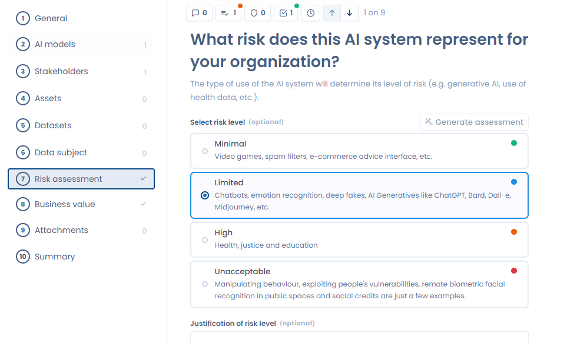
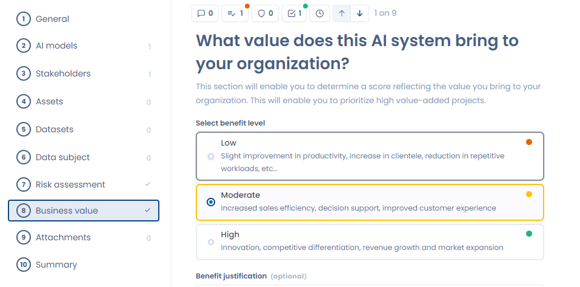

# Risicoanalyse en bedrijfswaarde

Met Dastra voert u een risicoanalyse uit van uw AI-systemen. In dit deel van het formulier wijst u aan elk systeem een van de 4 risiconiveaus toe. De AI-verordening (AI Act) definieert deze niveaus, van minimaal tot onaanvaardbaar risico. We raden aan een beschrijving toe te voegen die het risico van het systeem rechtvaardigt.


Verklaart u dat u gebruiksverantwoordelijke bent van een AI-systeem en is dat systeem ingedeeld als hoog risico, dan bent u volgens artikel 27 van de Europese AI-verordening verplicht een [beoordeling van de gevolgen voor de grondrechten](fria.md) uit te voeren voordat u het systeem in gebruik neemt.


<figure><figcaption>
Risicoanalyse van een AI-systeem
</figcaption></figure>

In het volgende deel van het formulier bepaalt u de toegevoegde waarde van het AI-systeem. U kiest hier uit 3 waardeniveaus, van laag tot hoog. U kunt die waarde rechtvaardigen door te beschrijven wat het systeem voor uw organisatie oplevert, zoals prestatiewinst of risicobeperking.


De AI-assistent kan automatisch een beoordeling en een rechtvaardiging van de toegevoegde waarde van uw AI-systeem genereren. Klik in de sectie **Bedrijfswaarde** op de knop voor AI-ondersteuning om de generatie te starten op basis van de gegevens die al in het register staan.


<figure><figcaption>
Bedrijfswaarde van een AI-systeem
</figcaption></figure>

Als u beide delen invult, ziet u meteen of dit gebruik van AI voor u een kans of een risico vormt. Een systeem met een hoog risico en een lage toegevoegde waarde is misschien niet de moeite waard om te behouden.
