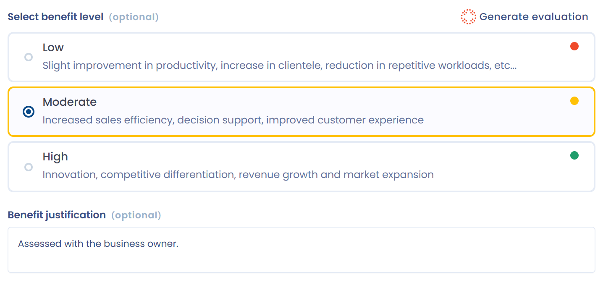

# Risicoanalyse en bedrijfswaarde

Twee stappen van het dossier van een AI-systeem beoordelen het systeem: **Classificatie** voor het risiconiveau en **Bedrijfswaarde** voor de waarde ervan voor uw organisatie. Deze pagina beschrijft beide stappen en de hulp die de AI-assistent biedt om ze in te vullen.

## Classificatie van het risiconiveau

In de stap **Classificatie** wijst u elk systeem een van vier risiconiveaus toe: **Minimaal**, **Beperkt risico**, **Hoog risico** of **Onaanvaardbaar**. Deze niveaus komen uit de AI-verordening (AI Act), van minimaal tot onaanvaardbaar risico. Onder elk niveau toont Dastra voorbeelden van de betrokken systemen.

Rechtvaardig het gekozen niveau in het veld **Rechtvaardiging van het risiconiveau**. Het wordt beschikbaar zodra een niveau is geselecteerd.

<figure><figcaption>
De stap Classificatie van een AI-systeem
</figcaption></figure>

### Risiconiveaus volgens de AI-verordening

De AI-verordening verdeelt AI-systemen in vier categorieën. Elke categorie brengt andere verplichtingen mee.

#### Minimaal risico

AI-systemen waarvan het risico voor de grondrechten of de veiligheid van mensen verwaarloosbaar of nihil is.

Voorbeelden: spamfilters, aanbevelingssystemen voor content zonder significante impact, AI in videogames.

Verplichtingen: de AI-verordening legt er geen specifieke op, maar de algemene regels blijven gelden, zoals de AVG en de verplichting om te zorgen voor AI-geletterdheid van het personeel (artikel 4).

#### Beperkt risico

AI-systemen die onder transparantieverplichtingen jegens gebruikers vallen, zonder significante impact op hun rechten.

Voorbeelden: conversationele chatbots, deepfakes die voor entertainment zijn gegenereerd.

Verplichtingen:

* de gebruiker informeren dat deze met een AI-systeem communiceert;
* bekendmaken dat content door AI is gegenereerd of gewijzigd.

#### Hoog risico

AI-systemen die een aanzienlijk risico vormen voor de gezondheid, de veiligheid of de grondrechten. Ze vallen onder een strikt kader voor conformiteit en beoordeling.

Voorbeelden:

* kredietscoring;
* geautomatiseerde werving, bijvoorbeeld het sorteren van sollicitaties;
* biometrische identificatie, buiten de verboden praktijken;
* AI in medische hulpmiddelen of kritieke infrastructuur.

Verplichtingen:

* conformiteitsbeoordeling voordat het systeem op de markt wordt gebracht;
* risicobeheer;
* governance van de gebruikte gegevens;
* transparantie en gedetailleerde technische documentatie;
* menselijk toezicht en traceerbaarheid.


Artikel 27 van de AI-verordening vereist van sommige gebruiksverantwoordelijken van hoogrisicosystemen een beoordeling van de gevolgen voor de grondrechten: gebruiksverantwoordelijken die onder het publiek recht vallen, private entiteiten die openbare diensten verlenen en gebruiksverantwoordelijken van bepaalde systemen in de financiële sector. Zie [Beoordeling van de gevolgen voor de grondrechten (FRIA)](fria.md).


#### Onaanvaardbaar risico

AI-systemen die verboden zijn omdat ze ingaan tegen de waarden van de Europese Unie of de grondrechten schenden.

Voorbeelden:

* sociale scoring van personen;
* biometrische identificatie op afstand in real time in openbare ruimten voor rechtshandhaving, buiten strikte uitzonderingen;
* subliminale manipulatie van personen.

Verplichtingen: het op de markt brengen en het gebruik in de Europese Unie zijn verboden.

Met het juiste risiconiveau bepaalt u de toepasselijke verplichtingen, geeft u prioriteit aan conformiteitsacties en communiceert u duidelijk met uw business- en juridische teams.

### De classificatie genereren met AI

Als uw abonnement de bijbehorende AI-functies bevat, verschijnt de knop **Genereren classificatie** boven de keuze van het niveau. Hij stelt een risiconiveau voor op basis van de informatie die al in het dossier staat.

1. Klik op **Genereren classificatie**. Het venster toont de gegevens die naar het AI-model worden verzonden: naam van het systeem, beschrijving, modellen, rol onder de AI-verordening, activa, gekoppelde verwerkingsactiviteiten, datasets en categorieën van betrokkenen.
2. Klik op **Genereer**.
3. Lees het voorstel: het risiconiveau, een rechtvaardiging die de toepasselijke bepalingen van de AI-verordening aanhaalt, de betrouwbaarheidsscore van de analyse en de ontbrekende informatie die de classificatie kan wijzigen of versterken.
4. Klik op **Toepassen op het formulier** om het niveau en de rechtvaardiging in de stap over te nemen, of op **Terug** om de generatie opnieuw uit te voeren.
5. Controleer het resultaat, corrigeer het indien nodig en sla het dossier op.

<figure><figcaption>
Een classificatie die door de AI-assistent is voorgesteld
</figcaption></figure>


Het voorstel van de AI-assistent helpt u het systeem te classificeren. Het vervangt uw juridische analyse niet. Controleer het voordat u het toepast.


### Classificatievragenlijst

Zolang er geen risiconiveau is ingesteld, biedt een vak **Hulp nodig om het niveau van risico te bepalen?** aan een vragenlijst voor AI-risicobeoordeling uit te voeren. Ze helpt u de classificatie van het systeem volgens de AI-verordening te bepalen: verboden praktijken, hoogrisicogebieden en transparantieverplichtingen.

Klik op **Een risico-evaluatie starten** en kies een sjabloon van het type **AI system risk assessment**. De vragenlijst wordt ingepland zoals elke andere: zie [Een audit of PIA plannen](../questionnaires/schedule.md). Als het venster geen sjabloon toont, installeert u er een uit de bibliotheek, zoals voor de [beoordeling van de gevolgen](fria.md). Het vak verschijnt als uw abonnement de module **Vragenlijsten** bevat en u vragenlijsten mag aanmaken.

## Bedrijfswaarde van een AI-systeem

De stap **Bedrijfswaarde** beoordeelt de waarde van het systeem voor uw organisatie. Selecteer een van de drie niveaus, **Laag**, **medium** of **Hoog**, en leg daarna in het veld **Voordeel rechtvaardiging** uit wat het systeem concreet oplevert, bijvoorbeeld:

* een winst in operationele prestaties;
* een betere servicekwaliteit;
* een vermindering van risico's of kosten.

<figure><figcaption>
De stap Bedrijfswaarde van een AI-systeem
</figcaption></figure>

### De evaluatie genereren met AI

De knop **Genereer de evaluatie** werkt zoals **Genereren classificatie**. De AI-assistent analyseert de context van het dossier (doel, modellen, activa, gekoppelde verwerkingsactiviteiten) en stelt een niveau van bedrijfswaarde voor, met een rechtvaardiging. Klik op **Genereer**, controleer het voorstel en klik daarna op **Toepassen op het formulier**. Corrigeer de tekst indien nodig en sla het dossier op.

## Waarom beide stappen invullen

Door het risiconiveau en de bedrijfswaarde in te voeren, ziet u of een AI-systeem eerder een strategische kans voor uw organisatie is of een onevenredig risico gezien het geringe nut. Een systeem met een hoog risico en een lage bedrijfswaarde rechtvaardigt mogelijk niet dat het in productie blijft.

Deze gecombineerde analyse ondersteunt uw afwegingen en de afstemming van uw AI-portfolio op uw strategische en regelgevende prioriteiten.
