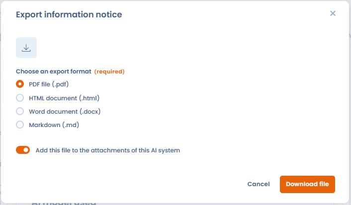
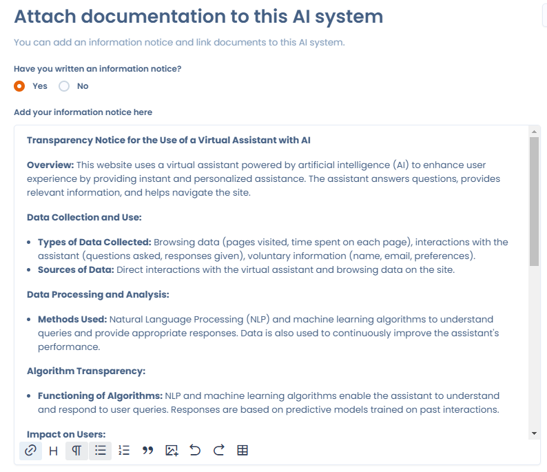

# Transparantiebericht

Een transparantiebericht (of informatiebericht) is een essentieel document om gebruikers en andere betrokkenen te informeren over de werking en het gebruik van AI-systemen. Het bericht moet ervoor zorgen dat AI-systemen transparant en verantwoord zijn en de grondrechten van personen respecteren.

In Dastra voegt u dit document toe aan de sectie **Bijlagen** van een AI-systeem. U kunt het als document uploaden of rechtstreeks op het tabblad schrijven.

Het bericht dat de AI-assistent genereert, exporteert u als PDF, Word, HTML of Markdown, vanuit de berichtassistent of via de actie **Kennisgeving exportinformatie** van het AI-systeem. In het exportvenster voegt de optie **Add this file to the attachments of this AI system**, standaard ingeschakeld, het geëxporteerde bestand toe aan de bijlagen van de stap **Bijlagen**. Elke export maakt een nieuwe bijlage aan.

<figure><figcaption>
Het geëxporteerde bericht toevoegen aan de bijlagen van het AI-systeem
</figcaption></figure>

<figure><figcaption>
Transparantiebericht van een AI-systeem
</figcaption></figure>
