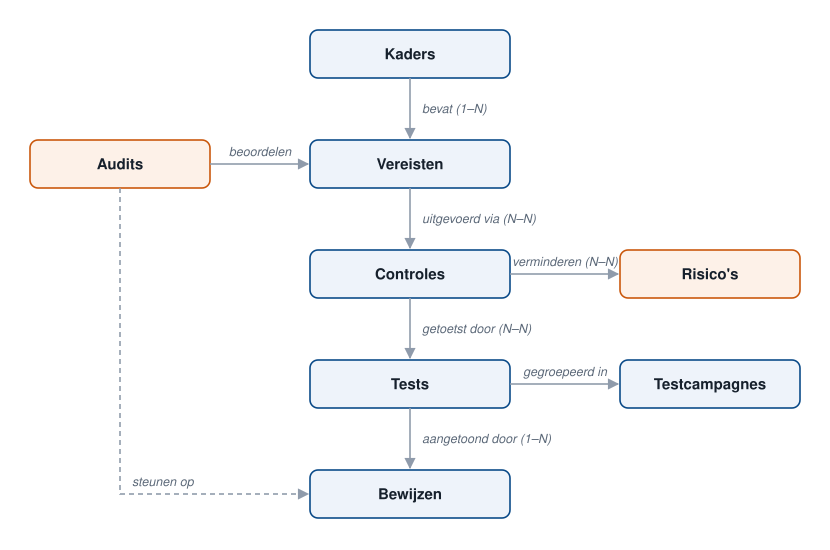
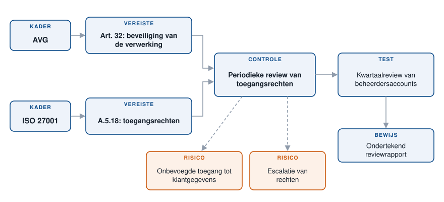
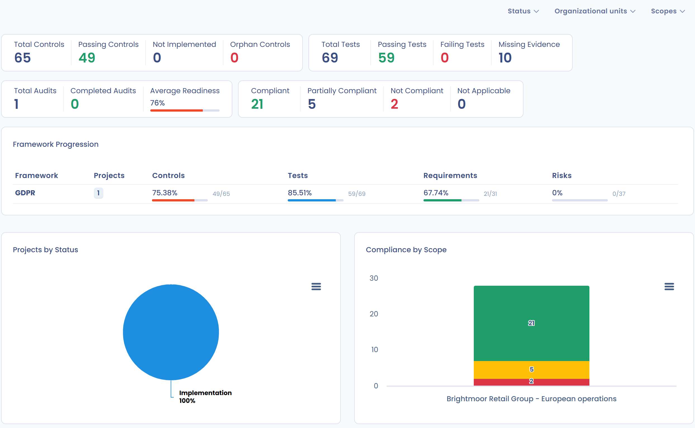

# Conformiteit

De module **Conformiteit** van Dastra beheert de naleving van regelgeving op een gestructureerde, traceerbare en controleerbare manier, met een modulaire opbouw op basis van conformiteitskaders.

***

## De module doorlopen

In het menu geeft **Conformiteit** toegang tot vier onderdelen:

* **Projecten**: de conformiteitsprojecten, hun fasen, hun audits en uw taken. Zie [Projecten](projects/README.md).
* **Bibliotheek**: de herbruikbare kaders, controles, tests, risico's en bedreigingen. Zie [Bibliotheek](library/README.md).
* **Perimeters**: de organisatorische eenheden die een project dekt. Zie [Perimeters](scopes.md).
* **Statistieken**: het conformiteitsdashboard van de werkruimte (zie hieronder).

***

## Architectuur van de module Conformiteit

De module berust op een logische keten van objecten, van regelgevende kaders tot bewijs van conformiteit.

<figure><figcaption></figcaption></figure>

### Kaders

Voorbeelden: AVG, ISO 27701, ISO 27001, AI-verordening.

Een kader:

* definieert het regelgevende of normatieve referentiekader,
* bevat een reeks toepasselijke vereisten.

***

### Vereisten

Vereisten zijn de verplichtingen die uit een kader voortvloeien.\
Voorbeelden: toegangsbeheer, beheer van autorisaties, logging.

Elke vereiste:

* is gekoppeld aan een kader,
* wordt beoordeeld tijdens conformiteitsaudits,
* wordt uitgevoerd met een of meer controles.

***

### Controles

Controles beschrijven hoe een vereiste concreet wordt toegepast.\
Voorbeelden: periodieke toegangsreview, autorisatieprocedure.

Een controle:

* geeft invulling aan een vereiste,
* is gekoppeld aan een of meer risicoscenario's,
* wordt geverifieerd met tests.

***

### Risicoscenario's

Risicoscenario's beschrijven de gevreesde gebeurtenissen. Ze verschijnen als **Risico's** in de toepassing.\
Voorbeeld: onbevoegde toegang tot gevoelige gegevens.

Met controles kunt u:

* deze risico's voorkomen of beperken,
* de genomen herstelmaatregelen aantonen.

***

### Tests

Met tests verifieert u de doeltreffendheid van controles.\
Voorbeelden: terugkerende toegangsreview, validatie van delegatie.

Een test:

* controleert een of meer controles,
* levert meetbare resultaten op,
* wordt onderbouwd met bewijs.

***

### Testcampagnes

Met campagnes organiseert u tests op grote schaal:

* campagnes versturen naar teams of klanten,
* antwoorden centraal verzamelen,
* de voortgang en de statussen opvolgen.

***

### Bewijs

Bewijs toont conformiteit aan.\
Voorbeelden: beleid, procedures, rapporten van toegangsreviews.

Een stuk bewijs:

* is gekoppeld aan een test,
* wordt gebruikt tijdens audits,
* waarborgt de traceerbaarheid van controles.

***

### Conformiteitsaudits

Met audits beoordeelt u het niveau van conformiteit:

* interne audits,
* zelfbeoordelingen,
* voorbereiding op externe audits.

Ze berusten op:

* vereisten,
* controles,
* de bijbehorende tests en het bewijs.

***

### Overzicht

Met de module Conformiteit van Dastra:

* structureert u regelgevende vereisten,
* koppelt u verplichtingen aan risico's,
* toont u conformiteit aan met geteste en gedocumenteerde controles,
* bereidt u audits en certificeringen doeltreffend voor.

### Het multikaderprincipe in Dastra

De module Conformiteit van Dastra is van nature multikader.

Dat betekent dat:

* een kader (AVG, ISO, AI-verordening enzovoort) zijn eigen vereisten bevat,
* een vereiste tot één kader behoort,
* een controle meerdere vereisten kan dekken, ook vereisten uit verschillende kaders,
* tests en bewijs worden gedeeld en hergebruikt.

Het doel is dubbel werk te vermijden en conformiteit transversaal te sturen.

***

### Belangrijkste verbanden tussen objecten

* een kader bevat meerdere vereisten (1 tot N),
* vereisten en controles: N-tot-N-relatie,
* controles en tests: N-tot-N-relatie,
* een test wordt onderbouwd met meerdere stukken bewijs (1 tot N),
* controles en risicoscenario's: N-tot-N-relatie.

Eén controle (bijvoorbeeld een toegangsreview) kan dus:

* voldoen aan een vereiste van de AVG,
* voldoen aan een vereiste van ISO 27001,
* meerdere risicoscenario's beperken.

Voorbeeld: de controle ‘Periodieke review van toegangsrechten’ voldoet aan een vereiste van de AVG en een vereiste van ISO 27001, wordt getoetst door een test met bewijs en vermindert twee risico's:

<figure><figcaption></figcaption></figure>

***

## Statistieken

**Conformiteit** > **Statistieken** opent het **Dashboard voor conformiteit**, dat alle projecten van de werkruimte samenbrengt. Filter het op **Status** (fase van het project), **Organisatorische eenheden** en **Perimeters**.

Het dashboard bevat:

* globale indicatoren. Controles: **Totaal aantal controles**, **Geverifieerde controles**, **Niet geïmplementeerd** en **Weescontroles** (zonder gekoppelde vereiste). Tests: **Totaal aantal tests**, **Geverifieerde tests**, **Mislukte tests** en **Ontbrekende bewijzen**. Audits: **Totaal aantal audits**, **Voltooide audits** en **Gemiddelde conformiteit**, met de verdeling van de vereisten over **Conform**, **Deels conform**, **Niet conform** en **Niet van toepassing**;
* **Vooruitgang van de frameworks**: per kader het aantal projecten en de voortgang van controles, tests, vereisten en risico's;
* **Projecten per status**: de verdeling van de projecten per fase;
* **Conformiteit per scope**: het conformiteitsniveau van elke perimeter.

<figure><figcaption></figcaption></figure>
