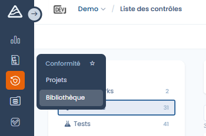

# Bibliotheek

De bibliotheek is de gemeenschappelijke basis waarop kaders, conformiteitsprojecten en risicobeheer worden gebouwd.



In de bibliotheek maakt en beheert u:

* kaders (conformiteitskaders),
* vereisten,
* controles, de centrale elementen die vereisten, tests en risico's met elkaar verbinden,
* en de bijbehorende risico's en bedreigingen.



<figure><figcaption></figcaption></figure>



Dankzij de bibliotheek pakt u conformiteit transversaal en herbruikbaar aan: één controle kan meerdere vereisten dekken, over meerdere kaders heen worden gedeeld en met gestandaardiseerde tests worden beoordeeld.
Die centralisatie vergemakkelijkt de governance, verbetert de consistentie van de kaders en geeft een globaal overzicht dankzij specifieke indicatoren en statistieken.
