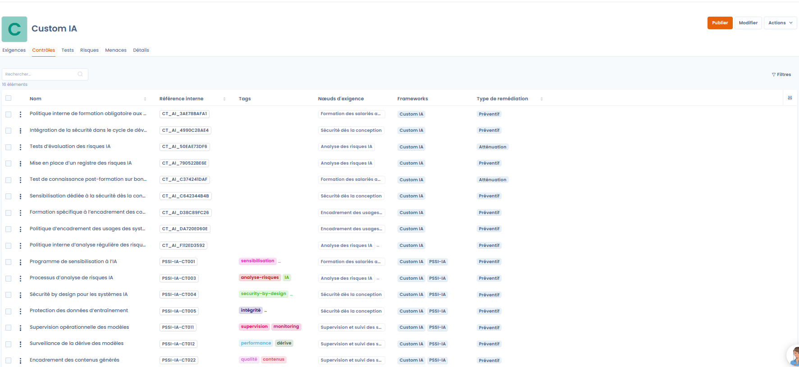
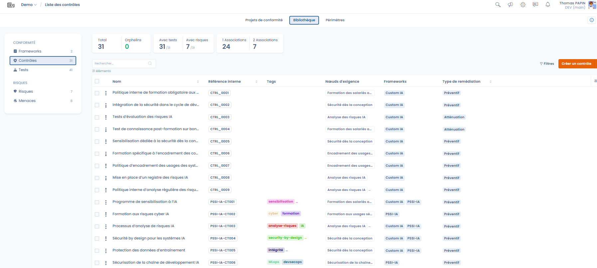
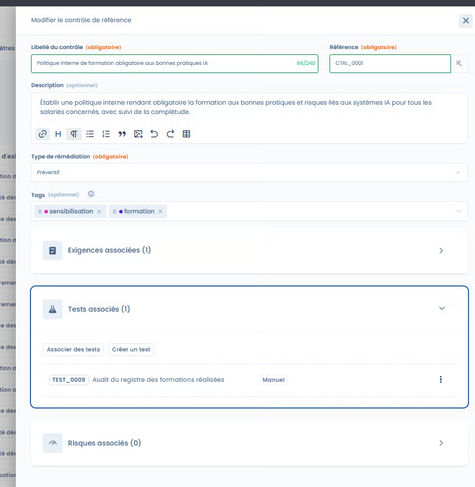
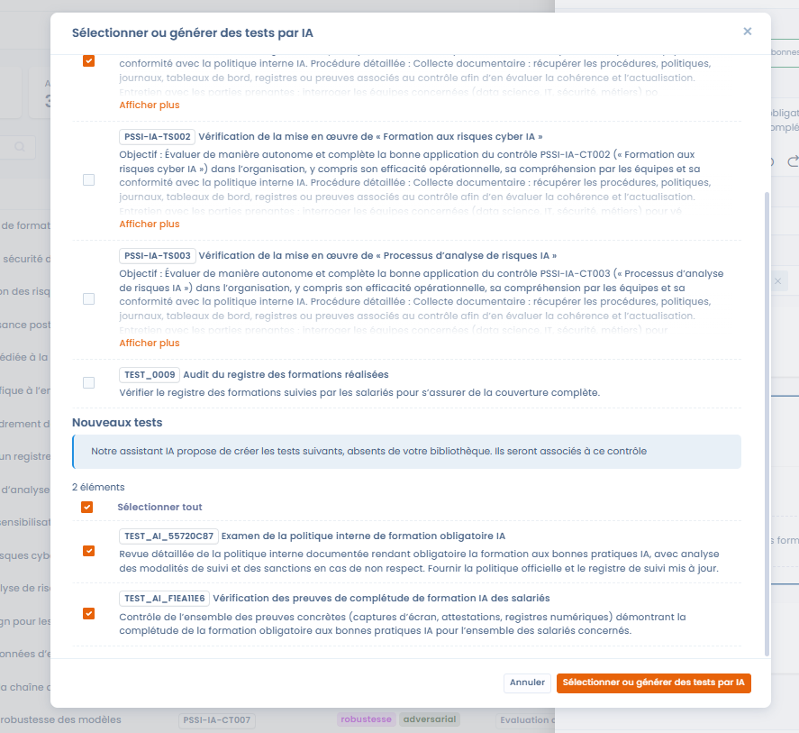
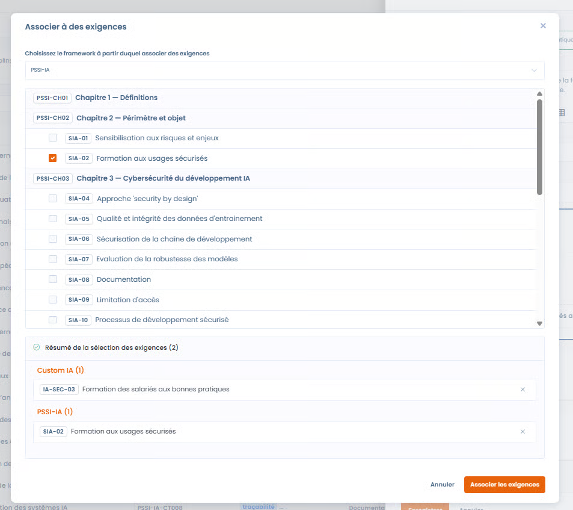
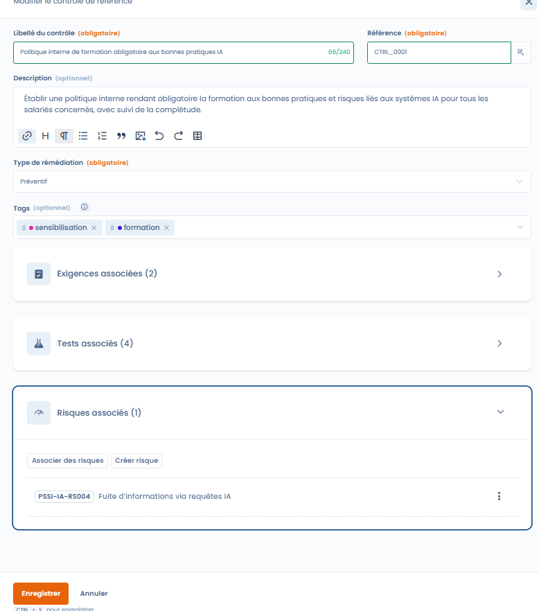
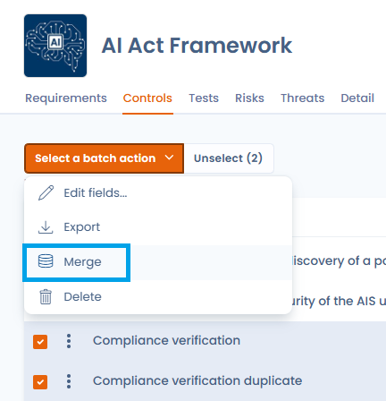

# Controles

Controles vertalen de vereisten van een kader naar concrete maatregelen die meetbaar en controleerbaar zijn, zodat u de doeltreffendheid van de conformiteit in de tijd kunt aantonen.

Een controle kan:

* een of meer vereisten dekken
* over meerdere kaders heen worden gedeeld
* aan tests en risico's worden gekoppeld

***

## Controles opvolgen en beheren

<figure><figcaption></figcaption></figure>

U kunt controles opvolgen vanuit twee complementaire ingangen.

***

### 1. Vanuit het kader

Op het tabblad **Controles** van een kader ziet de gebruiker:

* de controles die aan de vereisten van het kader zijn gekoppeld
* hun type remedie
* de gedekte vereisten
* de bijbehorende tests en risico's

Deze weergave is geschikt om:

* de dekking van een kader te begrijpen
* sleutelcontroles te identificeren
* de conformiteit per kader te sturen

***

### 2. Vanuit de controlebibliotheek

<figure><figcaption></figcaption></figure>

De controlebibliotheek bundelt alle controles van de organisatie, over alle kaders heen.

Met deze weergave kunt u:

* gebruikmaken van globale statistieken (controles met tests, risico's, meervoudige koppelingen, wezen)
* controles identificeren die in meerdere kaders worden hergebruikt
* de kwaliteit en de consistentie van de controlebibliotheek verbeteren

***

## Het venster om een controle te bewerken



In het bewerkingsvenster definieert u nauwkeurig de rol van de controle en haar verbanden met de rest van de kaderrepository.



<figure><figcaption></figcaption></figure>



***

### Label en referentie van de controle

* **Controlelabel**\
  Beschrijft duidelijk de actie of maatregel die wordt uitgevoerd.
* **Referentie**\
  Unieke identificatiecode van de controle in de bibliotheek.



Een referentiegenerator stelt automatisch een referentie voor die past bij:

* de context van de controle
* de naamconventies
* de gekoppelde kaders

De gebruiker kan de voorgestelde referentie vrij aanpassen.



<figure><figcaption></figcaption></figure>



***

### Type remedie

Elke controle moet aan een type remedie zijn gekoppeld, dat haar aard aangeeft:

* **Preventief**\
  De controle beoogt te voorkomen dat een risico zich voordoet\
  (bijvoorbeeld opleidingen, toegangsregels, validatie vóór de productiestart)
* **Verzachting**\
  De controle beoogt de impact of de waarschijnlijkheid van een bestaand risico te verminderen\
  (bijvoorbeeld monitoring, detectie, mitigatieplan)

Dit onderscheid is essentieel om:

* de risicobeheerstrategie te analyseren
* preventie en detectie in evenwicht te brengen
* de conformiteitsvolwassenheid te sturen

***

### Labels

Met labels kunt u:

* controles categoriseren (bijvoorbeeld opleiding, AI, beveiliging, monitoring)
* zoeken en filteren vergemakkelijken
* de dominante thema's van de bibliotheek analyseren

***

## Tests koppelen

Met [tests](tests.md) verifieert u het bestaan, de toepassing en de doeltreffendheid van een controle.

### Koppelen met AI-ondersteuning



<figure><figcaption></figcaption></figure>



De AI-ondersteuning stelt voor:

* bestaande tests in de bibliotheek die relevant zijn voor de controle
* het aanmaken van nieuwe tests wanneer dat nodig is

Deze aanpak zorgt voor:

* consistentie tussen controles en tests
* tijdwinst
* standaardisatie van auditmethoden



***

## Vereisten koppelen



Een controle kan worden gekoppeld aan:

* meerdere vereisten van hetzelfde kader
* vereisten uit verschillende kaders

In het gedeelte **Bijbehorende vereisten** van het bewerkingsvenster zijn de vereisten gegroepeerd per kader. Naast de naam van het kader staat het versienummer van het bronkader (bijvoorbeeld _Versie 2_).

Zo kunt u:

* controles delen
* een interne controle koppelen aan een regelgevend kader
* bruggen slaan tussen kaders (bijvoorbeeld Custom AI ↔ AI ISSP)



<figure><figcaption></figcaption></figure>



***

## Risico's koppelen



<figure><figcaption></figcaption></figure>



Controles kunnen worden gekoppeld aan:

* bestaande [risico's](risks.md)
* of nieuwe risico's die u rechtstreeks vanuit de controlefiche aanmaakt

Met de koppeling kunt u:

* de risico's zien die een controle dekt
* de impact van de controle op het restrisico beoordelen
* een samenhangende risicobeheeraanpak structureren



***

## Controles samenvoegen

In de loop van de tijd kan de controlebibliotheek overbodige of bijna identieke controles bevatten die uit verschillende kaders komen. Met de functie **Samenvoegen** consolideert u ze tot één referentiecontrole.

### Hoe het samenvoegen werkt

Selecteer in de controlebibliotheek of in een project de controles die u wilt samenvoegen (maximaal 30) en start het samenvoegen via de bulkacties. Een wizard vraagt u de **Reference version** te kiezen, dat wil zeggen de controle die behouden blijft. De koppelingen van de andere controles (bewijs, vereisten, risicoscenario's, gedekte controles) worden op die controle geconsolideerd, zonder gegevensverlies, waarna de andere controles worden verwijderd.


Het zoeken naar overeenkomsten gebeurt volledig handmatig: Dastra detecteert niet automatisch dubbels. U selecteert zelf de gelijkaardige controles die u wilt consolideren.


<figure><figcaption>
Selecteer maximaal 30 controles en start het samenvoegen via de bulkacties
</figcaption></figure>

De vergelijkingstabel toont de controles naast elkaar, met één kolom per controle. Kies de controle die u wilt behouden met het keuzerondje van haar kolom: die kolom draagt het label **Reference version**. De andere kolommen dragen het label **Keep selected fields**: alleen de velden die u daar aanvinkt, worden naar de referentieversie overgenomen (met **Select all** vinkt u de hele kolom aan).

<figure><figcaption>
Vergelijk de controles naast elkaar en kies veld per veld de te behouden waarden: bewijs, vereisten, risicoscenario's en gedekte controles worden op de behouden controle geconsolideerd
</figcaption></figure>


Het samenvoegen is onomkeerbaar. Controleer de koppelingen van elke controle voordat u de bewerking bevestigt.


### Typische gebruiksscenario's

* Ontdubbeling: meerdere kaderimports hebben gelijkwaardige controles aangemaakt. Door ze samen te voegen consolideert u ze zonder informatieverlies.
* Transversaal delen: een controle die zowel ISO 27001 als de AI-verordening dekt, krijgt u door de controles van elk kader samen te voegen.
* Opruiming van de bibliotheek: voor een audit verbetert het verwijderen van wezen of overbodige controles de leesbaarheid van het conformiteitsdashboard.

***

## Samengevat: waarom controles centraal staan

In Dastra zijn controles het convergentiepunt tussen:

* de vereisten (wat wordt verwacht)
* de tests (wat wordt geverifieerd)
* de risico's (wat wordt beheerd)

Deze aanpak maakt mogelijk:

* operationele en meetbare conformiteit
* transversale governance
* slim hergebruik van conformiteitsinspanningen
