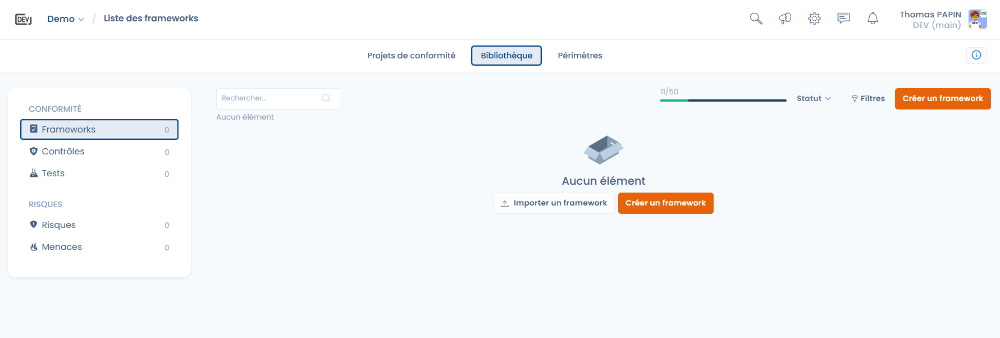

# Kaders

De pagina **Kaders** van de bibliotheek is het startpunt van de conformiteitsaanpak in Dastra.
Een kader is een gestructureerd conformiteitskader (bijvoorbeeld AVG, e-Privacy, AI-verordening) dat vereisten, controles, risico's en bedreigingen bundelt.
Deze kaders vormen de gemeenschappelijke basis voor uw conformiteitsprojecten, brengen uw werkwijzen op één lijn en waarborgen de volledige traceerbaarheid tussen wettelijke verplichtingen, operationele controles en risicobeheer.

***

## 1. Zijmenu van de conformiteitsbibliotheek

<figure><figcaption></figcaption></figure>

Het zijmenu geeft toegang tot de verschillende objecten van de bibliotheek:

* **Kaders**: conformiteitskaders (centrale bibliotheek)
* **Vereisten**: hoofdstukken en vereisten die een kader structureren
* **Controles**: het centrale element dat vereisten, tests en risico's met elkaar verbindt
* **Risico's**: hulpmiddelen om risico's te beoordelen en op te volgen
* **Bedreigingen**: gebeurtenissen of scenario's waarin een risico zich kan voordoen

***

## 2. Lijst van kaders

Het middengedeelte toont de lijst van kaders die in uw omgeving beschikbaar zijn:

* Kaders die uw organisatie heeft aangemaakt
* Kaders die uit de Dastra-bibliotheek zijn geïmporteerd
* Aantal kaders binnen uw quotum (het quotum wordt gedeeld op accountniveau, niet per werkruimte)
* Filters op status (concept, gepubliceerd enzovoort)
* Nummer van de huidige versie van elk kader en, voor een kader dat op basis van een sjabloon is aangemaakt, het label **Beschikbare update** wanneer er een nieuwere versie van het bronreferentiekader bestaat (zie [Versies van een kader](versions.md))

Als er nog geen kader is, biedt Dastra rechtstreeks aan om:

* [**Een framework importeren**](import.md)
* [**Een framework aanmaken**](custom.md)


Het quotum geldt voor de hele organisatie, niet voor één werkruimte. Houd uw verbruik in de gaten om de limieten niet te bereiken. De versies van een kader worden niet apart geteld: een versie aanmaken of importeren kost geen frameworkcredit.

