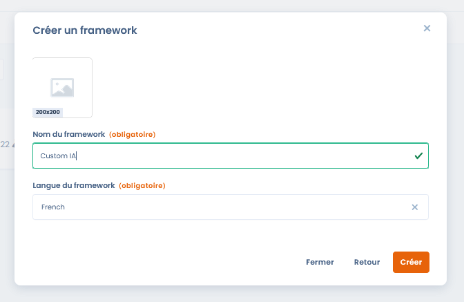
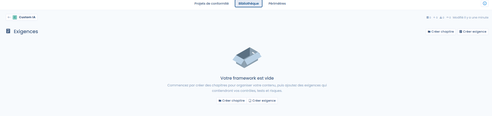
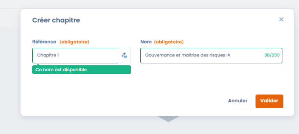
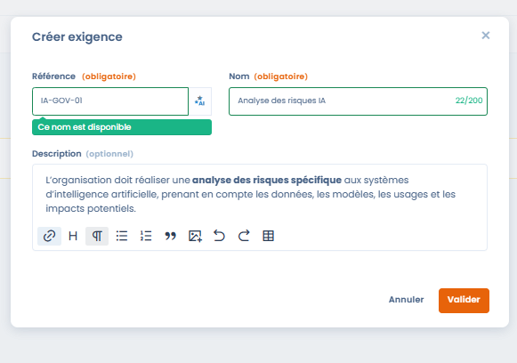
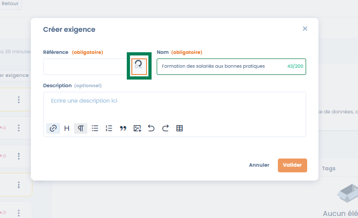
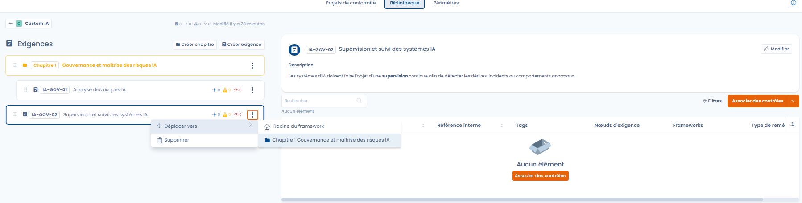
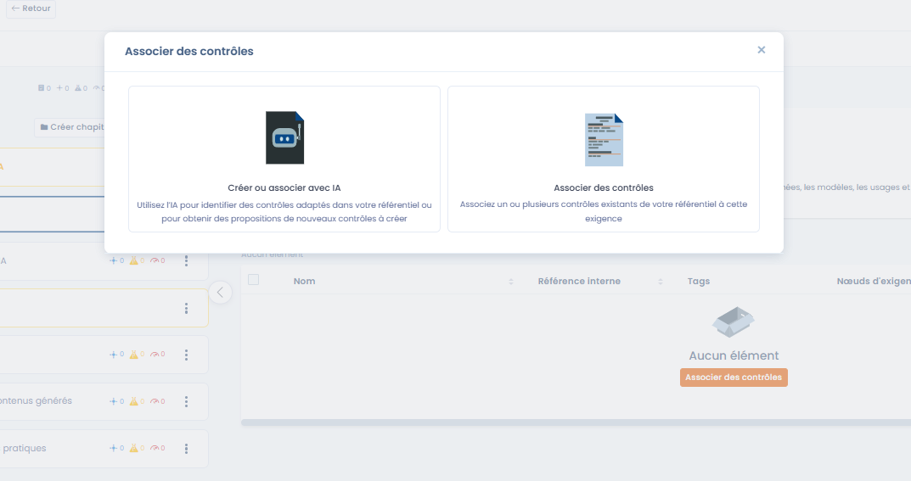
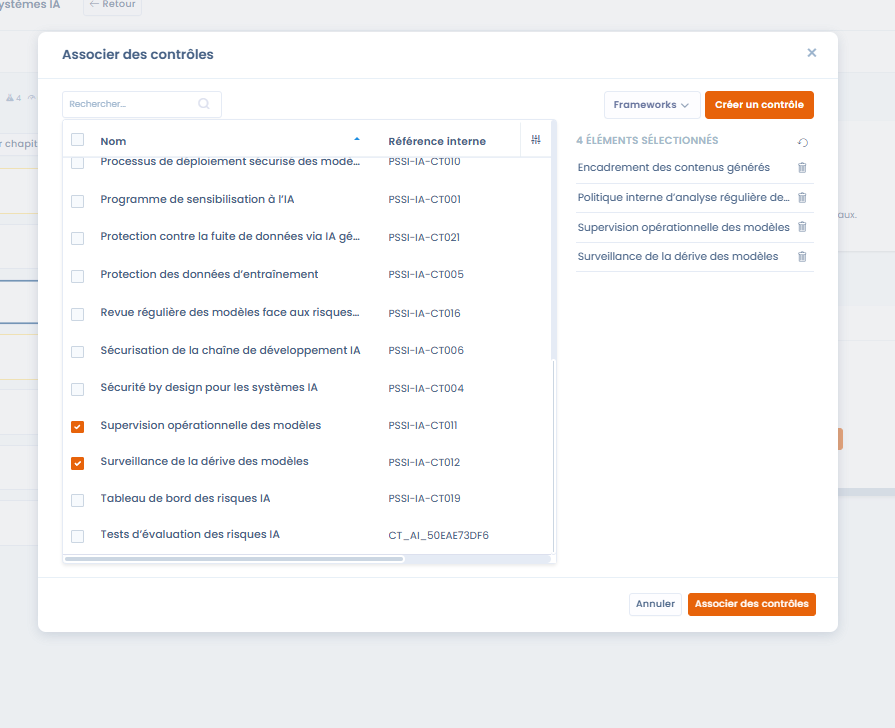
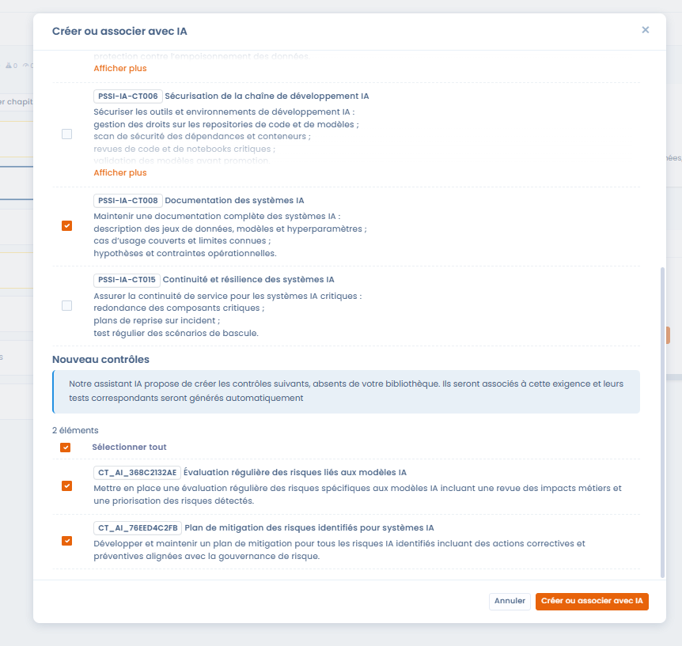

# Een eigen kader aanmaken

## Inleiding

Met een eigen kader bouwt u een conformiteitskader dat is afgestemd op de specifieke context van de organisatie: intern beleid, sectorkader, AI-initiatief, beveiliging, kwaliteit of governance.

Een eigen kader kan:

* helemaal vanaf nul worden opgebouwd,
* of dienen als gemeenschappelijke basis voor meerdere conformiteitsprojecten.

***

## Stap 1: het kader aanmaken



Bij het aanmaken van een eigen kader geeft de gebruiker op:

* de **Naam van het framework** (bijvoorbeeld _Custom AI_, _AI ISSP - Demo_)
* de **Taal van het framework**, die de standaardtaal van de vereisten en controles bepaalt

Na het aanmaken wordt het kader met de status concept toegevoegd aan de bibliotheek.



<figure><figcaption></figcaption></figure>



***

## Stap 2: weergave en beschikbare acties

Een nieuw aangemaakt kader is standaard:

* leeg
* alleen-lezen

### Acties die beschikbaar zijn zolang het kader niet is gewijzigd

* **Exporteren**: het kader ophalen in JSON- of Excel-formaat
* **Dupliceren**: een kopie van het kader maken
* **Verplaats naar de prullenbak**: het kader verwijderen

U kunt niets toevoegen of wijzigen zolang het kader zich niet in de bewerkingsmodus bevindt.

***

## Stap 3: overschakelen naar de bewerkingsmodus



Om het kader aan te vullen (hoofdstukken, vereisten, controles enzovoort) gaat u als volgt te werk:

1. Klik op **Bewerken**.
2. Het kader schakelt over naar de bewerkingsmodus.

In de bewerkingsmodus kan de gebruiker:

* hoofdstukken aanmaken
* vereisten toevoegen
* het kader stapsgewijs structureren


De bewerkingsmodus is alleen beschikbaar voor een conceptversie. De vereisten van een gepubliceerde versie zijn vergrendeld en de knop **Bewerken** is uitgeschakeld: maak een versie van het kader aan om ze te laten evolueren (zie [Versies van een kader](versions.md)). De naam, het logo en de beschrijving blijven bewerkbaar.




<figure><figcaption></figcaption></figure>



***

## Vereisten aanmaken en structureren

Zodra het kader is aangemaakt en in de bewerkingsmodus staat, kan de gebruiker het kader structureren met hoofdstukken en vereisten.
Zo vertaalt u een regelgevend, normatief of intern kader naar elementen die u in Dastra kunt gebruiken.

***

### Structureren met hoofdstukken



<figure><figcaption></figcaption></figure>



Met hoofdstukken organiseert u het kader op een leesbare en samenhangende manier.



#### Structureringsregels

Dastra staat toe:

* hoofdstukken op het hoogste niveau
* subhoofdstukken

De diepte is bewust beperkt tot maximaal twee niveaus, om:

* de leesbaarheid van het kader te waarborgen
* te complexe structuren te vermijden
* het gebruik van de vereisten in conformiteitsprojecten te vergemakkelijken

#### In te vullen velden

Bij het aanmaken van een hoofdstuk:

* **Referentie**: interne identificatiecode van het hoofdstuk
* **Naam**: functionele titel van het hoofdstuk


Goede praktijk: gebruik hoofdstukken om te structureren per hoofdthema (bijvoorbeeld governance, beveiliging, operaties, gebruiksvormen).


***

### Een vereiste aanmaken



Vereisten drukken de conformiteitsverwachtingen uit waaraan de organisatie moet voldoen.
Ze vormen de directe schakel tussen het kader en de operationele controles.



<figure><figcaption></figcaption></figure>



#### Beschikbare velden

* **Referentie** (verplicht)\
  Unieke identificatiecode van de vereiste binnen het kader
* **Naam** (verplicht)\
  Beknopte formulering van de vereiste
* **Beschrijving** (optioneel)\
  Details over de verwachte inhoud, de reikwijdte en de doelstellingen van de vereiste

***

### AI-ondersteuning voor de referentie van de vereiste



<figure><figcaption></figcaption></figure>



Bij het aanmaken van een vereiste biedt Dastra AI-ondersteuning om automatisch een referentie te genereren die past bij:

* de naam van de vereiste
* het bovenliggende hoofdstuk
* de context van het kader



Met deze functie kunt u:

* naamconventies harmoniseren
* inconsistenties of dubbels vermijden
* tijd besparen bij het aanmaken van eigen kaders

De gebruiker blijft vrij om de voorgestelde referentie te wijzigen.

***

### Vereisten organiseren en beheren

<figure><figcaption></figcaption></figure>

Eenmaal aangemaakt kunnen vereisten:

* naar een ander hoofdstuk worden verplaatst
* worden verwijderd
* stapsgewijs worden aangevuld

Elke vereiste toont ook indicatoren (koppelingen met controles, risico's en tests), zodat u haar dekkingsniveau beter begrijpt.

***

### Controles aan een vereiste koppelen



Controles zijn de operationele elementen waarmee u de conformiteit met een of meer vereisten aantoont.

Er zijn twee manieren om controles aan een vereiste te koppelen.



<figure><figcaption></figcaption></figure>



***

#### Optie 1: bestaande controles koppelen



De gebruiker selecteert een of meer controles die al in de bibliotheek staan en koppelt ze aan de vereiste.



<figure><figcaption></figcaption></figure>



Eén controle kan aan meerdere vereisten worden gekoppeld. Dat bevordert:

* het delen van controles
* de consistentie van het kader
* een betere traceerbaarheid

***

#### Optie 2: controles aanmaken of koppelen met AI



<figure><figcaption></figcaption></figure>



Dastra biedt een AI-assistent waarmee u:

* automatisch relevante bestaande controles identificeert
* zo nodig het aanmaken van nieuwe controles voorstelt

De AI baseert zich op:

* de inhoud van de vereiste
* de context van het kader
* de controles die al in de bibliotheek staan



Controles die via AI zijn aangemaakt, kunnen automatisch bevatten:

* hun beschrijving
* hun koppeling aan de vereiste
* de bijbehorende tests

***

### Voordelen van deze aanpak

Met deze aanpak bereikt u:

* een stapsgewijze structurering van het kader
* bewuste overlappingen tussen vereisten
* de aanmaak van transversale controles die meerdere vereisten dekken
* een stevige basis voor risicobeheer en conformiteitsprojecten
