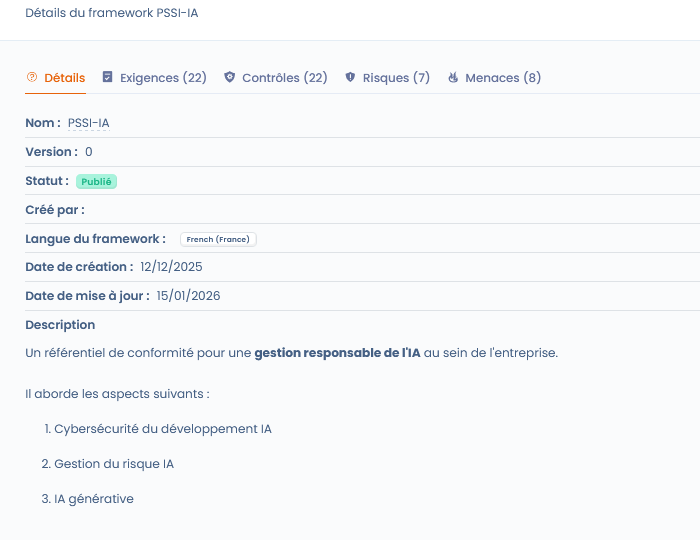
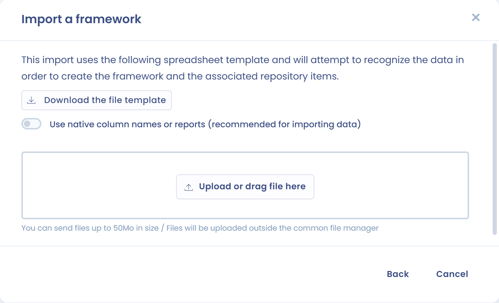

# Importeren en sjablonen van Dastra

Klik in **Conformiteit** > **Bibliotheek** > **Kaders** op **Een framework aanmaken**. Het dialoogvenster biedt drie methoden:



* **Ingebouwde sjabloon**: begin met een sjabloon uit de bibliotheek van Dastra (zie hieronder)
* **Gepersonaliseerd**: maak een leeg kader aan (zie [Een eigen kader aanmaken](custom.md)). Deze methode hangt af van uw abonnement
* **Een framework importeren**: stuur een JSON- of Excel-bestand (zie hieronder)

Op dezelfde pagina kunt u ook de **details van een bestaand kader** bekijken.







***

## Een kader aanmaken op basis van een sjabloon

### Voordelen van een sjabloon

Een kader importeren op basis van een sjabloon bespaart tijd en geeft u een kader dat al is gestructureerd en aansluit op de goede praktijken van de regelgeving of van uw sector.

De sjablonen van Dastra bevatten:

* De structuur van de hoofdstukken
* De bijbehorende vereisten
* De controles
* De gerelateerde risico's en bedreigingen

U past ze daarna aan uw context aan.

***

### Stappen om een sjabloon te importeren



* Klik op **Een framework aanmaken**
* Selecteer **Ingebouwde sjabloon**
* Open de sjabloonbibliotheek van Dastra
* Zoek een sjabloon op naam en stel vervolgens in:
  * het filter **Gegevensbron van de bibliotheek** (standaard **Sjablonen gemaakt door Dastra**)
  * de taal
  * de weergavemodus van de resultaten
* Selecteer het gewenste sjabloon
* Bekijk de **Frameworkdetails**:
  * Aantal vereisten
  * Controles
  * Risico's
  * Bedreigingen
  * Functionele beschrijving
* Bevestig de import\
  → Het kader wordt toegevoegd aan uw bibliotheek en is vanaf dan bewerkbaar.



<figure><figcaption></figcaption></figure>

<figure><figcaption></figcaption></figure>




Een nieuw kader aanmaken verbruikt een frameworkcredit op uw account. Als het quotum is bereikt, kunt u de details van een sjabloon nog steeds bekijken, maar u kunt het pas importeren nadat u ruimte hebt vrijgemaakt of uw quotum hebt verhoogd.


Latere versies van het kader (aangemaakt, geïmporteerd of gegenereerd door een update vanuit het bronreferentiekader) verbruiken geen extra credit.

***

## Een kader importeren uit een bestand

U kunt een kader importeren dat u zelf hebt voorbereid of uit Dastra hebt geëxporteerd. Voor deze methode hebt u het importrecht op de bibliotheek en een beschikbare frameworkcredit nodig.

1. Klik op **Een framework aanmaken** en vervolgens op **Een framework importeren**. Is de bibliotheek leeg, dan wordt de knop **Een framework importeren** ook rechtstreeks aangeboden.
2. Kies het formaat:
   * **Json**: importeer uw kader in .json;
   * **Complexe Excel-werkmap**: importeer uw kader met een Excel-werkmap die uit meerdere bladen bestaat.
3. Klik voor de Excel-werkmap op **Het bestandssjabloon downloaden** om de modelwerkmap te krijgen, die de import gebruikt om de gegevens te herkennen. Schakel **Native kolomnamen gebruiken (handig voor het importeren van gegevens)** in als uw bestand de native kolomnamen gebruikt.
4. Stuur uw bestand (telkens één).
5. Dastra toont eerst een simulatie: er wordt geen enkel gegeven gewijzigd. De tabel geeft per item aan of het wordt **Gemaakt**, **Bijgewerkt**, **Genegeerd** of **Gesimuleerd**, met de totalen. Controleer de tabel en klik vervolgens op **Valideren** om de definitieve import uit te voeren.

De import maakt het kader en alle items die het bevat aan in uw bibliotheek.

<figure><figcaption></figcaption></figure>

***

## Resultaat na de import



<figure><figcaption></figcaption></figure>



U kunt de elementen controleren voordat ze worden aangemaakt.

Alle objecten in uw kader worden aangemaakt in uw bibliotheek.



Na de import is het kader:

* Beschikbaar in de bibliotheek
* Aan te vullen of aan te passen
* De basis voor:
  * **Conformiteitsprojecten**
  * De beoordeling van controles
  * Risicobeheer

***

## Bijwerken vanuit het bronreferentiekader

Is er een nieuwere versie van het oorspronkelijke sjabloon beschikbaar, dan toont de kaderkaart het label **Beschikbare update** en toont de kaderpagina de banner _Een nieuwere versie van de bronnent repository is beschikbaar_ met de link **bijwerken**.

Die link opent een voorbeeld van de wijzigingen (controles, tests, risicoscenario's en bedreigingen). Zodra u bevestigt, wordt op basis van de bron een gepubliceerde versie van het kader aangemaakt, die de huidige versie wordt. Eerdere versies en de projecten die ze gebruiken, blijven ongewijzigd. Zie [Versies van een kader](versions.md).
