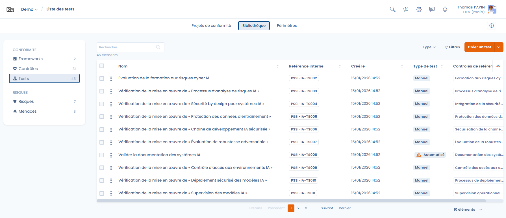
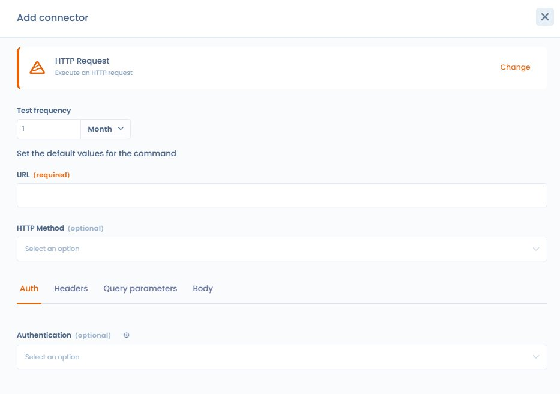
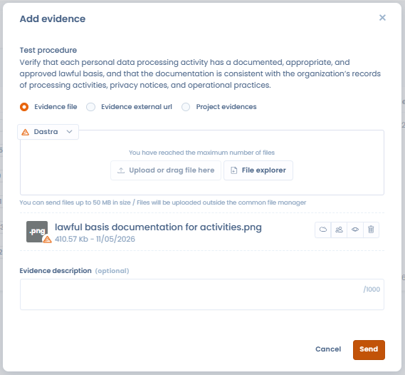
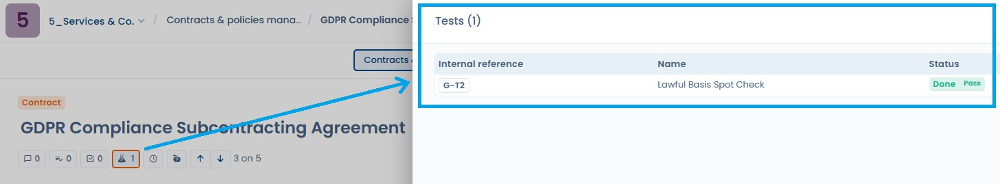

# Tests

Een test bepaalt hoe en hoe vaak een controle wordt geëvalueerd, en op welk bewijs die evaluatie steunt.

Tests vormen de operationele schakel tussen:

* de controles (de ingevoerde maatregelen),
* het verzamelde bewijs,
* de conformiteitsresultaten die in de loop van de tijd worden waargenomen.

***

## De rol van tests in Dastra

Een test beantwoordt één vraag:

> _Wordt de controle echt toegepast en is ze doeltreffend?_

Elke test is:

* gekoppeld aan een referentiecontrole,
* uitgevoerd volgens een vastgelegde frequentie,
* gebruikt in conformiteitsprojecten om bruikbaar bewijs en resultaten te leveren.

***

## Weergave van de testbibliotheek

<figure><figcaption></figcaption></figure>

De testbibliotheek biedt een overkoepelend overzicht van alle beschikbare tests, met onder meer:

* hun type (handmatig of geautomatiseerd),
* de aanmaakdatum,
* de gekoppelde controles,
* geavanceerde filters (kader, type, vereisten, wezen-tests).

Met deze weergave kunt u:

* tests herkennen die in meerdere contexten worden hergebruikt,
* tests opsporen die nergens aan gekoppeld zijn,
* verificatiemethoden standaardiseren.

***

## Handmatige tests (standaard)

Een test is standaard handmatig.

Een handmatige test steunt op een menselijke handeling, bijvoorbeeld:

* een documentenonderzoek,
* een gesprek met de teams,
* de controle van een register,
* een eenmalige audit van een proces.

### Werking binnen een conformiteitsproject

Wanneer u een handmatige test aan een project toevoegt:

* moet het bewijs regelmatig worden bijgewerkt,
* volgens de frequentie die in de test is vastgelegd (maandelijks, driemaandelijks, jaarlijks enzovoort).

Zo blijft de conformiteit actueel en wordt ze in de loop van de tijd bijgehouden.

***

## Een test configureren



Bij het aanmaken of bewerken van een test legt de gebruiker vast:

* de naam en de referentie van de test (met referentiegenerator),
* de **Frequentie van de test**,
* de gedetailleerde beschrijving, met onder meer:
  * het doel van de test
  * de te volgen procedure
  * het verwachte bewijs



<figure><figcaption></figcaption></figure>



Deze informatie dient als operationele leidraad wanneer u de test binnen een project uitvoert.

### Testvenster in een project

In een project opent een test in een venster met tabbladen:

* **Testdetails**: label, **Eigenaar van de test**, status, **Testprocedure**, **Frequentie van de test** en bewijs;
* **Geassocieerde controles**: de controles die de test verifieert;
* **Fouten in tests**: de problemen die auditors bij deze test hebben gemeld (zie [Audits](../projects/audits.md));
* **Context**: het project, de kaders en de perimeter waartoe de test behoort.

***

## Geautomatiseerde tests met Dastra-connectoren

Dastra biedt kant-en-klare connectoren (vragenlijsten, registers, beleidsdocumenten enzovoort), en een generieke connector voor HTTP-verzoeken. Deze connectoren, ook automatische bewijsverzamelaars genoemd, worden rechtstreeks gebruikt in de geautomatiseerde tests van de module Conformiteit.

<figure><figcaption></figcaption></figure>

Naast handmatige tests kunt u met connectoren geautomatiseerde tests configureren.

Een geautomatiseerde test gebruikt een Dastra-connector om:

* elementen van de werkruimte rechtstreeks te bevragen,
* automatisch bewijs te verzamelen,
* de conformiteit te verifiëren aan de hand van vastgelegde criteria.

### Een connector op een test installeren

1. Open een handmatige test en klik op **Installeer connector**.
2. Selecteer de connector in **Kies een automatische bewijsverzamelaar om te installeren**.
3. Stel de **Frequentie van de test** in (in dagen, maanden of jaren) en configureer de standaardwaarden van de connector.
4. Klik op **Valideren**. Het verzamelen van bewijs start onmiddellijk met deze configuratie.

Klik vervolgens op **Uitvoeren** om het verzamelen op aanvraag opnieuw uit te voeren. Elke uitvoering wordt opgeslagen als bewijs van de test. Als de configuratie van een connector ongeldig is, blijft het automatisch verzamelen uitgeschakeld totdat u de configuratie corrigeert.

### Beschikbare connectoren

| Connector | Verzamelt |
| --- | --- |
| **Verzamel questionnaires** | De vragenlijsten van de werkruimte, volgens criteria. |
| **Verzamel een contract of beleid** | Een contract of beleidsdocument, bijvoorbeeld om te controleren of het aanwezig en bijgewerkt is. |
| **Verzamel het register van actoren** | De stakeholders (derden) van de werkruimte. |
| **Verzamel het register van IA-systemen** | Het register van AI-systemen, bijvoorbeeld om hun documentatie te controleren. |
| **Verzamel het register van activa** | De activa van de werkruimte. |
| **Verzamel het incidentenregister** | De incidenten van de werkruimte. |
| **Verzamelt het register van gegevensverwerking** | De verwerkingsactiviteiten van het register. |
| **HTTP-verzoek** | Het resultaat van een verzoek aan een willekeurige API of een willekeurig eindpunt (zie hieronder). |

Voorbeeld: een geautomatiseerde test kan nagaan of elk AI-systeem conforme en actuele documentatie heeft, zonder handmatige tussenkomst.

## Een aangepaste connector toevoegen

Naast de standaardconnectoren kunt u in Dastra aangepaste connectoren maken om het verzamelen van bewijs in conformiteitstests te automatiseren.

Met een aangepaste connector kunt u:

* een technische query uitvoeren (bijvoorbeeld een HTTP-verzoek),
* een interne of externe bron bevragen,
* automatisch feitelijke gegevens verzamelen,
* bewijs opleveren dat in audits bruikbaar is.

De connector wordt zo een terugkerende en traceerbare bron van bewijs.

### HTTP-verzoek

Met de connector **HTTP-verzoek** bevraagt u elke beschikbare API of elk eindpunt.

De connector is vooral geschikt om:

* tools van derden te bevragen,
* het bestaan of de status van een resource te controleren,
* technische of documentaire controles te automatiseren.

## De HTTP-connector configureren

<figure><figcaption>
De configuratie-interface van de HTTP-connector met de tabbladen Auth, Headers, URL-parameters en Body
</figcaption></figure>

Met de configuratie-interface van de HTTP-connector bouwt u een verzoek op zonder de JSON-syntaxis te kennen.

| Veld | Beschrijving |
| --- | --- |
| **URL** | Het te bevragen eindpunt. Verplicht, in de indeling `http://` of `https://`. |
| **HTTP Method** | `GET` of `POST`. |
| Tabblad **Auth** | Kies de **Authenticatie**: **Geen**, **API-sleutel**, **Autorisatietoken (Bearer)** of **Basisauthenticatie (Basic)**. De bijbehorende header wordt automatisch aan elk verzoek toegevoegd, zonder dat u JSON hoeft in te voeren. |
| Tabblad **Headers** | Eigen headers als sleutel/waarde-paren, verzonden naast de authenticatie. |
| Tabblad **URL-parameters** | Queryparameters als sleutel/waarde-paren, aan de URL toegevoegd. |
| Tabblad **Body** | **Aanvraagtekst** in JSON-indeling. |

Gevoelige velden (API-sleutel, token, wachtwoord) zijn standaard afgeschermd. Met een oogpictogram maakt u ze tijdelijk zichtbaar. Alleen-lezen voorbeelden tonen wat er werkelijk wordt verzonden: **Headers die worden verzonden**, **URL die wordt aangeroepen** en **Aanvraagtekst die wordt verzonden**, waarbij gevoelige waarden afgeschermd blijven.

### Resultaat van het verzoek

De test slaagt wanneer het eindpunt met HTTP-code 200 antwoordt. Elke uitvoering wordt als bewijs opgeslagen in het conformiteitsproject, en de test wordt opnieuw uitgevoerd volgens de **Frequentie van de test** die u bij de installatie van de connector hebt gekozen. De succescriteria kunt u niet configureren.

## Voordelen van geautomatiseerde tests

Met geautomatiseerde tests kunt u:

* continu bewijs verzamelen,
* de operationele werklast verlagen,
* de betrouwbaarheid van de controles verbeteren,
* afwijkingen sneller opsporen.

Ze zijn vooral geschikt voor terugkerende of gestructureerde controles.

***

## Bewijs bijvoegen vanuit Bestandsbeheer

Wanneer u bewijs aan een test toevoegt, kunt u een bestand rechtstreeks selecteren in het **Bestandsbeheer** van Dastra, zonder het opnieuw te hoeven uploaden. Klik in het venster **Bewijs toevoegen** op **Bestandsverkenner**.

<figure><figcaption>
Met de knop Bestandsverkenner selecteert u bewijs dat al in het Bestandsbeheer van Dastra staat
</figcaption></figure>

***

## AI-analyse van bewijs

Dastra kan het bewijs dat aan een test is gekoppeld automatisch analyseren en aangeven of het overeenkomt met wat de procedure verwachtte. Deze functie is een hulpmiddel voor de auditor: ze vervangt het menselijke oordeel nooit en accepteert of weigert geen bewijs namens u.

### Werking

Wanneer u bewijs aan een test toevoegt, vergelijkt de AI de inhoud van het bewijs met het label en de beschrijving van de testprocedure. Het resultaat verschijnt in de kolom **Waardering IA** van de bewijstabel, als een gekleurde badge:

| Waardering | Betekenis |
| --- | --- |
| **Correct** | Het bewijs komt overeen met de procedure. |
| **Waarschijnlijk correct** | Het bewijs lijkt overeen te komen, een menselijke controle wordt aanbevolen. |
| **Niet conform** | Het bewijs komt niet overeen met de procedure. |
| **Onbekend** | De AI kan geen conclusie trekken. |

Houd de muisaanwijzer boven de badge om het **Document** (samenvatting van het geanalyseerde document), het **Vertrouwen in de analyse** (van 0 tot 100 %) en de **Details** weer te geven die de waardering onderbouwen.

### Ondersteunde soorten bewijs

De analyse past zich aan het type aangeleverd bewijs aan:

| Soort bewijs | Analysemethode |
| --- | --- |
| Afbeelding (schermafdruk, JPEG, PNG enzovoort) | Visuele analyse van de inhoud door een visueel model |
| Document (PDF, Word) | Extractie van de tekst, daarna analyse van de tekst |

De tooltip van de kolomkop **Waardering IA** herinnert aan deze methode.

### Activering en instellingen

De functie is optioneel en standaard uitgeschakeld. Om ze te activeren gaat u naar **Instellingen voor werkruimte** > **Conformiteit** en schakelt u de optie **Automatische IA-analyse van bewijsstukken** in.


Zolang de functie niet is geactiveerd, worden er geen bewijsgegevens naar het AI-model verzonden.


Om de analyse uit te schakelen klikt u op **Ik wil deze functie uitschakelen** in de tooltip van een resultaat: de link leidt naar de conformiteitsinstellingen. Het AI-model dat wordt gebruikt, kunt u naar keuze van uw organisatie configureren via de instellingen van de AI-assistent (modelfamilie of aangepaste AI-provider).

### Wat de analyse niet doet

* Ze accepteert of weigert bewijs niet automatisch: de eindbeslissing blijft altijd bij de auditor.
* Ze wijzigt de status van de test niet.
* Ze is niet bindend: een waardering **Onbekend** of **Waarschijnlijk correct** geeft alleen aan dat een menselijke controle aanbevolen is.

***

## Tests samenvoegen

Net als bij controles kan de testbibliotheek overbodige tests verzamelen, vooral na het importeren van meerdere kaders. Met de functie voor het samenvoegen van tests voegt u deze dubbele tests samen tot één referentietest.

### Werking van het samenvoegen

Selecteer in de testbibliotheek de tests die u wilt samenvoegen en klik op **Samenvoegen**. Kies de **Reference version**, dat wil zeggen de test die u wilt behouden: de koppelingen van de andere tests (gekoppelde controles, uitvoeringsresultaten, frequentie) worden overgenomen door die test, waarna de andere tests worden verwijderd. Vink in de vergelijkingstabel de velden aan die u wilt overnemen in de kolommen **Keep selected fields**.


Het samenvoegen is onomkeerbaar. Controleer de koppelingen van elke brontest voordat u bevestigt.


### Typische gebruiksscenario's

* Ontdubbeling: twee kaderimports hebben een dubbele test "Verificatie van het privacybeleid" aangemaakt. Het samenvoegen voegt ze samen.
* Rationalisatie: meerdere sterk op elkaar lijkende handmatige tests kunt u groeperen tot één completere test.
* Opruimen vóór een audit: minder wezen-tests verbetert de leesbaarheid van het dashboard.

***

## Een test aan een document koppelen

Een conformiteitstest kunt u koppelen aan een of meer documenten uit het Bestandsbeheer van Dastra: contracten, beleidsdocumenten, documentair bewijs, verwerkersovereenkomsten voor subverwerking. Dankzij deze koppeling vindt u de tests die bij elk document horen, en omgekeerd.

### Vanuit de weergave van een document

Wanneer een test aan een document is gekoppeld, verschijnt in de bewerkingsweergave van het betrokken document of contract een paneel **Tests**, met de referentie, de naam en de status van elke gekoppelde test.

<figure><figcaption>
Een gekoppelde test verschijnt in het paneel Tests rechts van het document (hier: G-T2 Lawful Basis Spot Check, status Done en resultaat Pass)
</figcaption></figure>

### Vanuit Bestandsbeheer

In Bestandsbeheer toont het detailblad van een document in de zijkolom alle Dastra-entiteiten waaraan het is gekoppeld: verwerkingsactiviteiten, contracten en conformiteitstests.

<figure><figcaption>
Bestandsbeheer toont de tests die bij elk document horen in de detailkolom
</figcaption></figure>

Dankzij deze tweerichtingstraceerbaarheid controleert u welke tests op welk document steunen en vindt u al het documentaire bewijs vanuit Bestandsbeheer.

***

## Een combinatie van benaderingen

In Dastra kunt u combineren:

* handmatige tests voor controles die analyse of menselijk oordeel vereisen,
* geautomatiseerde tests voor objectieve en repetitieve verificaties.

Deze combinatie zorgt voor een evenwicht tussen striktheid, efficiëntie en pragmatisme.
