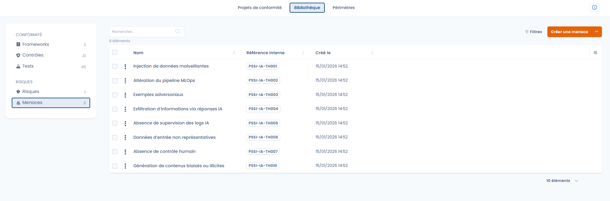
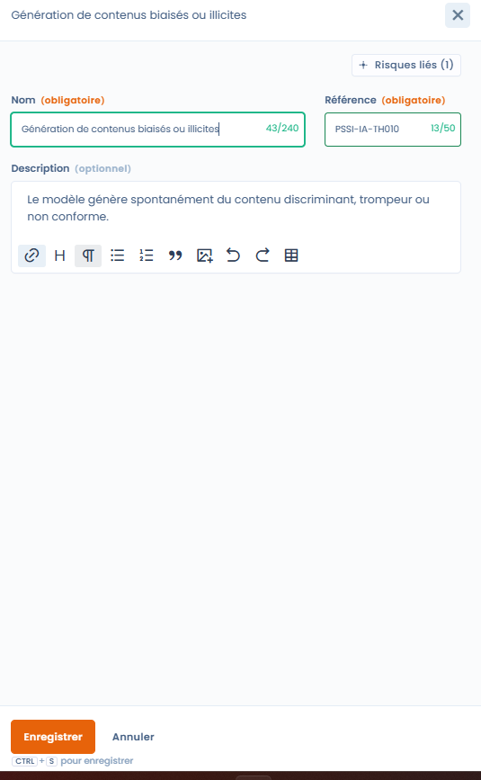

# Bedreigingen

In Dastra is een bedreiging de aanleiding van een risico:\
ze beschrijft hoe of waarom een risico zich kan voordoen.

Bedreigingen verrijken de risicoanalyse zonder de beoordeling ervan complexer te maken.

***

## Bedreigingen, risico's en controles: de oorzakelijke logica

Het Dastra-model steunt op een eenvoudige en leesbare keten:

> Bedreiging → Risico → Controles → Tests

* Een bedreiging beschrijft een situatie, een gedrag of een gebeurtenis.
* Een risico beschrijft de mogelijke impact voor de organisatie.
* Controles beperken het optreden of de gevolgen van het risico.
* Tests controleren of de controles doeltreffend zijn.

Voorbeeld:

* Bedreiging: gebrek aan monitoring van AI-logs
* Risico: informatielek via AI-vragen
* Controles: logging, monitoring, bewustmakingstrainingen
* Tests: controle van logs, periodieke audits

***

## Weergave van de bedreigingenbibliotheek

<figure><figcaption></figcaption></figure>

De bedreigingenbibliotheek centraliseert alle geïdentificeerde bedreigingen, met:

* hun naam en referentie,
* hun aanmaakdatum,
* filters om het navigeren te vergemakkelijken.

Met deze weergave kunt u:

* bestaande bedreigingen hergebruiken,
* een consistente terminologie waarborgen,
* samenhangende risicoscenario's opbouwen.

***

## Een bedreiging aanmaken en beheren



Bij het aanmaken of bewerken van een bedreiging geeft de gebruiker op:

* de naam van de bedreiging,
* een interne referentie,
* een optionele beschrijving om de bedreiging in context te plaatsen.



<figure><figcaption></figcaption></figure>



De module is bewust beknopt gehouden:\
bedreigingen hebben geen gekwantificeerde beoordeling en zijn niet rechtstreeks aan controles gekoppeld.

***

## Koppeling met risico's

Een bedreiging is gekoppeld aan een of meer risico's.

Dankzij deze koppeling kunt u:

* risicoscenario's nauwkeurig documenteren,
* de oorzaken beter begrijpen,
* de consistentie van de algehele analyse versterken.

Dezelfde bedreiging kan bijdragen aan meerdere risico's, en omgekeerd.

***

## Waarom bedreigingen gebruiken

Met bedreigingen hebt u:

* een fijnere en realistischere analyse van risico's,
* een betere traceerbaarheid van scenario's,
* een duidelijkere communicatie met de betrokken partijen (CISO, FG, businessteams).

Bedreigingen vullen de analyse aan zonder de operationele beheerslast te verzwaren.

***

## Samenvatting

Bedreigingen zijn een verduidelijkingsinstrument.\
Ze helpen de oorsprong van risico's beter te begrijpen en dus de bestaande controles beter te rechtvaardigen.
