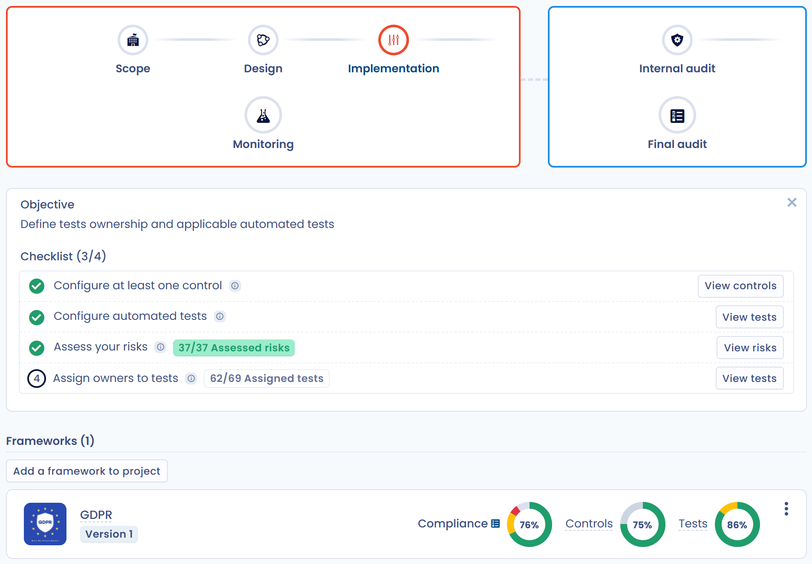

# Projecten

Een conformiteitsproject volgt hoe een of meer kaders worden toegepast op een perimeter van uw organisatie. Het groepeert vereisten, controles, tests, risico's en audits en gaat in fasen vooruit, van de afbakening tot de eindaudit.

Deze pagina behandelt het aanmaken van een project, de zes fasen, de assistent van de fase en de navigatie. Elke fase wordt uitgebreid beschreven op de volgende pagina's:

* [Projectontwerp](design.md): kaders, vereisten, controles en risico's die u importeert;
* [Projectimplementatie](implement.md): tests, risicobeoordeling, connectoren;
* [Conformiteitsmonitoring](monitoring.md): bewijs, testcampagnes, export van de verklaring van toepasselijkheid;
* [Audits](audits.md): interne audits en eindaudits.

Voor een volledige doorloop van een certificeringsproject, zie het [voorbeeld van een ISO 27001-project](../../../examples/iso-27001-project.md).

## De projecten openen

Klik in het menu op **Conformiteit** en vervolgens op **Projecten**. Het zijmenu heeft twee groepen:

* **Complianceprojecten**: **Alle projecten** toont de projecten van de werkruimte;
* **Mijn taken**: de items die aan u zijn toegewezen, in alle projecten (zie hieronder).

## Een project aanmaken

1. Klik in **Alle projecten** op **Een project aanmaken**.
2. Voer de **Titel** van het project in (maximaal 200 tekens).
3. Kies de **Perimeter** (verplicht). Bestaat die nog niet, klik dan in de lijst op **Een perimeter creëren** om hem te bepalen zonder het venster te verlaten. Zie [Perimeters](../scopes.md).
4. Klik op **Volgende**.
5. Voeg bij **Wijs gebruikers aan het project toe** de personen toe die het project mogen beheren en geef elk de rol **Goedkeurder** of **Op de hoogte**. U wordt standaard toegevoegd met de rol **Goedkeurder**.
6. Klik op **Toevoegen**.

Het project opent op het overzicht, in de fase **Perimeter**.


Voor het aanmaken of wijzigen van een project hebt u schrijftoegang tot de operationele conformiteit nodig.


<figure><figcaption></figcaption></figure>

## Fasen van een project

Een project doorloopt zes fasen. De huidige fase is gemarkeerd op het overzicht en elke fase toont haar doel wanneer u er met de muis overheen gaat.

| Fase | Doel | Pagina |
| --- | --- | --- |
| **Perimeter** | De perimeter van de conformiteit bepalen, dat wil zeggen de betrokken organisatorische eenheden. Dat gebeurt meestal bij het aanmaken van het project. | [Perimeters](../scopes.md) |
| **Design** | De toe te passen kaders bepalen (AVG, ISO enzovoort), met hun vereisten, controles en risico's. U kunt de sjablonen van Dastra of uw eigen kaders gebruiken. | [Projectontwerp](design.md) |
| **Implementatie** | Bepalen hoe de conformiteit wordt uitgevoerd: tests, risicobeoordeling, eigenaars en mogelijke automatiseringen. | [Projectimplementatie](implement.md) |
| **Toezicht** | Bewijs verzamelen voor het hele project met testcampagnes en ervoor zorgen dat zoveel mogelijk controles slagen. Dit is de dagelijkse uitvoeringsfase. | [Conformiteitsmonitoring](monitoring.md) |
| **Interne audit** | Een eerste interne audit uitvoeren om na te gaan of alles correct is ingevoerd vóór de eindaudit. | [Audits](audits.md) |
| **Eindaudit** | De certificeringsaudit uitvoeren voor elk kader dat u hebt ingevoerd. | [Audits](audits.md) |

<figure><figcaption></figcaption></figure>

### De fase wijzigen

De fasen zijn niet vergrendeld: u kunt naar elke fase gaan, vooruit of achteruit.

1. Klik op het overzicht op de gewenste fase.
2. Bevestig in het venster **Wilt u het project naar deze stap verplaatsen?**.

Sommige functies worden in- of uitgeschakeld naargelang de fase en al uw werk blijft behouden. Handelt u buiten de aanbevolen fase, dan toont Dastra een waarschuwing zonder u te blokkeren:

* het wijzigen van bewijs buiten de fase **Toezicht**;
* het starten van een testcampagne buiten de fase **Toezicht**;
* het aanmaken van een audit buiten een auditfase, of van een certificeringsaudit buiten de fase **Eindaudit**.

### De checklist van de assistent volgen

Bovenaan het overzicht herinnert de assistent aan het **Fase doel** en toont hij een **Checklist** voor de huidige fase. Elke stap heeft een actieknop die het betreffende scherm opent.

| Fase | Stappen van de checklist |
| --- | --- |
| **Perimeter** | Bepaal de scope van het project |
| **Design** | Voeg ten minste één framework toe; Voeg controles toe aan het project; Voeg risico's toe aan het project |
| **Implementatie** | Configureer ten minste één controle; Configureer de geautomatiseerde tests; Evalueer alle risico's; Eigenaren toewijzen aan de tests |
| **Toezicht** | Valideer ten minste één test; Zorg ervoor dat minstens 80% van de tests slaagt |
| **Interne audit** | Configureer uw eerste conformiteitsaudit; Minimaal één interne audit afronden |
| **Eindaudit** | Een finale audit per framework starten; Een van uw finale audits of certificeringen afronden |

Zijn alle stappen uitgevoerd, dan verschijnt de knop **Overgaan naar fase: …** om naar de volgende fase te gaan, na dezelfde bevestiging.

Klik op het kruisje om de assistent te verbergen (**De assistent verbergen**). Met de knop **Weergave-assistent** haalt u hem terug.

## Door een project navigeren

Het zijmenu van een project toont de perimeter, de titel (klik erop om hem te wijzigen) en de gebruikers van het project, en geeft toegang tot deze tabbladen:

| Groep | Tabbladen |
| --- | --- |
| **Project** | **Statistieken**, **Vereisten**, **Audits** |
| **Controles & tests** | **Controlepunten**, **Tests**, **Testcampagnes** |
| **Risico's** | **Risico's**, **Bedreigingen** |

Met de knoppen voor taken en opmerkingen in het menu volgt u het project samen met andere gebruikers. Het menu **⋯** biedt:

* **Instellingen**: de titel, de beschrijving en de perimeter wijzigen;
* **Historiek**: de wijzigingen in het project nalezen;
* **Exporteren**: het project exporteren als pdf, DOCX, JSON, HTML of Markdown;
* **Verplaats naar de prullenbak**: het project archiveren. Een gearchiveerd project is alleen-lezen: met **Herstellen** kunt u het weer wijzigen en met **Verwijderen** wordt het definitief gewist.

## Uw taken opvolgen

De groep **Mijn taken** van het zijmenu bundelt wat aan u is toegewezen, in alle projecten. Het is de dagelijkse werkruimte van testeigenaars en auditors. Een gebruiker die de lijst van projecten niet kan openen, komt bij het openen van **Conformiteit** rechtstreeks op **Mijn tests** terecht.

| Weergave | Inhoud |
| --- | --- |
| **Mijn tests** | De tests waarvan u eigenaar bent, met hun statistieken. Filter op testcampagne om een campagne te openen en uw bewijs toe te voegen. |
| **Mijn controles** | De controles waarvan u eigenaar bent. |
| **Mijn risico's** | De risico's waarvan u eigenaar bent. |
| **Mijn audits** | De audits waarin u auditor bent. Klik op een audit om hem te beoordelen. |
| **Mijn testcampagnes** | De testcampagnes, die u kunt filteren op status en op kader. |

Zie ook [Tests valideren](monitoring.md#tests-valideren).

## Een project weergeven in het Trust Center

Het Trust Center kan een samenvatting tonen van alle kaders van een conformiteitsproject, met de gegevens van de laatste audit en de bijbehorende bijlagen. U schakelt de optie in bij de configuratie van het Trust Center: zie [Uw Trust Center configureren](../../trust-center/configuration/README.md).
