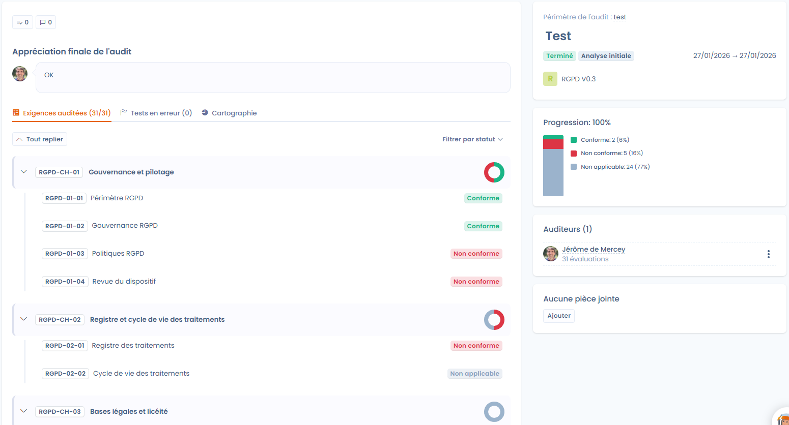

# Audits

In de fasen **Interne audit** en **Eindaudit** van een project valideert u officieel de stand van de conformiteit op een bepaald moment. Ze bouwen voort op het ontwerpwerk en de monitoring die eraan voorafgingen, voor een gestructureerde beoordeling die intern of door externe auditors wordt uitgevoerd.

Een audit heeft betrekking op één kader van het project. De auditors beoordelen elke vereiste op basis van de controles, tests en het bewijs die al in het project staan, waarna de audit wordt afgerond met een algemene beoordeling.

<figure><figcaption></figcaption></figure>

## Wat de module doet

* **Audits uitvoeren**, intern of extern, met standaardkaders (AVG, AI-verordening enzovoort) of met uw eigen aangepaste rasters.
* **Samenwerken**: de auditors hebben toegang tot de bijbehorende vereisten, controles, tests en het bewijs, en tijdens de audit kan een auditor worden toegevoegd.
* **Het monitoringwerk hergebruiken**: de controles en het bewijs van het project zijn tijdens de beoordeling rechtstreeks te raadplegen.
* **Afwijkingen aanpakken**: fouten in tests melden en corrigerende taken aanmaken.
* De resultaten **exporteren** als XLSX, pdf, DOCX, JSON, HTML of Markdown.

<figure><figcaption></figcaption></figure>

## Een audit aanmaken

Maak een audit aan vanuit het conformiteitsproject, niet vanuit de module Vragenlijsten. Er zijn twee ingangen:

* het tabblad **Audits** van het project, met de knop **Maak een nieuwe audit aan**. Kies daarna het kader in de lijst **Selecteer een framework om te auditen**, die voor elk kader aangeeft of er al een audit loopt;
* het menu **⋯** van een kaderkaart op het projectoverzicht, met **Maak een nieuwe audit aan**. Het kader is dan al geselecteerd.

Heeft het project geen kader, dan toont Dastra **Geen framework om te auditen**: voeg eerst een kader aan het project toe (zie [Projectontwerp](design.md)).


Een audit aanmaken buiten een auditfase wordt niet aanbevolen: Dastra toont een waarschuwing maar blokkeert u niet. Kiest u de auditfase **Eindaudit** terwijl het project niet in de fase **Eindaudit** is, dan verschijnt dezelfde waarschuwing.


### Algemene informatie

| Veld | Beschrijving |
| --- | --- |
| **Naam** | Titel van de audit, bijvoorbeeld "Jaarlijkse conformiteitsaudit". Verplicht, maximaal 80 tekens. |
| **Beschrijving** | Context of specifieke perimeter van de audit. Optioneel, maximaal 500 tekens. |
| **Auditeurs** | Gebruikers die de audit mogen uitvoeren. Verplicht. Staat u niet in deze lijst, dan kunt u de vereisten niet beoordelen, ook niet als u eigenaar van de organisatie bent. |

<figure><figcaption></figcaption></figure>

### Auditfase en data

Met de **Fase van de audit** segmenteert u de audit en filtert u de governancedashboards. Ze staat los van de fase van het project.

| Fase | Gebruik |
| --- | --- |
| **Initiële Analyse** | Afbakening: bepaling van de perimeter, het kader en de regelgevende vraagstukken. Standaardwaarde. |
| **Voorbereiding** | Logistiek: controles aan auditors toewijzen en gesprekken plannen. |
| **Vooraudit** | Proefaudit: zelfbeoordeling om afwijkingen vast te stellen vóór de officiële deadline. |
| **Eindaudit** | Afsluiting: definitieve scoring, conclusies en officieel rapport. |

Vul de **Startdatum** en de **Deadline** in om de audit in de tijd af te bakenen. Beide zijn verplicht.

### Opties

* **Resultaten van een eerdere audit behouden?**: u vertrekt van de beoordelingen van een bestaande audit. Dat is nuttig voor terugkerende audits of om een audit opnieuw uit te voeren waarvan de controles niet bevredigend waren. Selecteer vervolgens de audit waarvan u de resultaten wilt hergebruiken.
* **Definieer als actieve audit**: de audit voedt de opvolgingsindicatoren van het kader, waaronder het conformiteitspercentage op het projectoverzicht. Standaard ingeschakeld.
* **Stuur een e-mail naar de auditor**: verstuurt een uitnodiging aan de aangewezen auditors. Voer indien nodig een **Inhoud van het bericht** in en laat **Stuur de e-mail onmiddellijk** ingeschakeld, of schakel het uit en kies een datum en tijd binnen de komende 3 dagen.

Klik op **Valideren** om de audit aan te maken. Het dashboard van de audit opent.

## De audit uitvoeren

Het dashboard van de audit bundelt de voortgang en het team.

Links staan drie tabbladen:

* **Geauditeerde vereisten (x/y)**: de boomstructuur van het kader met de status van elke vereiste. Filter op status met **Filteren op status**;
* **Fouten in tests (n)**: de fouten die auditors in tests hebben gemeld (zie [Een fout in een test melden](#een-fout-in-een-test-melden));
* **In kaart brengen**: grafieken met de verdeling van de vereisten en de controles.

Rechts staan:

* de geauditeerde perimeter, de titel, de beschrijving, de status en de fase van de audit, de data en het kader met zijn versie. Met **Bewerken** opent u de algemene informatie;
* de **Vooruitgang** van de audit als percentage, met de verdeling van de vereisten (niet geauditeerd, conform, deels conform, niet conform, niet van toepassing);
* de lijst van **Auditeurs**, met het aantal beoordelingen dat elk van hen heeft afgerond. Met **Auditor toevoegen** en **Auditor verwijderen** past u het team tijdens de audit aan;
* de **Bijlagen**: verzamel hier externe bewijsdocumenten zodat alle auditors er toegang toe hebben.

Met de knoppen voor taken en opmerkingen van het dashboard volgt u de audit samen met andere gebruikers, bijvoorbeeld om corrigerende taken aan te maken.

De knop **Audit aanvullen** opent de beoordelingsruimte. Het bijbehorende menu biedt ook:

* **Heropen de audit**: maakt een afgeronde audit weer bewerkbaar;
* **Exporteren**;
* **Link kopiëren**;
* **Audit archiveren**, en daarna **Herstellen** om hem terug te halen. De audit die als actief is gedefinieerd, kan niet worden gearchiveerd.

Bent u niet als auditor aangewezen, dan is de knop **Audit aanvullen** vergrendeld: vraag om aan de lijst **Auditeurs** te worden toegevoegd.

## De vereisten beoordelen

In de beoordelingsruimte doorloopt u elke vereiste van het kader zonder de auditpagina te verlaten.

* **Navigatiebalk**: met **Terug** en **Volgende** gaat u door de vereisten, een pijl springt naar de volgende niet voltooide vereiste en een teller toont de positie (bijvoorbeeld 1/31).
* **Linkerpaneel**: de boomstructuur van het kader, onderverdeeld in hoofdstukken en vereisten. Een indicator bevestigt de reeds beoordeelde vereisten.
* **Centraal werkgebied**: het doel van de vereiste, daarna de gekoppelde controles met hun tests. Voor elke test bekijkt u het bijgevoegde bewijs (bestanden, links, JSON-gegevens) rechtstreeks in de interface.
* **Rechterpaneel**: de voortgang van de audit en drie tabbladen: **Evaluatie**, **Auditdetails** en **Frameworkdetails**.

<figure><figcaption></figcaption></figure>

Kies na de analyse van het bewijs in het tabblad **Evaluatie** een status voor de vereiste en voer een **Opmerking** in om uw oordeel te motiveren:

| Status | Betekenis |
| --- | --- |
| **Conform** | Het aangeleverde bewijs voldoet volledig aan de vereiste. |
| **Deels conform** | Er is bewijs, maar het is onvoldoende of onvolledig. |
| **Niet conform** | Er is geen bewijs of de controle wordt als ondoeltreffend beschouwd. |
| **Niet van toepassing** | De vereiste valt buiten de perimeter van de audit. |

De **Historiek** van de vereiste bewaart de opeenvolgende beoordelingen. Elke invoer werkt de voortgang van de audit bij.

### Een fout in een test melden

Is het bewijs van een test niet bevredigend, meld dat dan aan de eigenaar van de test zonder de beoordeling te blokkeren.

1. Zoek in het centrale werkgebied de test en klik op **Fout melden**.
2. Kies de **Ernst**: **Low**, **Medium** (standaard) of **High**.
3. Beschrijf het probleem bij **Leg het probleem uit met de geleverde bewijzen**. De opmerking is optioneel, maar helpt de eigenaar van de test het bewijs te verbeteren.
4. Klik op **Maak het foutrapport aan**.

De knop wordt daarna vervangen door een vlag in de kleur van de ernst. Ga er met de muis overheen om de opmerking te lezen of de melding te verwijderen. Een test kan per audit maar één melding hebben.

<figure><figcaption></figcaption></figure>

De meldingen staan gebundeld in het tabblad **Fouten in tests** van het auditdashboard, met de referentie, de test, de status en de ernst. Filter op **Ernst van de fout**, vink daarna tests aan om:

* **De tests ongeldig maken**: de gemelde tests krijgen weer de status **Te doen**. Dastra stelt dan voor **Een testcampagne opnieuw starten?** om hun eigenaars te verwittigen, zodat ze hun bewijs bijwerken vóór de volgende audit;
* **Start van een testcampagne**: maakt rechtstreeks een campagne aan met de aangevinkte tests (zie [Conformiteitsmonitoring](monitoring.md)).

<figure><figcaption></figcaption></figure>

## De audit afronden

Zijn alle vereisten beoordeeld, dan wordt de knop **Finaliseer de audit** beschikbaar. Die opent een venster waarin u de **Eindbeoordeling van de audit** invoert (verplicht, maximaal 1.000 tekens). Met deze samenvatting geeft u een algemeen oordeel over het maturiteitsniveau van de geauditeerde perimeter, benadrukt u aandachtspunten of successen en kunt u documenten met een samenvatting bijvoegen vanuit de bestandsverkenner.

Klik op **Valideren** om de audit af te sluiten.


Zodra de audit is afgerond, kunt u de individuele beoordelingen niet meer wijzigen, tenzij u de audit heropent met **Heropen de audit**.


## De resultaten benutten

De afgeronde audit voedt de opvolging van de conformiteit:

* het conformiteitspercentage per kader verschijnt op het projectoverzicht en in **Conformiteit** > **Statistieken**;
* de **Eindbeoordeling van de audit** staat bovenaan het dashboard van de audit;
* de export van de audit bewaart een gestructureerd auditspoor dat u de volgende jaren kunt hergebruiken;
* niet-conforme of deels conforme vereisten kunt u opvolgen met taken, aangemaakt via de taakknop van de audit, vóór de volgende monitoringcyclus.

<figure><figcaption></figcaption></figure>
