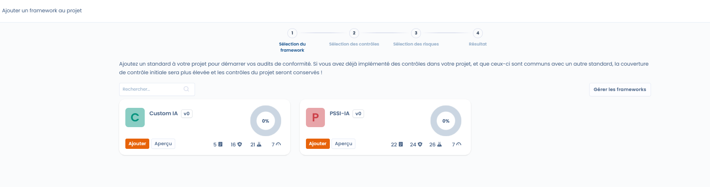
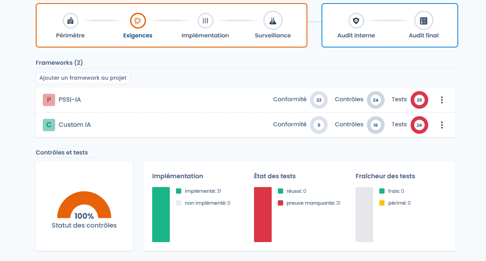

# Projectontwerp

In deze fase bepaalt u de organisatorische perimeter, selecteert u de toepasselijke kaders en initialiseert u automatisch de bijbehorende controles, tests en risico's.

Deze stap legt de basis van het project en bepaalt de kwaliteit van de opvolging in de volgende fasen.

***

<figure><figcaption></figcaption></figure>

## 1. Het project aanmaken en de perimeter bepalen

Bij het aanmaken van het project moet u een organisatorische perimeter selecteren.\
De perimeter groepeert een of meer organisatorische eenheden en bepaalt het toepassingsgebied van het conformiteitsproject.



Zodra het project is aangemaakt, wordt de perimeter weergegeven in de projectkop en gebruikt tijdens de hele conformiteitscyclus.



<figure><figcaption></figcaption></figure>



***

## 2. Gebruikers aan het project toewijzen



<figure><figcaption></figcaption></figure>



In de ontwerpfase wijst u ook de gebruikers aan die het project mogen beheren.

* U kunt aan elke gebruiker een rol toewijzen (bijvoorbeeld eigenaar).
* Deze gebruikers mogen de controles, tests en audits van het project aansturen.



***

<figure><figcaption></figcaption></figure>

## 3. Conformiteitskaders toevoegen

Een conformiteitsproject steunt op een of meer kaders (normen, interne of aangepaste referentiekaders).

Door een kader toe te voegen importeert u:

* de vereisten,
* de controles,
* de tests,
* en de bijbehorende risico's.

<figure><figcaption></figcaption></figure>

Alleen de gepubliceerde versies van een kader worden aangeboden. Als er meerdere gepubliceerde versies bestaan, kiest u de versie in de lijst **Te installeren versie** naast de naam van het kader. De huidige versie is vooraf geselecteerd.

Het project blijft gekoppeld aan de geïnstalleerde versie. Wanneer dat niet meer de huidige versie is, toont de kaderkaart in het projectoverzicht de badge **Beschikbare update**. U schakelt handmatig over naar een andere versie met de actie **Werk de versie van het framework bij**. Dat is niet mogelijk zolang er een audit loopt in het project (zie [Versies van kaders](../library/frameworks/versions.md)).

U kunt achtereenvolgens meerdere kaders aan hetzelfde project toevoegen.

***

## 4. Controles delen tussen kaders

Wanneer u meerdere kaders aan het project toevoegt, detecteert Dastra automatisch de gemeenschappelijke controles.

* Een controle die door meerdere kaders wordt gedeeld, wordt maar één keer geïmporteerd.
* De invoering ervan dekt tegelijk alle bijbehorende vereisten.
* Zo vergroot u de conformiteitsdekking zonder acties te vermenigvuldigen.

<figure><figcaption></figcaption></figure>

***

## 5. De te importeren controles selecteren

Wanneer u een kader toevoegt, hebt u meerdere opties:

* alle controles van het kader importeren,
* alleen bepaalde controles importeren,
* geen controles importeren, om ze handmatig in te voeren.

<figure><figcaption></figcaption></figure>

Dankzij deze flexibiliteit stemt u het project af op de maturiteit van de organisatie.

***

## 6. Controles en tests initialiseren



Zodra de kaders zijn geïmporteerd:

* worden de geselecteerde controles automatisch aan het project toegevoegd,
* gelden ze standaard als ingevoerd,
* worden de bijbehorende tests ook aan de controles gekoppeld.

In dit stadium:

* hebben de tests de status **Ontbrekend bewijs**,
* is er nog geen bewijs verzameld.







***

## 7. De risicoanalyse voorbereiden

U kunt tijdens het importeren de risico's van de kaders selecteren.

Ze vormen:

* de basis voor de initiële risicobeoordeling,
* het referentiepunt voor de berekening van het restrisico na toepassing van de controles.

<figure><figcaption></figcaption></figure>

***

## Resultaat van de ontwerpfase

Na de ontwerpfase heeft het project:

* een duidelijk bepaalde perimeter,
* aangewezen eigenaars,
* de toepasselijke geïmporteerde kaders,
* gedeelde controles die klaar zijn voor opvolging,
* geïnitialiseerde tests,
* en een gestructureerde risicobasis.

Het project is dan klaar voor de volgende fase: de implementatie.
