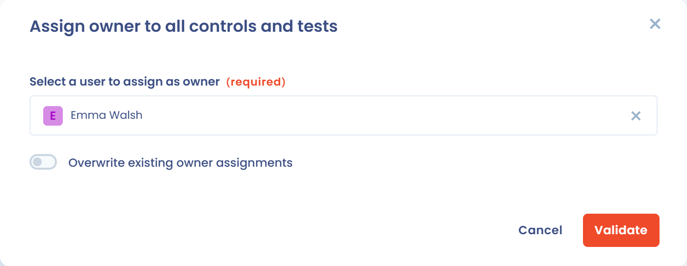

# Projectimplementatie

De fase **Implementation** is de overgang van het theoretische kader naar de operationele uitvoering van conformiteit. In deze fase configureert u de controles concreet, bepaalt u de verificatiemethoden en bereidt u het verzamelen van bewijs voor.

In dit stadium heeft het project al:

* zijn kaders,
* zijn controles,
* zijn tests en risico's, geïnitialiseerd tijdens de ontwerpfase.

***

## Doel van de fase

De implementatiefase heeft als doel om:

* te bepalen hoe de controles worden geverifieerd,
* de tests (handmatig of geautomatiseerd) te configureren,
* de risico's aan de controles te koppelen,
* het verzamelen van conformiteitsbewijs voor te bereiden.

***

## 1. De status van tests tijdens de implementatiefase begrijpen

Standaard hebben alle tests van het project de status **Ontbrekend bewijs**.

Dat betekent dat:

* de controle bestaat,
* de test is gedefinieerd,
* maar er nog geen bewijs is aangeleverd of verzameld.

Zolang het project zich niet in de fase **Monitoring** bevindt, is het niet aanbevolen bewijs te wijzigen of te valideren: Dastra toont een waarschuwing, zonder u te blokkeren.

<figure><figcaption></figcaption></figure>

Het tabblad **Context** van de details van de test toont waar de test vandaan komt: het **Project** (naam, status, beschrijving en **Kaders**) en de **Perimeter** ervan.

***

## 2. Conformiteitstests configureren

Elke controle kunt u verifiëren met een of meer tests.



Met een test bepaalt u:

* een verificatieprocedure,
* een uitvoeringsfrequentie (bijvoorbeeld maandelijks, driemaandelijks, jaarlijks),
* een **Eigenaar van de test**.

Tests kunnen zijn:

* handmatig, met een menselijke handeling en bewijs,
* of geautomatiseerd, via een Dastra-connector of een aangepaste connector.



<figure><figcaption></figcaption></figure>



***

## Status en uitsluiting van een controle

Elke controle van het project heeft een **Status van de controle**, die u wijzigt in de lijst van het tabblad **Controlepunten** of in het venster van de controle:

| Status | Betekenis |
| --- | --- |
| **Concept** | De controle is geïdentificeerd, maar nog niet geïmplementeerd. Ze telt mee bij de niet-geïmplementeerde controles. |
| **Geïmplementeerd** | De controle is ingevoerd. Dit is de status van controles die met een kader zijn geïmporteerd. Ze wordt gevalideerd wanneer al haar tests slagen. |
| **Excluded** | De controle is niet van toepassing op het project. |

Om een controle uit te sluiten, kiest u **Excluded**: het venster **Rechtvaardigen van de uitsluiting van de controle** opent. Geef de reden op in **Leg uit waarom deze controle moet worden uitgesloten** (maximaal 2.000 tekens). De rechtvaardiging is in dit venster optioneel, maar u vult haar best in: ze wordt getoond op de controle en tijdens audits en ze wordt overgenomen in de verklaring van toepasselijkheid, waar een uitgesloten controle als niet van toepassing wordt aangemerkt (zie [Conformiteitsmonitoring](monitoring.md)).

Een uitgesloten controle wordt niet langer beoordeeld: tijdens een audit wordt de rechtvaardiging getoond in plaats van de tests. Wanneer u een uitgesloten controle in bulk opnieuw aan het project toevoegt, wordt ze opnieuw geactiveerd.

<figure><figcaption></figcaption></figure>

***

## Een eigenaar toewijzen aan alle controles en tests van een vereiste

In het tabblad **Vereisten** van het project opent de gebruikersknop rechts van een vereiste het venster **Een eigenaar toewijzen aan alle controles en tests**. Zo wint u tijd aan het begin van de implementatie, vóór de checkliststap **Eigenaren toewijzen aan de tests**.

1. Klik op de knop van de betreffende vereiste. De actie geldt voor de vereiste en haar subvereisten.
2. Kies de persoon in **Een gebruiker selecteren om als eigenaar toe te wijzen**.
3. Schakel **Bestaande eigenaarschaptoewijzingen overschrijven** in als u de reeds bepaalde eigenaren wilt vervangen. Anders worden alleen items zonder eigenaar ingevuld.
4. Klik op **Valideren**.

Hiervoor is schrijftoegang tot operationele conformiteit vereist.

<figure><figcaption></figcaption></figure>

***

## 3. Risico's koppelen en beoordelen

U kunt controles aan een of meer risico's koppelen om hun invloed op de risicovermindering te meten.

Voor elk risico kunt u:

* een initiële beoordeling vastleggen (waarschijnlijkheid × impact),
* een resterende beoordeling vastleggen, na toepassing van de controles,
* de risicobehandeling kiezen (vermindering, aanvaarding enzovoort).

Met deze aanpak ziet u concreet wat de controles voor de risicohouding betekenen.

<figure><figcaption></figcaption></figure>

### Risico's op een kaart weergeven

In het tabblad **Risico's** van het project schakelt de keuzeknop boven de lijst tussen de weergave **Tabel**, die elk risico met zijn scores toont, en de weergave **Cartography**, die de risico's op een matrix van waarschijnlijkheid × impact plaatst.

De weergave **Cartography** toont drie matrices naast elkaar:

* **Initiële risico**: het niveau dat is beoordeeld toen het risico werd geïdentificeerd, vóór elke herstelmaatregel;
* **Huidig risico**: het niveau op een bepaald moment, op basis van de werkelijke voortgang van de herstelacties en controles;
* **Restrisico**: het niveau dat wordt verwacht zodra alle geplande maatregelen zijn uitgevoerd, dat wil zeggen het risico dat de organisatie aanvaardt of tolereert.

Filter op **Kader** om alleen de risico's van één kader te zien, klik op een risico om het te openen of klik op **Afdrukken** om de pagina af te drukken. Door risico's zowel als tabel als op een kaart te lezen, stelt u gemakkelijker prioriteiten en communiceert u ze aan de stakeholders.

<figure><figcaption></figcaption></figure>

***

## 4. Bedreigingen, risico's en controles koppelen

Bedreigingen zijn de concrete scenario's die een risico kunnen doen ontstaan\
(bijvoorbeeld injectie van kwaadaardige gegevens, gebrek aan toezicht, exfiltratie van informatie).

Een bedreiging kan zijn:

* gekoppeld aan een of meer risico's,
* indirect gedekt door de ingevoerde controles.

Deze keten zorgt voor volledige traceerbaarheid:\
Bedreiging > Risico > Controle > Test > Bewijs

***

## 5. Een connector installeren om bewijs te automatiseren

Voor bepaalde tests kunt u een Dastra-connector installeren om het verzamelen van bewijs te automatiseren.

Met connectoren kunt u bijvoorbeeld:

* de aanwezigheid van een beleidsdocument of een contract controleren,
* een register bevragen (AI-systemen, assets, incidenten, verwerkingsactiviteiten, derden) of de audits,
* terugkerende controles automatiseren zonder handmatige actie.

De lijst van connectoren en hun configuratie staan beschreven in [Tests](../library/tests.md).

Elke connector wordt geconfigureerd met:

* een uitvoeringsfrequentie,
* verzamelparameters die op de test zijn afgestemd.

<figure><figcaption></figcaption></figure>

***

## 6. Resultaat van de implementatiefase

Na de implementatiefase:

* zijn de controles geconfigureerd,
* zijn de tests klaar om te worden uitgevoerd,
* zijn de risico's beoordeeld en gekoppeld,
* zijn eventuele connectoren geïnstalleerd.

Het project is dan klaar voor de volgende fase: **Monitoring**. In die fase:

* worden de tests periodiek uitgevoerd,
* wordt het bewijs verzameld,
* wordt de conformiteit in de loop van de tijd gemeten.

## De projectlijsten exporteren

De tabbladen **Controles**, **Tests** en **Risico's** van een project hebben elk een knop **Exporteren**. Ze exporteert de lijst zoals ze wordt weergegeven: de actieve filters zijn van toepassing. Kies in het exportvenster het formaat (CSV, Excel of JSON) en de op te nemen kolommen en klik daarna op **Bestand downloaden**.

De knop vereist de machtiging om de operationele gegevens van de compliancemodule te exporteren. Zonder die machtiging is ze uitgeschakeld.
