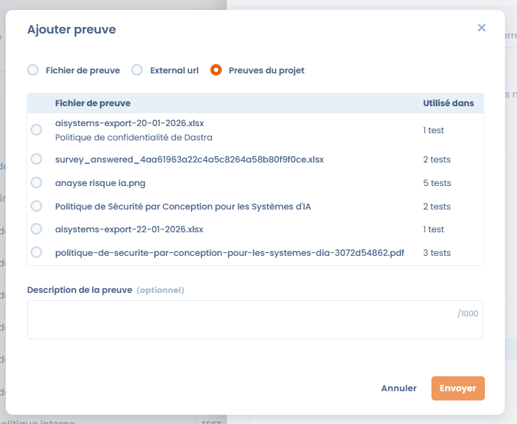
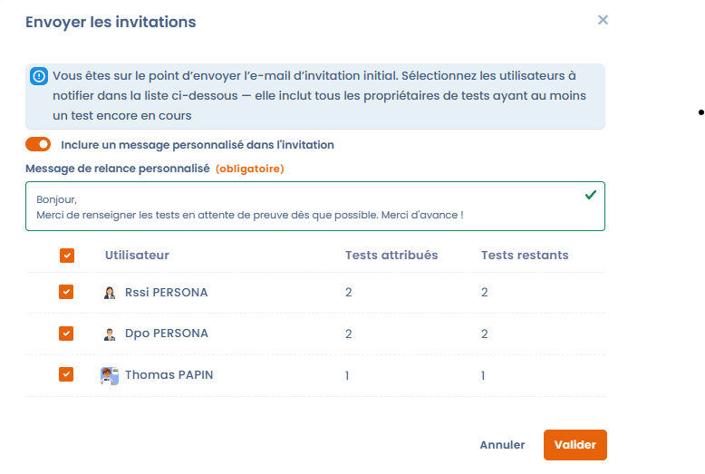

# Conformiteitsmonitoring

De fase **Monitoring** controleert de werkelijke doeltreffendheid van de controles in de loop van de tijd, verzamelt het bijbehorende bewijs en volgt de evolutie van de conformiteit via terugkerende testcampagnes.

Het doel: bewijs verzamelen voor het hele project met testcampagnes, zorgen dat een maximum aan controles slaagt en een conformiteitsniveau aanhouden dat in de loop van de tijd meetbaar is.

***

## Overzicht van de monitoringfase

In deze fase gaat het project van een voorbereidende logica naar een logica van continue uitvoering:

* de controles zijn al ingevoerd,
* de tests worden regelmatig uitgevoerd,
* het bewijs wordt verzameld, bijgewerkt en beoordeeld,
* de conformiteitsindicatoren worden bruikbaar.

<figure><figcaption></figcaption></figure>

***

## Algemene opvolging van controles en tests

In het gedeelte **Controles en tests** van het tabblad **Statistieken** van het project geven vier indicatoren een beknopt beeld van de status van het project:

* **Status van de controles**: aandeel van de gevalideerde controles.
* **Implementatie**: geïmplementeerde of niet-geïmplementeerde controles.
* **Teststatus**:
  * geslaagde tests,
  * tests met ontbrekend bewijs,
  * mislukte tests.
* **Frisheid van de tests**:
  * actuele tests,
  * verlopen tests waarvoor nieuw bewijs nodig is.

Met deze indicatoren ziet u snel welke punten aandacht vragen en prioriteert u corrigerende acties.

<figure><figcaption></figcaption></figure>

### Projectgeschiedenis

Onder deze indicatoren toont de grafiek **Projectgeschiedenis** hoe het project zich in de loop van de tijd ontwikkelt. Kies de periode met de datumkiezer (maximaal 3 jaar) en stel vervolgens in:

* **Tijdseenheid**: **Dag**, **Week**, **Maand** of **Jaar**;
* **Metriek**: **Tests**, **Controles**, **Vereisten**, **Risico's** of **Conformiteit**.

Met de grafiek toont u de voortgang van de conformiteit aan het management of aan auditors.

<figure><figcaption></figcaption></figure>

***

## Bewijsbeheer



Bewijs vormt de kern van de monitoringfase.\
U voegt het rechtstreeks vanuit een test toe met **Bewijs toevoegen** en kunt het hergebruiken voor meerdere tests van het project.

De beschikbare manieren om bewijs aan te leveren zijn onder meer:

* bewijsbestanden toevoegen,
* externe links,
* bewijs selecteren dat al in het project staat.

U kunt elk stuk bewijs documenteren met een **Beschrijving van het bewijs** om latere audits te vergemakkelijken.



<figure><figcaption></figcaption></figure>



***

## Testcampagnes

Met **Testcampagnes** organiseert u de uitvoering van tests op grote schaal. U beheert ze in het tabblad **Testcampagnes** van het project.

Met een campagne kunt u:

* een reeks uit te voeren tests groeperen,
* aan elke test een eigenaar toewijzen,
* een algemene deadline bepalen,
* de voortgang centraal opvolgen.

Om een campagne aan te maken, klikt u op **Een testcampagne aanmaken** en vult u het **Campagne label** in. U kunt **Selecteer vooraf alle tests van uw project die wachten op bewijs** aanvinken om de start te vergemakkelijken. De campagne opent dan in configuratie: **Stel de inhoud van de testcampagne in**, controleer of elke test een eigenaar heeft en start de campagne vervolgens.


Als een of meer tests van de campagne geen eigenaar hebben, toont Dastra een waarschuwing en vraagt het u ze na te lopen voordat de uitnodigingen worden verstuurd. Met **Bekijk tests zonder eigenaren** vindt u ze terug.


Een campagne starten buiten de fase **Monitoring** is niet aanbevolen: Dastra toont een waarschuwing, zonder u te blokkeren.

<figure><figcaption></figcaption></figure>

***

## Campagnes starten en opvolgen



Zodra de campagne is geconfigureerd:

* ontvangen de betrokken gebruikers een uitnodiging per e-mail, die u verstuurt met **Stuur de uitnodigingen** nadat u de eigenaren hebt geselecteerd die u wilt verwittigen,
* kunt u een persoonlijk bericht toevoegen om het verzoek in context te plaatsen,
* verloopt elke test afzonderlijk (_Te doen_, _In afwachting van validatie_, _Voltooid_).

De algemene voortgang van de campagne is in real time zichtbaar, zodat de projecteigenaar snel vertragingen of blokkades ziet.



<figure><figcaption></figcaption></figure>



### Een campagne herinneren, afsluiten en opvolgen

In de lijst van de campagnes biedt het menu **⋯** van elke rij:

* **Stuur een herinnering**: selecteer de eigenaren die nog tests moeten voltooien. Er wordt een standaardherinnering verstuurd, waaraan u een **Aangepast herinneringsbericht** kunt toevoegen;
* **Sluit de campagne**: beëindigt de campagne; met **Heropen de campagne** zet u ze weer in uitvoering;
* **Link kopiëren**: kopieert de link naar de campagne;
* **Verplaats naar de prullenbak**: verwijdert de campagne uit de lijst. Met **Herstellen** brengt u ze terug, met **Verwijderen** verwijdert u ze definitief.

**Details** opent het dashboard van de campagne: aantal tests, deelnemers en kaders, gevalideerde tests, **Voltooiingspercentage per gebruiker** (voltooide tests, tests in afwachting van validatie en nog te doen tests) en **Verdeling van tests per framework**.

***

## Tests valideren

Elke test doorloopt een duidelijke cyclus:

* de **Testprocedure** raadplegen,
* het bewijs toevoegen of bijwerken,
* de test valideren met **Test valideren**.

Het resultaat van een test is **Geslaagd**, **Fout**, **Ontbrekend bewijs** of **Verlopen bewijs**. Voor een handmatige test zet **Test valideren** de test op **Done**; met **Test ongeldig maken** annuleert u de validatie. Zodra de test is gevalideerd, draagt hij automatisch bij aan een betere status van de gekoppelde controle en aan de algemene indicatoren van het project.

De uitnodiging brengt de gebruiker naar een persoonlijk opvolgingsdashboard, waar hij het bewijs invult voor de tests waarvan hij eigenaar is. Deze werkruimte is ook beschikbaar via **Mijn tests** (zie [Projecten](README.md)). Wanneer een gebruiker al zijn tests heeft voltooid, toont Dastra een felicitatiebericht met de knop **Bekijk mijn taken**.

<figure><figcaption></figcaption></figure>

***

## Export van de verklaring van toepasselijkheid (SOA)

De **verklaring van toepasselijkheid** (Statement of Applicability, SOA) is het referentiedocument dat alle controles van een kader van het project bundelt. U gebruikt ze voor certificeringsaudits, bijvoorbeeld ISO 27001, en om de dekking van de vereisten aan te tonen aan uw management of uw auditors.

De export gebeurt per kader, als XLSX-bestand:

1. Open het conformiteitsproject.
2. Klik in het tabblad **Statistieken** op het menu **⋯** van de kaderkaart, of open het tabblad **Vereisten** en gebruik het menu **⋯** van het kader.
3. Klik op **Exporteer de verklaring van toepasselijkheid**.

Hiervoor is exporttoegang tot operationele conformiteit vereist.

<figure><figcaption></figcaption></figure>

Het bestand bevat één rij per controle, met de volgende kolommen:

| Kolom | Inhoud |
| --- | --- |
| `ControlId` | Referentie van de controle. |
| `Label` | Naam van de controle. |
| `Description` | Beschrijving van de controle, zonder opmaak. |
| `Applicable` | Toepasselijkheid: een controle met de status **Excluded** is niet van toepassing. |
| `Justification` | Rechtvaardiging van de uitsluiting die op de controle is ingevoerd (zie [Status en uitsluiting van een controle](implement.md)). |
| `ImplementationStatus` | Status van de controle: **Concept**, **Geïmplementeerd** of **Excluded**. |
| `Evidence` | Verwijzingen naar het bewijs dat op de tests van de controle is verzameld. |
| `Auditor` | Eigenaar van de controle. |
| `RequirementNodes` | Vereisten waarop de controle betrekking heeft. |

***

## Verwacht resultaat van de monitoringfase

Na deze fase heeft het project:

* verzameld en getraceerd bewijs,
* regelmatig uitgevoerde en bijgewerkte tests,
* een betrouwbaar en meetbaar beeld van de werkelijke conformiteit,
* een stevige basis om de fasen van interne audit en certificering voor te bereiden.
