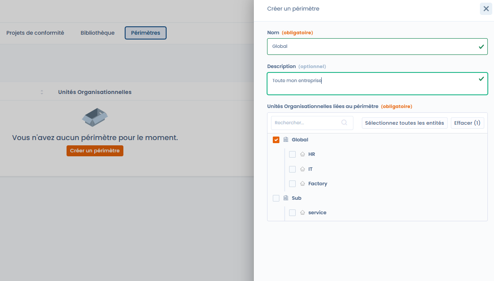

# Perimeters

Met perimeters groepeert u organisatorische eenheden, zodat u een conformiteitsaanpak op de hele organisatie of op een deel ervan kunt toepassen.

Een perimeter beantwoordt een eenvoudige vraag:

> _Op welke organisatorische entiteiten is dit conformiteitsproject van toepassing?_

***

## De rol van perimeters in Dastra

In Dastra worden perimeters uitsluitend gebruikt in conformiteitsprojecten.\
Ze maken het mogelijk om:

* de betrokken entiteiten nauwkeurig af te bakenen,
* de vereisten, controles en tests op het juiste niveau af te stemmen,
* conformiteit te structureren volgens de organisatorische werkelijkheid.

Een perimeter wijzigt de kaders niet:\
ze bepaalt waar de conformiteit van toepassing is, niet wat er van toepassing is.

***

## Een flexibele organisatorische indeling

Een perimeter wordt gedefinieerd op basis van de organisatorische eenheden die in de werkruimte bestaan.

Ze kan het volgende voorstellen:

* het hele bedrijf (bijvoorbeeld _Global_),
* een divisie of een afdeling (bijvoorbeeld _IT_, _HR_),
* een vestiging, een dochteronderneming of een specifieke activiteit.

Organisatorische eenheden kunt u afzonderlijk of in groepen selecteren, met inachtneming van hun hiërarchie.

***

## Een perimeter aanmaken

Bij het aanmaken van een perimeter geeft de gebruiker op:

* de naam van de perimeter (bijvoorbeeld _Global_, _IT & Security_),
* een optionele beschrijving,
* de organisatorische eenheden die in de perimeter zijn opgenomen (verplicht).

<figure><figcaption></figcaption></figure>

Een perimeter moet altijd ten minste één organisatorische eenheid bevatten.

***

## Voorbeeld van een perimeter

Voorbeeld:

* Naam: Global
* Beschrijving: Het hele bedrijf
* Organisatorische eenheden:
  * Global
  * HR
  * IT
  * Factory
  * Sub / Service

Deze perimeter kunt u vervolgens in een conformiteitsproject selecteren om aan te geven dat het project voor de hele organisatie geldt.

***

## Goede praktijken

* Maak een globale perimeter voor overkoepelende aanpakken.
* Maak beperktere perimeters voor gerichte projecten.
* Hergebruik perimeters in verschillende projecten om de consistentie te waarborgen.
* Geef perimeters een expliciete, op de bedrijfsvoering gerichte naam.

***

## Koppeling met conformiteitsprojecten

U selecteert perimeters bij het aanmaken van een conformiteitsproject.

Ze maken het mogelijk om:

* hetzelfde kader op meerdere entiteiten toe te passen,
* de conformiteit per perimeter op te volgen,
* de resultaten van verschillende delen van de organisatie te vergelijken.

***

## Samenvatting

Perimeters zijn een instrument voor organisatorische afbakening.\
Ze stemmen de conformiteit af op de werkelijke structuur van het bedrijf, zonder de referentiekaders complexer te maken.
