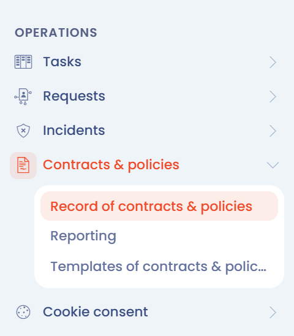
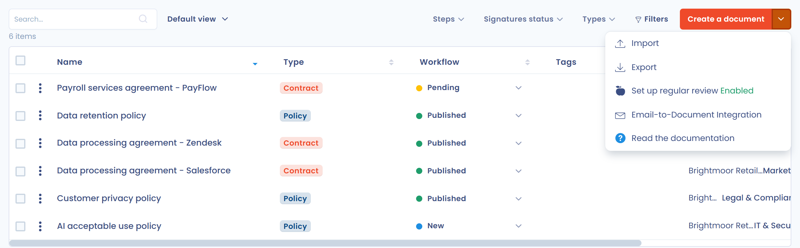

# Contracten en beleidslijnen

De module **Contracten en beleidslijnen** van Dastra helpt u uw juridische en organisatorische documenten aan te maken, te bewerken, te ondertekenen en te versioneren: contracten, beleidslijnen, kennisgevingen en procedures. Elk document is gekoppeld aan de activa, stakeholders en gebruikers waarop het betrekking heeft, zodat uw verplichtingen consistent blijven met uw register en uw referentiedatabases.

## Toegang tot de module

Uw abonnement moet de functie Contracten bevatten. Als die in uw abonnement is geactiveerd, opent u in de zijbalk **Operations** > **Contracten en beleidslijnen**. De module heeft drie onderdelen:

* **Register van contracten en beleidslijnen**: de lijst van uw documenten.
* **Rapportage**: de indicatoren en grafieken van de module (zie [Rapportage](README.md#rapportage)).
* **Documentmodellen**: de sjablonen waarmee u documenten genereert (zie [Contractsjablonen](templates.md)). Dit onderdeel is verborgen voor gebruikers met de rol `User`.

<figure><figcaption>
De module Contracten en beleidslijnen in de zijbalk
</figcaption></figure>

## Documenttypen

Elk document heeft een type: **Contract**, **Beleid**, **Kennisgeving**, **Procedure** of **Anders**. U kiest het type wanneer u het document aanmaakt (zie [Een document aanmaken](declare.md)). Om het later te wijzigen, klikt u op het typelabel naast de titel van het document.

In het register beperkt het filter **Soorten** de lijst tot een of meer typen.

## Het register van documenten

Het register toont uw documenten in een tabel waarvan u de kolommen kiest, bijvoorbeeld de versie, het aantal handtekeningen, het aantal bijlagen en de einddatum. Met filters vindt u een document op organisatorische eenheid, stap, ondertekeningsstatus, type, status, label of gebruiker.

De knop **Een document aanmaken** opent de wizard voor het aanmaken (zie [Een document aanmaken](declare.md)). De pijl rechts ervan opent de andere acties van de module:

* **Importeren**: meerdere documenten uit een bestand importeren.
* **Exporteren**: de lijst exporteren.
* **Set up regular review**: bepalen hoe vaak documenten worden beoordeeld (zie [Regelmatige beoordeling van documenten](review.md)).
* **E-mails omzetten in documenten**: documenten aanmaken op basis van de e-mails die op een verzameladres binnenkomen.
* **Lees de documentatie**: deze documentatie openen.

<figure><figcaption>
Het register en de acties van de knop Een document aanmaken
</figcaption></figure>

## Importeren en exporteren

**Importeren** opent de importwizard voor documenten. Die is beschikbaar voor gebruikers met de importmachtiging voor contracten. De wizard wordt beschreven in [Uw gegevens importeren (Excel, CSV)](../general/import.md).

**Exporteren** opent een venster waarin u het formaat kiest: CSV, XLSX, JSON, PDF, HTML, DOCX of Markdown. Vanuit het register omvat de export de lijst. Vanuit een document biedt het menu van de knop **Opslaan** de optie **Exporteren** voor alleen dat document, met de optie **Documenten opnemen** om de bijlagen toe te voegen.

## Documenten aanmaken vanuit uw e-mails

Het onderdeel **E-mails omzetten in documenten** leidt naar de integratie van verzameladers voor e-mailadressen. Zodra het adres voor contracten is aangemaakt, maakt elke ontvangen e-mail een document aan: het onderwerp wordt de naam, de tekst wordt de beschrijving en geldige bijlagen worden aan het document toegevoegd. Voor het installeren van het adres is de machtiging om integraties te beheren vereist. Het wordt beschreven in [Gegevens verzamelen via inkomende e-mail](../settings/mailboxes.md).

## Rapportage

Het onderdeel **Rapportage** geeft een overzicht van uw documenten. De indicatoren bovenaan tonen het aantal documenten dat **Overdue** is, het **Total**, de **Drafts** en de **Published** documenten. Klik op een indicator om de bijbehorende lijst te openen.

De grafieken tonen:

* **Nieuwe documenten**: de evolutie van het aantal documenten in de werkruimte en het aantal dat op elke datum is aangemaakt.
* **Signers**: het aantal documenten per ondertekenaar.
* **Workflow stages**: het aantal documenten per workflowstap.
* **Tags**: het aantal documenten per label.
* **Documenten per eenheden organisatie**: het aantal documenten in elke organisatorische eenheid, voor elke workflowstap.

De knop **Filters** beperkt de indicatoren en grafieken en **Afdrukken** maakt een afdrukbare versie. De indicator **Overdue** is gebaseerd op de einddatum van uw documenten: vul die in op het tabblad **Details** (zie [Details en bijlagen](documents.md)).

<figure><figcaption>
De pagina Rapportage van de module
</figcaption></figure>
