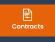

# Contracten

## Uw contracten rechtstreeks in Dastra aanmaken en beheren

De module Contracten van Dastra helpt u uw contracten te beheren en op te volgen. U maakt contracten veilig aan, wijzigt, ondertekent en versioneert ze, met inachtneming van de regelgeving voor gegevensbescherming.

## Toegang tot de module Contracten

U hebt een abonnement nodig dat de functie Contracten bevat om toegang te krijgen tot de module.

Als de functie in uw abonnement is geactiveerd, opent u de module via het pictogram **Contracten en beleidslijnen** in de navigatie.

<figure><figcaption>
Het pictogram van de functie Contracten
</figcaption></figure>
