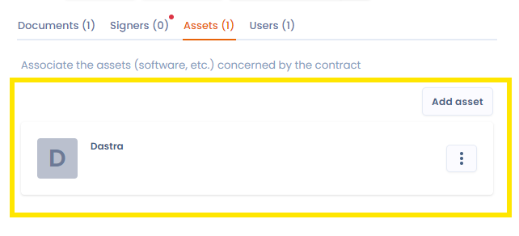

# Activa

In het tabblad Activa koppelt u specifieke activa aan uw contract. Zo volgt u de materiële of immateriële middelen op die bij de uitvoering van het contract betrokken zijn, zoals apparatuur, software of gegevens.

De activa die u koppelt, komen uit uw [module voor het in kaart brengen van gegevens](../mapping/README.md). U vindt de activa die aan uw contract zijn gekoppeld in het contract zelf, maar ook op de profielpagina van het activum, waar u alle contracten ziet waaraan het is gekoppeld.

<figure><figcaption>
Activa koppelen aan uw contract
</figcaption></figure>
