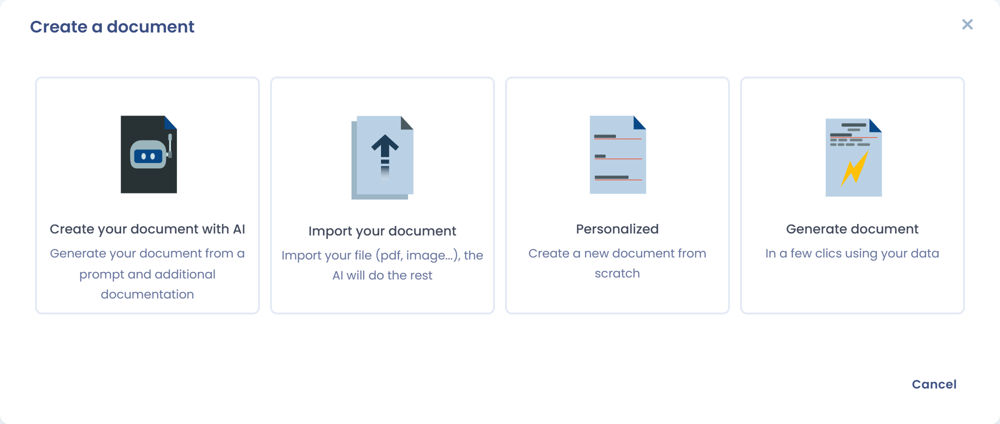
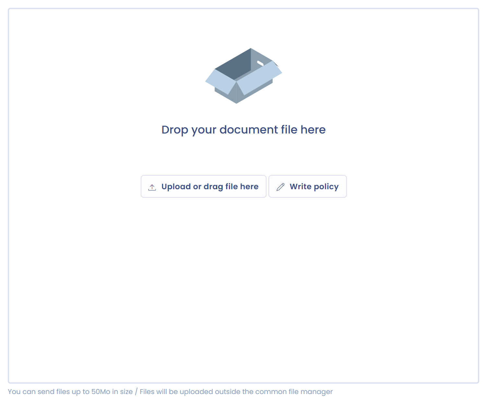

# Een document aanmaken

Om een contract, een beleid of een ander document aan te maken, klikt u op **Een document aanmaken** in het register van de module **Contracten en beleidslijnen**. Een wizard biedt vier manieren om het document aan te maken.

<figure><figcaption>
De vier opties om een document aan te maken
</figcaption></figure>

| Optie | Wat het doet |
| --- | --- |
| **Genereer een document** | Schrijft het document met AI op basis van uw instructie. |
| **Importeer uw document** | Analyseert een bestaand bestand met AI en vult het dossier voor u in. |
| **Gepersonaliseerd** | Maakt een leeg dossier aan dat u zelf invult. |
| **Generate document** | Genereert het document op basis van een [dynamisch contractsjabloon](templates.md). |

De eerste twee opties vereisen de bijbehorende AI-functies. Als die niet in uw abonnement zijn opgenomen, zijn ze grijs weergegeven.

## Van nul beginnen

1. Kies **Gepersonaliseerd**.
2. Selecteer het **Type document**: contract, beleid, kennisgeving, procedure of anders.
3. Voer de **Documentnaam** in.
4. Optioneel: voeg bestanden toe met **Add related files**. U kunt ze ook later toevoegen, zodra het document is aangemaakt.
5. Kies het **Gebied**.
6. Klik op **Een document aanmaken**.

Dastra opent vervolgens het dossier van het document (zie [Structuur van een document](structure.md)).

<figure><figcaption>
Het formulier om een document aan te maken
</figcaption></figure>

## Een beleid schrijven in Dastra

Een document zonder bijlage toont een plaats om bestanden neer te zetten. U kunt het bestand daar neerzetten of op **Een beleid schrijven** klikken om de tekst in een editor te schrijven. De tekst wordt als bijlage van het document opgeslagen, samen met de andere bestanden.

<figure><figcaption>
De plaats om bestanden neer te zetten en de knop Een beleid schrijven
</figcaption></figure>

## Een document genereren met AI

1. Kies **Genereer een document**.
2. Typ een korte beschrijving van het document dat u wilt genereren. U kunt **Bijlagen** of een **Website url** toevoegen als aanvullende documentatie.
3. Klik op **Genereer** en controleer vervolgens het voorbeeld.
4. Controleer de **Documentnaam** en de **Organisatie-eenheid** en klik vervolgens op **Valideren**.

Het document wordt aangemaakt met het type **Beleid**. U kunt het type daarna wijzigen via het label naast de titel.

## Een bestaand document importeren

1. Kies **Importeer uw document**.
2. Kies de **Organisatie-eenheid**.
3. Zet een bestand neer (PDF, DOCX, TXT, Markdown, JPG of PNG).

De analyse start zodra u het bestand neerzet. De AI-assistent van Dastra haalt de metagegevens uit het bestand (naam, beschrijving, labels, einddatum, aangepaste velden enzovoort), leidt het documenttype af en maakt het dossier aan met het bestand als bijlage. Controleer het dossier: de AI-analyse kan onjuist zijn.

## Genereren op basis van een sjabloon

Kies **Generate document** om het document op basis van een sjabloon aan te maken. Het proces wordt beschreven in [Contractsjablonen](templates.md).
