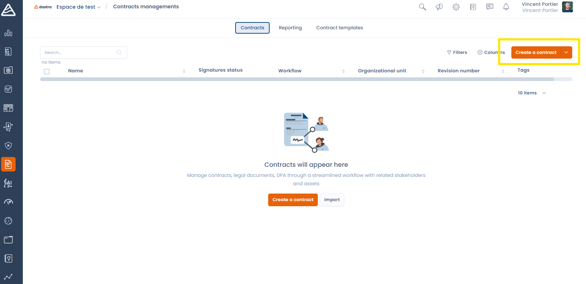
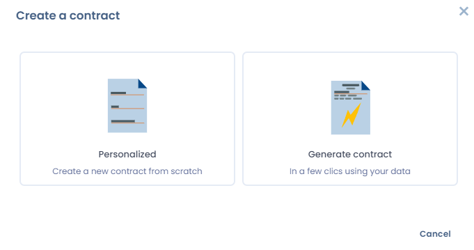

# Een contract aanmaken

U maakt een nieuw contract aan met de knop **Een document aanmaken** op de hoofdpagina van de module Contracten.

<figure><figcaption>
Maak uw eerste contract aan met de knop Een document aanmaken
</figcaption></figure>

U kunt van nul beginnen of een contract genereren op basis van een van onze [dynamische contractsjablonen](templates.md).

<figure><figcaption>
De opties om een contract aan te maken
</figcaption></figure>

Als u van nul begint, geeft u het contract een naam, voegt u uw bijlage toe en wijst u het contract toe aan een organisatorische eenheid. U kunt de bijlage ook later toevoegen, nadat het contract is aangemaakt.

<figure><figcaption>
Het formulier om een nieuw contract aan te maken
</figcaption></figure>
