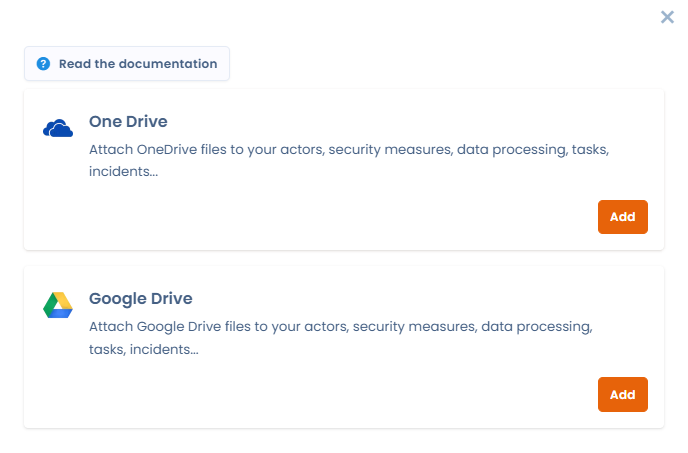
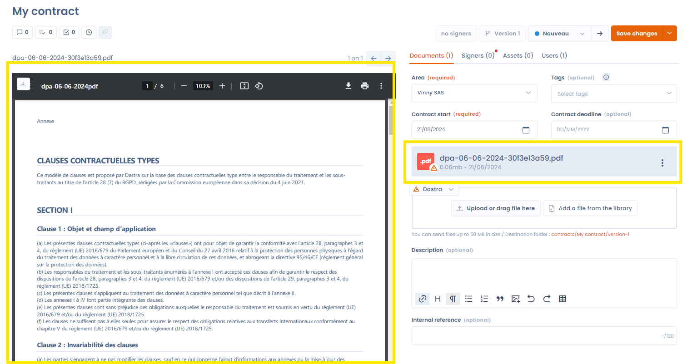

# Documenten

## Bijlagen

In de sectie documenten voegt u de documenten toe waaruit uw contract bestaat. Dat kan het contract zelf zijn, overeenkomsten, bijlagen of andere bestanden die bij het contract horen. Om een voorbeeld van een document te kunnen bekijken, slaat u PDF-bestanden of afbeeldingen op.

De opslag van documenten is gekoppeld aan onze module [Documentbeheer](../files/README.md). U kunt ook onze integratie voor cloudopslag installeren, waarmee u documenten uit uw eigen OneDrive of Google Drive koppelt.

<figure><figcaption>
Onze integratie voor cloudopslag om uw OneDrive of Google Drive te koppelen
</figcaption></figure>

Links ziet u het voorbeeld van het document en rechts een lijst van alle documenten die aan uw contract zijn gekoppeld. Om een voorbeeld van een ander document te bekijken, klikt u op de naam in de lijst rechts of navigeert u met de linker- en rechterpijltoetsen van uw toetsenbord (of met de pijlen op het scherm). Het document waarvan u het voorbeeld bekijkt, is in de lijst blauw gemarkeerd.

Het voorbeeldvenster blijft actief, ongeacht het tabblad van het contract waarin u zich bevindt. Zo kunt u het document raadplegen terwijl u bijvoorbeeld de ondertekenaars of de activa invult.

<figure><figcaption>
Een voorbeeld van een document bekijken
</figcaption></figure>

## Metagegevens

In deze sectie wijzigt u ook de organisatorische eenheid die aan het contract is gekoppeld, voegt u labels toe, vult u de begin- en einddatum van het contract in en voegt u een beschrijving en een interne referentie toe.

De einddatum van het contract is bijzonder nuttig voor het beheer van uw contracten: het tabblad met statistieken toont alle contracten waarvan de einddatum is verstreken.

## Gekoppelde conformiteitstests

Wanneer een document of een contract als bewijs dient voor een test in de module Conformiteit, is die koppeling rechtstreeks vanuit het contract zichtbaar. Een pictogram toont het aantal gekoppelde conformiteitstests. Als u erop klikt, opent de lijst van die tests. Als u op een test klikt, ziet u de details ervan zonder de pagina van het contract te verlaten.

<figure><figcaption>
Het pictogram toont het aantal gekoppelde conformiteitstests; een klik opent de lijst en daarna de details van de test zonder het contract te verlaten
</figcaption></figure>
