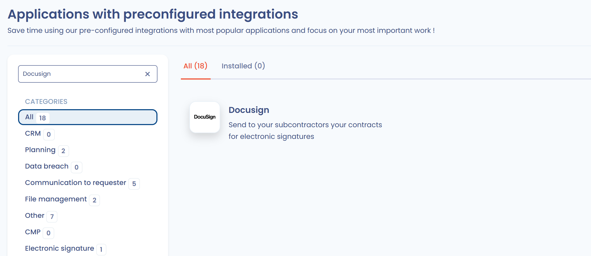
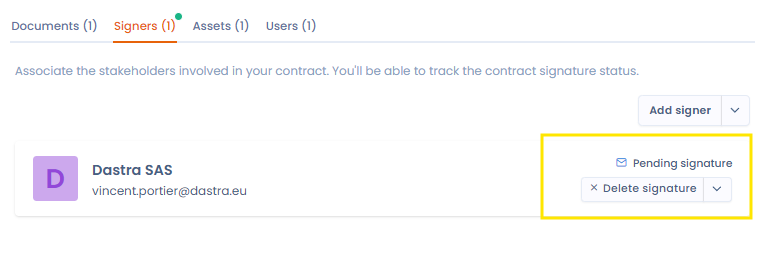

# Docusign-integratie

Dastra heeft een native integratie met DocuSign, de oplossing voor elektronische handtekeningen. U verstuurt een document ter ondertekening, volgt de ondertekeningsstatus en vindt die actueel terug, rechtstreeks vanuit de module **Contracten en beleidslijnen**.

## De integratie installeren

1. Open **Instellingen voor werkruimte** > **Integraties** en klik op de kaart **Docusign**.

   <figure><figcaption>
Selecteer Docusign in de integraties
</figcaption></figure>
2. Klik bij het gebruiksscenario voor contracten op **Integratie toevoegen**.
3. Maak bij de stap **Verbinding** de verbinding aan: Dastra stuurt u door naar de authenticatie van Docusign om uw Docusign-account met Dastra te koppelen.
4. Voer bij de configuratiestap **Account ID** en **Accountbasis-URI** in. U vindt ze in uw Docusign-account, op de pagina [Apps and Keys](https://apps.docusign.com/admin/apps-and-keys).

   <figure><figcaption>
De sleutels die u in Dastra invoert, afkomstig uit uw Docusign-account
</figcaption></figure>
5. Sla op. Dastra controleert het account bij Docusign.

De installatie is voltooid: de ondertekening met Docusign is beschikbaar in het ondertekeningsvenster van uw documenten. Hoe verbindingen en gebruiksscenario's in het algemeen werken, wordt beschreven in [Verbindingen, gebruiksscenario's en veldmapping](../integrations/connections.md).

## Een document ter ondertekening versturen

Om een document te versturen, hebt u nodig:

* een ondertekenaar waarvan de stakeholder een geldig e-mailadres heeft;
* ten minste één bijlage om te ondertekenen, in PDF-, DOC- of DOCX-indeling;
* een onderwerp voor de uitnodigings-e-mail.

Kies in het venster **Add signature** de optie **Sign with Docusign®** (zie [Een document ondertekenen](sign.md)). Als de integratie niet is geïnstalleerd, toont het venster de knop **Integratie installeren**, die de instellingen ervan opent.

### Verzendopties

Vul de volgende velden in:

* **Select the signers whose signature you want to record.**: de ondertekenaars naar wie u het verzoek verstuurt. Een stakeholder zonder e-mailadres of die al heeft ondertekend, kan niet worden geselecteerd. De knop **Verversen** laadt de lijst opnieuw na een wijziging.
* **Choose attachments added to the signature request**: de PDF-, DOC- of DOCX-bestanden die ter ondertekening worden verstuurd. Alle geldige bijlagen zijn standaard aangevinkt.
* **Invitation email subject**: het onderwerp van de e-mail die naar de ondertekenaars wordt gestuurd (maximaal 80 tekens).
* **Give detailed instructions for signing the document**: een optionele tekst, opgenomen in de uitnodigings-e-mail en zichtbaar voor de ondertekenaar in de Docusign-interface.

Twee optionele instellingen vervolledigen het verzoek:

* **Voeg automatisch handtekeningplaatsing toe**: beschikbaar wanneer alle bijlagen PDF-bestanden zijn. Voor elke ondertekenaar toont Dastra de tekst die u in het document invoegt op de plaats waar die moet ondertekenen, bijvoorbeeld `[Signature Signer name]`. De handtekening wordt op die tekst geplaatst.
* **Voeg automatisch initialen toe aan elke documentpagina**: beschikbaar wanneer de handtekeningplaatsing is ingeschakeld.

Klik op **Verzenden** om het verzoek te versturen. De ondertekenaars ontvangen een uitnodigings-e-mail van Docusign.

## De ondertekening opvolgen

Zodra het verzoek is verstuurd, wordt de ondertekeningsstatus gesynchroniseerd met uw document en bijgewerkt telkens wanneer die aan de Docusign-kant verandert. Op het tabblad **Signers - Signatories** toont de rij van de ondertekenaar **Pending signature** totdat die heeft ondertekend.

<figure><figcaption>
Een openstaande handtekening
</figcaption></figure>
