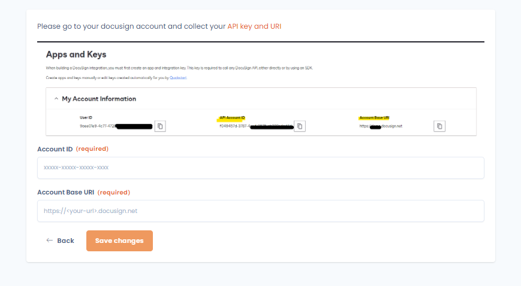
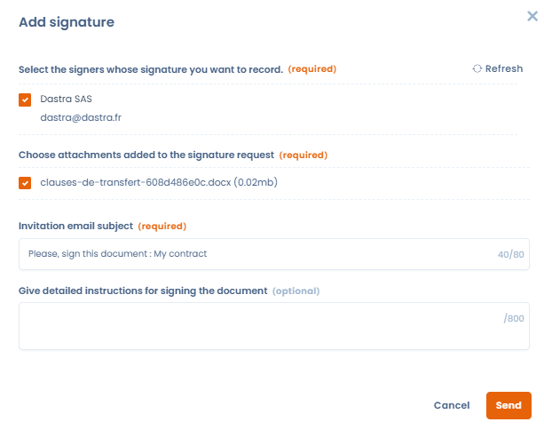

# Docusign-integratie

Dastra heeft een native integratie met DocuSign, de wereldwijde marktleider voor elektronische handtekeningen. Daarmee verstuurt, ondertekent en volgt u de status van een handtekening rechtstreeks vanuit de module Contracten van Dastra.

Om deze integratie in te stellen en beschikbaar te maken in de sectie voor handtekeningen van een contract, gaat u naar de instellingen van uw werkruimte, opent u het tabblad **Integraties** en configureert u de integratie.

Zodra de DocuSign-integratie is geopend, klikt u op **Integratie toevoegen**. U wordt dan doorgestuurd naar de authenticatie van DocuSign om uw DocuSign-account met Dastra te koppelen. Nadat de verbinding is gelegd, vult u in Dastra uw DocuSign-**Account ID** en de **Accountbasis-URI** van uw DocuSign-account in.

<figure><figcaption></figcaption></figure>

Zodra deze velden zijn ingevuld, is de integratie ingesteld. U gaat nu naar de module Contracten en beheert de ondertekening van uw contracten elektronisch.

## Het ondertekeningsvenster van DocuSign

Hieronder ziet u het venster om een contract via DocuSign te ondertekenen. Het opent via de knop **Add signature** naast een ondertekenaar.

Om dit venster te valideren hebt u nodig:

* een actor (ondertekenaar) met een geldig e-mailadres;
* een bijlage om te ondertekenen, in PDF-, DOC- of DOCX-indeling;
* een titel voor de uitnodigings-e-mail voor de ondertekening.

U kunt ook gedetailleerde instructies voor de ondertekening toevoegen. Die instructies staan in de uitnodigings-e-mail en zijn zichtbaar voor de ondertekenaar in de DocuSign-interface wanneer die het document opent om te ondertekenen.

<figure><figcaption></figcaption></figure>

Zodra de handtekening is verstuurd, wordt de status automatisch gesynchroniseerd met uw contract en bijgewerkt bij elke statuswijziging aan de DocuSign-kant.

<figure><figcaption></figcaption></figure>
