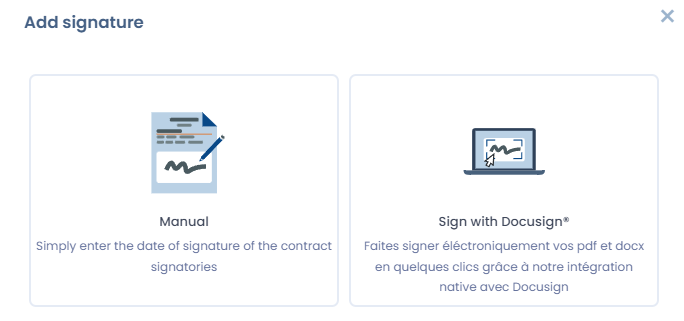
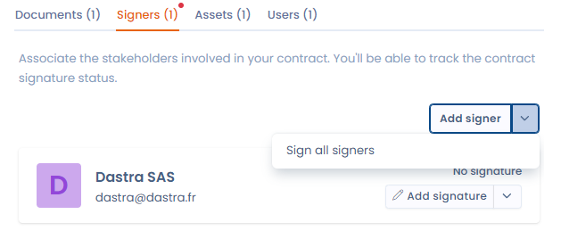
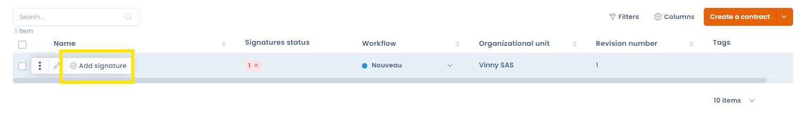
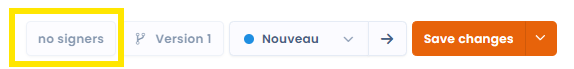
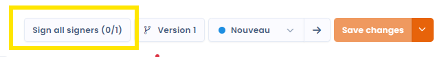
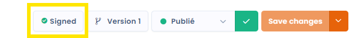

# Het contract ondertekenen

Zodra u ten minste één ondertekenaar aan uw contract hebt toegevoegd ([zie Ondertekenaars](signers.md)), beheert u het ondertekeningsproces van uw contract. Sla het contract eerst op: niet-opgeslagen wijzigingen blokkeren de knop voor ondertekening.

U kunt handtekeningen handmatig registreren of [de integratie met Docusign](docusign.md) gebruiken om het hele elektronische ondertekeningsproces elektronisch af te handelen. Die integratie stroomlijnt de ondertekening en helpt te voldoen aan de vereisten voor elektronische handtekeningen.

<figure><figcaption></figcaption></figure>

Het ondertekeningsmenu opent u op verschillende manieren:

1. Afzonderlijke handtekeningen registreren: u registreert de handtekening van elke ondertekenaar afzonderlijk met de knop **Add signature** naast de ondertekenaar.
2. Meerdere handtekeningen tegelijk registreren: klik op de pijl naast de knop **Add signature** om de ondertekenaars te selecteren voor wie u wilt ondertekenen.
3. Ondertekenen vanuit de tabelweergave: u kunt een contract rechtstreeks vanuit de overzichtstabel ondertekenen.

<figure><figcaption>
Ondertekenen vanuit het tabblad Ondertekenaars van het contract
</figcaption></figure>

<figure><figcaption>
Ondertekenen vanuit de tabelweergave
</figcaption></figure>

## De ondertekeningsknop in het gebied met hoofdacties

In het gebied met hoofdacties van uw contract (zie [Structuur van een contract](structure.md)) staat een knop voor de handtekeningen. Afhankelijk van het aantal ondertekenaars en het aantal ontvangen handtekeningen verandert de status van die knop:

1. Geen ondertekenaars: geef ondertekenaars op om met deze knop te werken.

<figure><figcaption></figcaption></figure>

2. Handtekeningen ontbreken: met deze status registreert u de ontbrekende handtekeningen.

<figure><figcaption></figcaption></figure>

3. Contract ondertekend door alle ondertekenaars: met deze status verwijdert u indien nodig handtekeningen.

<figure><figcaption></figcaption></figure>
