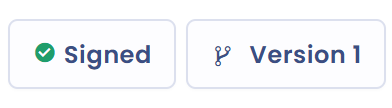

# Een document ondertekenen

Zodra u ten minste één ondertekenaar aan uw document hebt toegevoegd (zie [Ondertekenaars](signers.md)), kunt u de ondertekening beheren. Sla het document eerst op: zolang een wijziging niet is opgeslagen, zijn de knoppen voor ondertekening vergrendeld.

## Handmatige ondertekening of Docusign

Het venster **Add signature** biedt twee modi:

* **Manual**: u meldt dat ondertekenaars hebben ondertekend. Selecteer de ondertekenaars van wie u de handtekening wilt registreren, voer de **Signature date** in en klik op **Add signature**.
* **Sign with Docusign®**: Dastra verstuurt het document ter elektronische ondertekening en volgt de voortgang. Voor deze modus is de [Docusign-integratie](docusign.md) vereist.

<figure><figcaption>
De twee ondertekeningsmodi
</figcaption></figure>

Wanneer elke ondertekenaar een handtekening heeft, vraagt Dastra of u het document wilt publiceren. Bevestig om het document de status **Actief** te geven.

## Het ondertekeningsvenster openen

Het ondertekeningsvenster opent op drie manieren.

### Ondertekenen voor één ondertekenaar

Klik op het tabblad **Signers - Signatories** op **Add signature** in de rij van de betrokken ondertekenaar.

### Ondertekenen voor meerdere ondertekenaars

Klik op de pijl rechts van de knop **Add signer** en vervolgens op **Sign all - Apply all signatures**. U selecteert daarna de ondertekenaars voor wie u de handtekening registreert.

<figure><figcaption>
Ondertekenen voor meerdere ondertekenaars vanaf het tabblad Signers
</figcaption></figure>

### Ondertekenen vanuit het register

Open in het register het menu van de rij van het document en klik op **Add signature**. Deze actie is uitgeschakeld wanneer alle ondertekenaars al hebben ondertekend.

<figure><figcaption>
Ondertekenen vanuit het register
</figcaption></figure>

## De ondertekeningsknop van het register

In het menu met hoofdacties van het register (zie [Structuur van een document](structure.md)) vat een knop de status van de handtekeningen samen. Het label verandert met het aantal ondertekenaars en het aantal ontvangen handtekeningen.

### Geen ondertekenaars

De knop is uitgeschakeld en toont **no signers**. Voeg ondertekenaars toe om hem te gebruiken.

<figure><figcaption>
Geen ondertekenaars
</figcaption></figure>

### Handtekeningen ontbreken

De knop toont **Sign all - Apply all signatures**, gevolgd door het aantal ontvangen handtekeningen ten opzichte van het aantal ondertekenaars. Klik erop om de ontbrekende handtekeningen te melden.

<figure><figcaption>
Handtekeningen ontbreken
</figcaption></figure>

### Document ondertekend door alle ondertekenaars

De knop toont **Signed**. Wanneer u de aanwijzer erop plaatst, wordt het **Delete signature**: na bevestiging verwijdert een klik de handtekeningen, als u ze opnieuw moet registreren.

<figure><figcaption>
Document ondertekend door alle ondertekenaars
</figcaption></figure>
