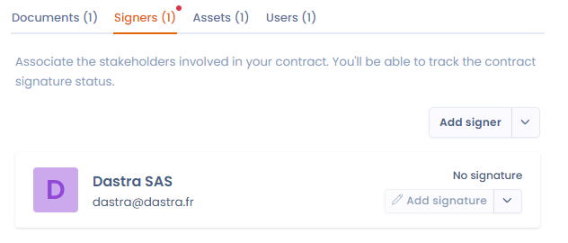

# Ondertekenaars

Geef de partijen bij het contract aan door de vereiste ondertekenaars op te geven.

Een ondertekenaar wordt vertegenwoordigd door een actor uit uw [beheer van actoren](../mapping/README.md). Net als bij activa vindt u op de profielpagina van de actoren (ondertekenaars) die aan uw contract zijn gekoppeld, de details van alle contracten waaraan ze zijn gekoppeld.

<figure><figcaption>
Actoren koppelen als ondertekenaars van uw contract
</figcaption></figure>

U beheert de handtekening van elke ondertekenaar afzonderlijk (zie [Het contract ondertekenen](sign.md)).
