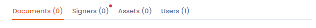
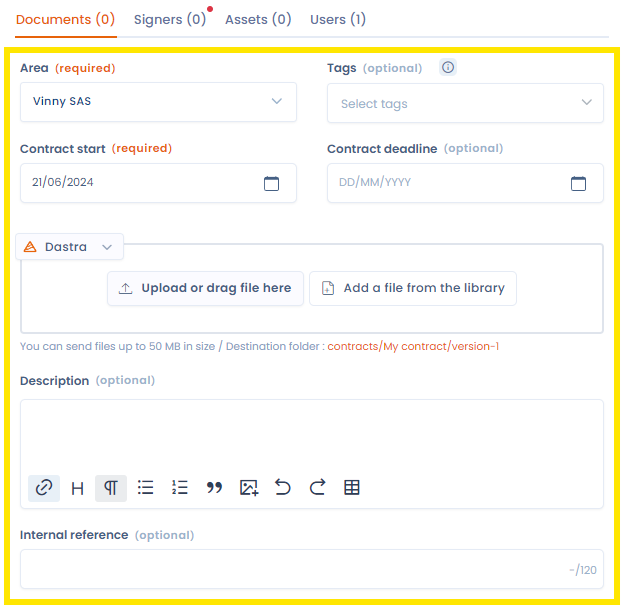
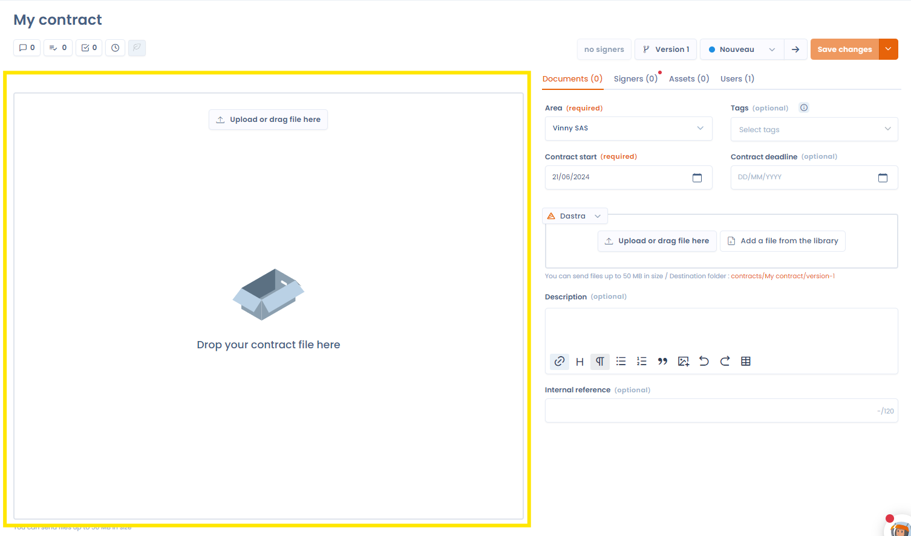

# Structuur van een contract

Zodra uw contract is aangemaakt, wordt u doorgestuurd naar de bewerkingsweergave van het contract.

<figure><figcaption>
Een nieuw contract
</figcaption></figure>

## Structuur van de bewerkingspagina van het contract

### De titel

Linksboven vindt u de bewerkbare titel van uw contract.

### Het menu met hoofdacties

Met het menu met hoofdacties rechtsboven beheert u de handtekeningen, de versies, de stappen van het proces en het opslaan van het contract.

<figure><figcaption>
Het menu met hoofdacties
</figcaption></figure>

### Het snelkoppelingenmenu

Via het snelkoppelingenmenu linksboven opent u ook de interne discussies over het contract, de gekoppelde taken, vragenlijsten, de wijzigingsgeschiedenis en de regelmatige beoordelingen van het contract. Als u vanuit het dashboard van de contracten navigeert en meer dan één contract hebt opgeslagen, kunt u met de pijlknoppen ook van het ene naar het andere contract gaan.

<figure><figcaption>
Het snelkoppelingenmenu
</figcaption></figure>

### Het menu met de in te vullen secties van het contract

Met een menu rechtsboven navigeert u tussen de verschillende in te vullen secties van het contract, zoals documenten, activa, ondertekenaars en gebruikers.

<figure><figcaption>
De secties van het contract
</figcaption></figure>

### Het bewerkingsgebied voor de velden van de secties

Een contract bestaat momenteel uit vier secties: documenten, activa, ondertekenaars en gebruikers. De in te vullen velden van elke sectie staan aan de rechterkant van het scherm en veranderen wanneer u met het sectiemenu van de ene sectie naar de andere gaat.

<figure><figcaption>
Het bewerkingsgebied voor de velden
</figcaption></figure>

### Voorbeeld van de documenten

In dit gebied bekijkt u een voorbeeld van de documenten van uw contract (het hoofdcontract en eventuele bijlagen).

<figure><figcaption>
Het gebied met het voorbeeld van de documenten
</figcaption></figure>
