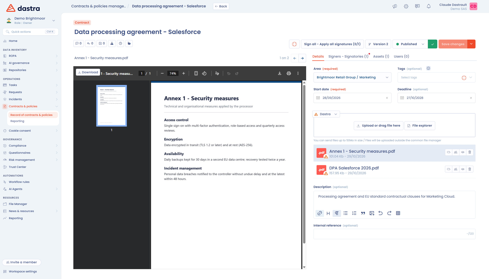

# Structuur van een document

Zodra uw document is aangemaakt, opent Dastra het bijbehorende dossier (zie [Een document aanmaken](declare.md)). Het voorbeeld van het bestand staat links op het scherm en de invoertabbladen staan rechts.

<figure><figcaption>
Het dossier van een nieuw aangemaakt document
</figcaption></figure>

## De titel en het type

De bewerkbare titel van het document staat linksboven. Boven de titel staat het typelabel (contract, beleid, kennisgeving, procedure of anders): klik erop om het type te wijzigen.

<figure><figcaption>
Het type, de titel, de snelkoppelingen en de hoofdacties
</figcaption></figure>

## Het snelkoppelingenmenu

Onder de titel, links, geeft het snelkoppelingenmenu toegang tot de elementen die aan het document zijn gekoppeld:

* de interne discussies;
* de gekoppelde taken, als taakbeheer actief is;
* het auditlogboek, als audit actief is, en de activiteitengeschiedenis van het document (**Historisch**);
* de gekoppelde conformiteitstests, als de module Conformiteit actief is (zie [Details en bijlagen](documents.md));
* de regelmatige beoordeling van het document (zie [Regelmatige beoordeling van documenten](review.md)).

Als u vanuit het register komt, kunt u met pijlen van het ene document naar het andere gaan.

## De hoofdacties

Het menu met hoofdacties, rechtsboven, bevat:

* de knop **AI analysis (beta)**: die opent de AI-analyse van het document. Deze functie is in bèta, vereist de functies AI-analyse en AI-agent en de resultaten moeten voorzichtig worden geïnterpreteerd;
* de ondertekeningsknop, waarvan het label de status van het document volgt (zie [Een document ondertekenen](sign.md));
* de knop **Version** gevolgd door het versienummer, die het versiebeheer opent (zie [Documentversies](versions.md));
* de keuzelijst voor de stap van het proces;
* de knop **Opslaan**.

De pijl rechts van **Opslaan** opent drie acties:

* **Delen**: een deellink voor het document aanmaken.
* **Exporteren**: het document exporteren (zie [Contracten en beleidslijnen](README.md#importeren-en-exporteren)).
* **Verplaats naar de prullenbak**: het document in de prullenbak plaatsen.

Een document in de prullenbak draagt het label **In de prullenbak**. Hetzelfde menu biedt dan **Herstellen** om het document terug te zetten in het dossier en **Verwijderen** om het te verwijderen.

<figure><figcaption>
De acties van de knop Opslaan
</figcaption></figure>

## De invoertabbladen

Rechts op het scherm staan vier tabbladen. Hun inhoud verandert wanneer u van het ene naar het andere gaat:

* **Details**: de algemene informatie, de bijlagen en de aangepaste velden (zie [Details en bijlagen](documents.md)).
* **Signers - Signatories**: de partijen die het document ondertekenen (zie [Ondertekenaars](signers.md)).
* **Actief**: de activa waarop het document betrekking heeft (zie [Activa](assets.md)).
* **Users**: de gebruikers van de werkruimte die aan het document werken (zie [Gekoppelde gebruikers](users.md)).

Behalve bij **Details** toont elk tabblad tussen haakjes het aantal elementen dat het bevat.

<figure><figcaption>
De tabbladen van een documentdossier
</figcaption></figure>

## Het voorbeeld van de bijlagen

Het gebied links toont een voorbeeld van de bestanden van het document: het contract of beleid en eventuele bijlagen. Het blijft zichtbaar, welk tabblad ook open is. Heeft het document nog geen bestand, dan kunt u een bestand neerzetten of een beleid schrijven.
