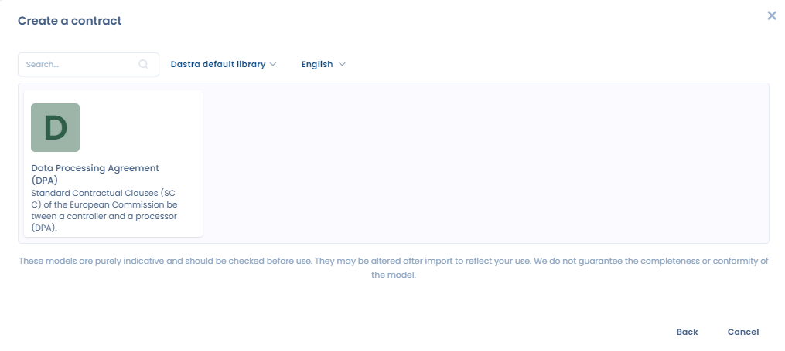
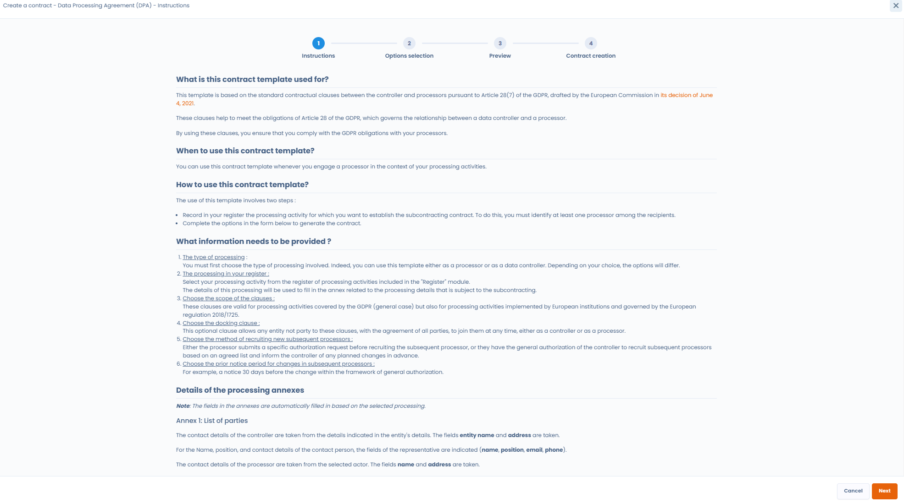
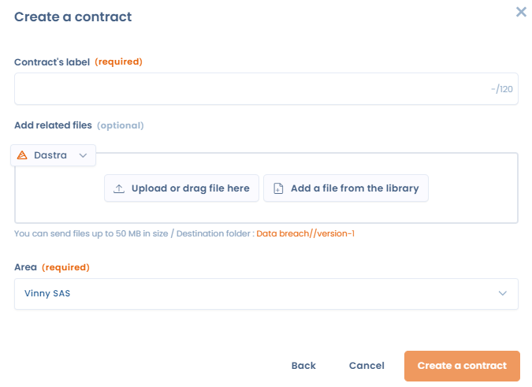
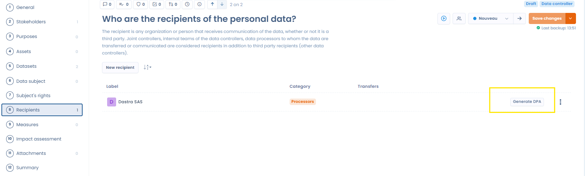

# Contractsjablonen

## Onze contractsjablonen gebruiken

Wanneer u [een contract in Dastra aanmaakt](declare.md), kiest u bij het aanmaken de optie om een contract te genereren, zodat u een van onze dynamische contractsjablonen gebruikt. U krijgt dan toegang tot de lijst met alle sjablonen die we aanbieden, zoals het sjabloon met de standaardcontractbepalingen voor uw verwerkersovereenkomsten (DPA).

Met ons sjabloon met standaardbepalingen voldoet u bijvoorbeeld aan de verplichtingen van de AVG tegenover uw verwerkers en genereert u een volledig contract dat dynamisch wordt ingevuld met informatie uit uw verwerkingsregister en uw repositories.

<figure><figcaption>
Het te gebruiken contractsjabloon selecteren
</figcaption></figure>

Nadat u het sjabloon hebt geselecteerd, wordt u doorgestuurd naar een formulier waarin u de nodige informatie invult om het sjabloon aan te vullen. Dit formulier is specifiek voor elk sjabloon en hangt af van de velden die dynamisch in het sjabloon worden ingevuld.

Bij een DPA wordt u bijvoorbeeld gevraagd de verwerkingsactiviteit uit uw register te kiezen waarop de DPA betrekking heeft, de verwerker (vermeld in het verwerkingsregister) te selecteren met wie u het contract wilt sluiten en diverse vragen te beantwoorden over optionele keuzes of bepalingen die in het contract moeten komen.

<figure><figcaption>
Beantwoord enkele vragen om het sjabloon in te vullen
</figcaption></figure>

Nadat u deze vragen hebt beantwoord, wordt uw contract automatisch gegenereerd en dynamisch ingevuld met alle nodige informatie. Doordat uw register en repositories volledig zijn, is de informatie in het contractsjabloon relevant.

Daarna kunt u het document in een voorbeeldweergave aanpassen of opmaken.

<figure><figcaption>
U kunt het document dat we automatisch genereren nakijken en bewerken voordat u het definitief valideert.
</figcaption></figure>

Bent u tevreden met uw document, dan geeft u het contract een titel, kiest u het formaat voor het genereren (.docx of .pdf), kiest u de opslaglocatie en klikt u op **Een document aanmaken**.

<figure><figcaption>
Het contract wordt aangemaakt en automatisch toegevoegd aan uw contracten. U wordt automatisch doorgestuurd naar de bewerkingsweergave van het nieuwe contract.
</figcaption></figure>

## Gebruiksscenario: een verwerkersovereenkomst (DPA) genereren vanuit een verwerkingsactiviteit

In plaats van te beginnen in de module Contracten, het DPA-sjabloon te selecteren en daar de verwerkingsactiviteit en de verwerker van het contract in te vullen, kunt u het proces ook rechtstreeks starten vanuit de betreffende verwerkingsactiviteit.

Selecteer daarvoor de verwerkingsactiviteit waarvoor u een DPA wilt opstellen en ga naar de sectie **Ontvangers**. Kies de ontvanger van het type verwerker met wie u de DPA wilt sluiten en klik op **Genereer een VWO**.

<figure><figcaption>
Genereer rechtstreeks vanuit een verwerkingsactiviteit een verwerkersovereenkomst (DPA) met een verwerker.
</figcaption></figure>

U wordt dan doorgestuurd naar onze contractgeneratie, waarin het DPA-sjabloon automatisch is geselecteerd en is ingesteld met de verwerkingsactiviteit en de verwerker waarop u hebt geklikt. Dezelfde actie is mogelijk voor een verwerkingsactiviteit van het type verwerker wanneer u een DPA met een klant opstelt (vanuit het tabblad van de klant).
