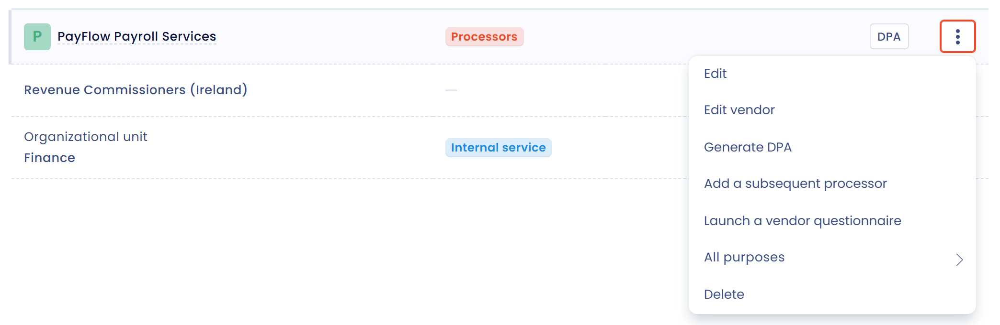
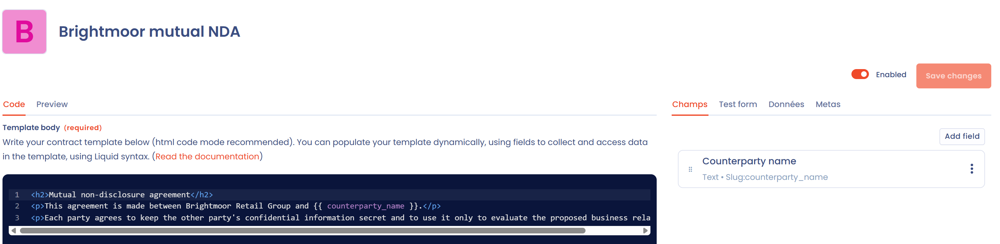

# Contractsjablonen

## Een sjabloon gebruiken

Wanneer u [een document in Dastra aanmaakt](declare.md), kiest u de optie **Generate document** om een dynamisch sjabloon te gebruiken. U krijgt de lijst met beschikbare sjablonen, zoals het sjabloon met de standaardcontractbepalingen voor uw verwerkersovereenkomsten (DPA).

Met het sjabloon met standaardbepalingen wordt het document ingevuld met informatie uit uw verwerkingsregister en uw referentiedatabases. Hoe completer die zijn, hoe relevanter het gegenereerde document is.

<figure><figcaption>
Selecteer het te gebruiken sjabloon
</figcaption></figure>

Nadat u het sjabloon hebt geselecteerd, leidt een paneel u door meerdere stappen. Met de knoppen **Volgende** en **Vorige** gaat u vooruit of terug.

1. **Instructies**: de toelichting bij het sjabloon, als het die heeft.
2. **Opties selectie**: een formulier dat specifiek is voor elk sjabloon en afhangt van de in te vullen velden. Bij de DPA kiest u de betreffende verwerkingsactiviteit uit het register en de verwerker met wie u de overeenkomst sluit, en beantwoordt u vragen over optionele bepalingen. Klik op **Fill in the template** om naar de volgende stap te gaan.
3. **Voorbeeld**: het gegenereerde document. Klik op **Bewerken** om de inhoud of de opmaak te wijzigen. Dastra waarschuwt u dat bewerken opmaakelementen van het sjabloon kan verwijderen.

<figure><figcaption>
Beantwoord de vragen van het sjabloon
</figcaption></figure>

Vul in de stap **Voorbeeld** de **Documentnaam** en de **Organisatie-eenheid** in. Selecteer de opslaglocatie en het formaat van het gegenereerde bestand, **PDF-bestand (.pdf)** of **Word (.docx)**, en klik daarna op **Een document aanmaken**.

<figure><figcaption>
Controleer en bewerk het document voordat u het aanmaakt
</figcaption></figure>

Dastra maakt het document aan, voegt het toe aan het register en opent de bijbehorende pagina.

## Een DPA genereren vanuit een verwerkingsactiviteit

U kunt ook beginnen bij de betreffende verwerkingsactiviteit, zonder via de module **Contracten en beleidslijnen** te gaan. Open de verwerkingsactiviteit en daarna de stap **Ontvangers**. Open op de rij van de ontvanger van het type verwerker met wie u de DPA sluit het menu en klik op **Genereer een VWO**. Voor deze actie hebt u de machtiging nodig om contracten te schrijven.

<figure><figcaption>
Een DPA met een verwerker genereren vanuit een verwerkingsactiviteit
</figcaption></figure>

Dastra opent de generatie met het DPA-sjabloon al geselecteerd en ingevuld met de verwerkingsactiviteit en de verwerker die u hebt gekozen. Dezelfde actie bestaat in een verwerkingsactiviteit van het type **Verwerker**, om vanuit het tabblad van de klanten een DPA met een klant op te stellen.

## Uw eigen sjablonen maken

Het onderdeel **Documentmodellen** van de module toont de sjablonen van uw werkruimte. Elke kaart toont de naam van het sjabloon, de status (**Actief** of **Uitgeschakeld**) en de categorie. Het kaartmenu biedt **Bewerken**, **Exporteren** en **Permanent verwijderen**.

Een sjabloon maken:

1. Klik op **Documentmodel toevoegen**.
2. Kies **Vanaf nul** en voer het **Template label** in, of importeer met **Het bestand verzenden** een JSON-bestand dat is geëxporteerd uit een ander sjabloon.
3. Dastra opent de sjablooneditor.

In de editor schrijft u de **Body van de template** in HTML. Met de syntaxis van [Liquid](https://shopify.github.io/liquid/) voegt u de antwoorden in die het formulier van het sjabloon verzamelt. U definieert deze velden met **Veld toevoegen**, samen met de instructies bovenaan het formulier, de taal, de categorie en de beschrijving van het sjabloon. Met een voorbeeld en een testformulier controleert u het resultaat voordat u het sjabloon publiceert.

Zet de schakelaar **Actief** aan en klik daarna op **Opslaan** om het sjabloon beschikbaar te maken in de optie **Generate document**. Een uitgeschakeld sjabloon wordt bij het aanmaken niet aangeboden.

<figure><figcaption>
De editor voor documentsjablonen
</figcaption></figure>
