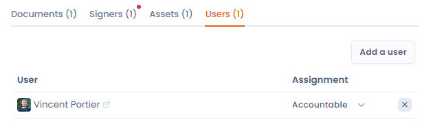

# Gekoppelde gebruikers

U kunt gebruikers van uw werkruimte aan uw contract koppelen om rollen te bepalen: **Goedkeurder**, **Verantwoordelijk** of **Op de hoogte**.

U bepaalt de rollen van uw gebruikers in uw contracten als volgt:

1. **Goedkeurder**: de gebruiker in Dastra die controleert of het contract en de bijbehorende elementen, zoals ze in Dastra zijn gedocumenteerd, aan de verwachtingen van de organisatie voldoen. Deze rol kan verschillen van de ondertekenaar van het contract.
2. **Verantwoordelijk**: de gebruiker die de acties uitvoert die nodig zijn om aan de vereisten van het contract te voldoen. Dat kunnen maatregelen voor gegevensbeveiliging zijn, het beheer van toegangsrechten of andere taken om de naleving van de contractvoorwaarden te garanderen.
3. **Op de hoogte**: gebruikers die op de hoogte moeten blijven van de voortgang en de status van het contract, maar geen actieve rol hebben bij de goedkeuring of uitvoering ervan. Denk aan leden van het managementteam, projectleiders of andere belanghebbenden die belang hebben bij een goede uitvoering van het contract.

<figure><figcaption>
Gebruikers aan uw contract koppelen
</figcaption></figure>
