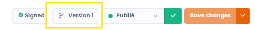
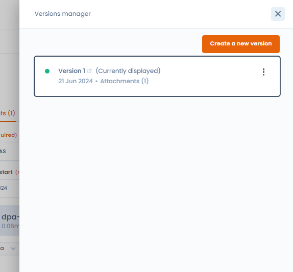
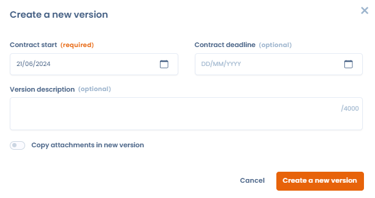
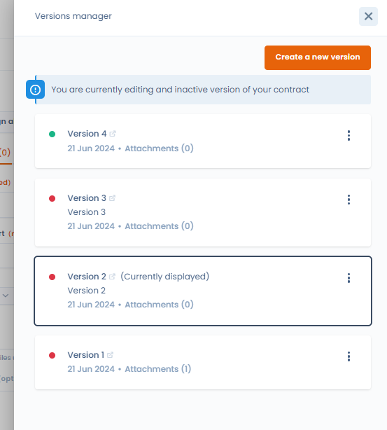
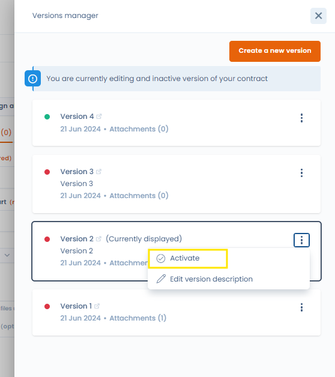
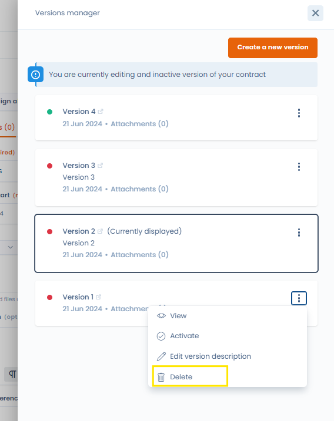

# Contractversies

Om wijzigingen, bijwerkingen of verlengingen van uw contract bij te houden, versioneert u uw contract.

Elke versie heeft een revisienummer dat automatisch oploopt wanneer een versie wordt aangemaakt. U ziet dit revisienummer in de overzichtstabel van uw contracten.

Een contract heeft op elk moment maar één actieve versie. Dat is de versie die in de overzichtstabel wordt weergegeven (inactieve versies staan niet in de overzichtstabel).

Met het versiebeheer van het contract navigeert u tussen de verschillende versies van een contract. U bekijkt eerdere versies van uw contract op het scherm en activeert op elk moment een versie, ook een latere.

## Versiebeheer

Wanneer u een contract aanmaakt, maken we standaard versie 1 van dat contract aan. Die is zichtbaar in het menu met hoofdacties van het contract.

<figure><figcaption>
Knop om het versiebeheer te openen
</figcaption></figure>

Met deze knop opent u het versiebeheer.

<figure><figcaption></figcaption></figure>

In dit menu bekijkt en beheert u alle versies van uw contract en maakt u nieuwe versies aan met **Stel een nieuwe versie in**.

## Een nieuwe versie aanmaken

Met **Stel een nieuwe versie in** maakt u een nieuwe versie aan door de volgende gegevens op te geven:

<figure><figcaption>
Het formulier om een versie aan te maken
</figcaption></figure>

Wanneer u een nieuwe versie aanmaakt, geldt het volgende:

* De naam, de beschrijving, de organisatorische eenheid, de activa, de ondertekenaars en de gebruikers van het contract blijven behouden in de nieuwe versie.
* U geeft de begin- en einddatum van het contract voor de nieuwe versie op (die u later kunt wijzigen) en u kunt een beschrijving van deze nieuwe versie toevoegen.
* Voor de bijlagen van uw contract kiest u of ze naar de nieuwe versie worden overgenomen, door het vakje **Copy attachments in new version** aan te vinken.
* De nieuwe versie wordt aangemaakt op basis van de versie die op het scherm wordt weergegeven wanneer u op **Stel een nieuwe versie in** klikt. Controleer dus dat u zich in de versie bevindt waarvan u de nieuwe versie wilt afleiden.
* De nieuwe versie wordt automatisch de actieve versie van uw contract (de versie die in de overzichtstabel van de contracten zichtbaar is).

## Een versie bekijken

1. Open het versiebeheer.
2. Klik op het menu met drie puntjes naast de versie die u wilt bekijken.
3. Selecteer **Tonen**.

Houd rekening met het volgende:

* U kunt een versie die niet de actieve versie van uw contract is, bekijken en wijzigen.
* De actieve versie is de referentieversie van uw contract en er is er maar één. Ze is in het versiebeheer gemarkeerd met een groene stip. Onderscheid haar van de versie die op dat moment wordt weergegeven.
* Inactieve versies van het contract zijn in het versiebeheer gemarkeerd met een rode stip.

<figure><figcaption>
Hoewel versie 4 de actieve versie is, kunt u versie 2 nog steeds bekijken en bewerken.
</figcaption></figure>

## Een versie actief maken

Wanneer u een nieuwe versie aanmaakt, wordt die automatisch de actieve en de weergegeven versie.

U maakt zelf een versie actief via het versiebeheer, met de optie **Activate** van de gewenste versie.

<figure><figcaption>
Versie 2 instellen als actieve of hoofdversie
</figcaption></figure>

## Verwijderen

U kunt op elk moment een inactieve versie van het contract verwijderen met **Verwijderen** in het menu van de versie.

<figure><figcaption></figcaption></figure>

U kunt de actieve versie van het contract en de versie die op dat moment wordt weergegeven, niet verwijderen.

Als u een contract verwijdert vanuit de overzichtstabel van de module Contracten, worden de actieve versie en alle inactieve versies van het contract verwijderd.
