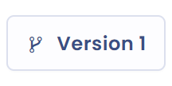
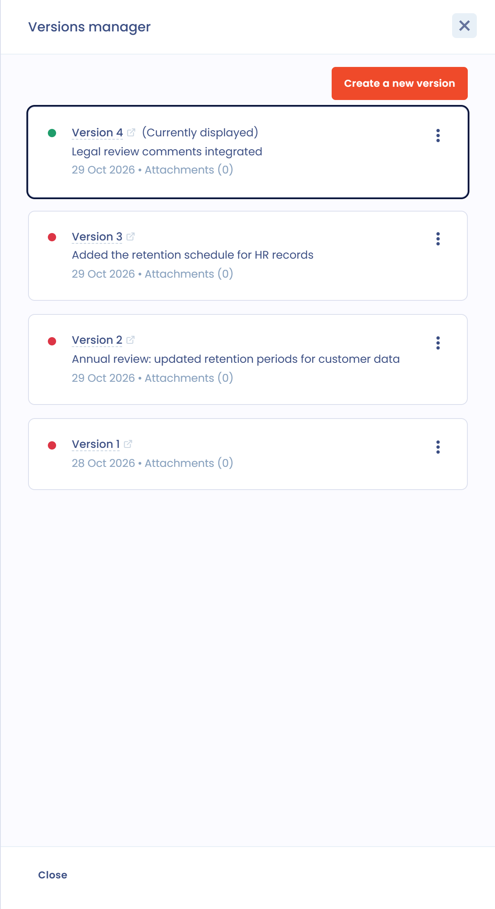
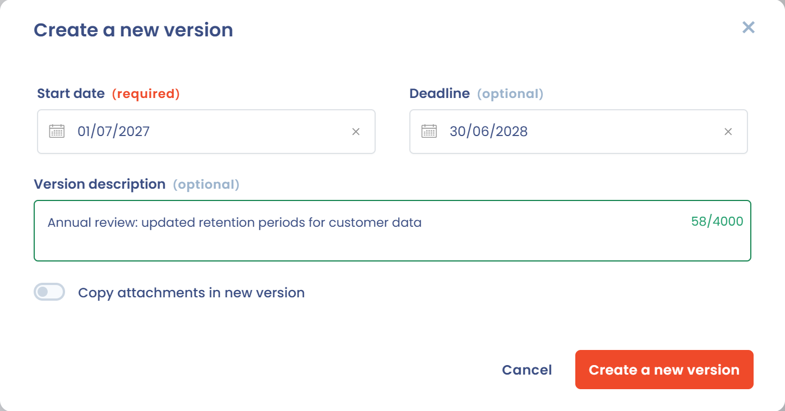

# Documentversies

Om wijzigingen, bijwerkingen of verlengingen van een document bij te houden, maakt u er een nieuwe versie van.

Elke versie heeft een revisienummer dat automatisch oploopt wanneer een versie wordt aangemaakt. Dit nummer is zichtbaar in het dossier. Een document heeft op elk moment maar één actieve versie: dat is de versie die het dossier toont, inactieve versies staan er niet in.

In het versiebeheer navigeert u tussen de versies van een document, geeft u een eerdere versie weer en maakt u op elk moment een versie actief, ook een recentere.

## Het versiebeheer

Wanneer u een document aanmaakt, maakt Dastra versie 1 ervan aan. De knop **Version** gevolgd door het nummer, in het menu met hoofdacties, opent het versiebeheer.

<figure><figcaption>
De knop die het versiebeheer opent
</figcaption></figure>

Het versiebeheer toont alle versies van het document. Elke kaart toont het versienummer, de beschrijving, de aanmaakdatum en het aantal bijlagen. Een stip geeft de status van de versie aan: groen voor de versie die **Actief** is, rood voor een versie die **Uitgeschakeld** is. De vermelding **(Currently displayed)** markeert de versie die u op het scherm bekijkt.

<figure><figcaption>
Het versiebeheer
</figcaption></figure>

## Een nieuwe versie aanmaken

De nieuwe versie wordt aangemaakt op basis van de versie die op dat moment wordt weergegeven: ga dus eerst naar de versie waarvan u wilt uitgaan.

1. Klik in het versiebeheer op **Stel een nieuwe versie in**.
2. Voer de **Startdatum** in en, indien nodig, de **Einddatum**. U kunt ze later nog wijzigen.
3. Voeg desgewenst een **Beschrijving van de versie** toe.
4. Zet **Copy attachments in new version** aan om de bestanden over te nemen.
5. Klik op **Stel een nieuwe versie in**.

<figure><figcaption>
Het venster om een versie aan te maken
</figcaption></figure>

De naam, de beschrijving, de organisatorische eenheid, de activa, de ondertekenaars en de gebruikers van het document blijven behouden in de nieuwe versie. De aangemaakte versie wordt de actieve versie en de weergegeven versie.

## Een versie bekijken

Open in het versiebeheer het menu van de versie (de drie puntjes) en klik op **Tonen**. Deze actie wordt niet aangeboden voor de versie die al wordt weergegeven.

U kunt een versie die niet de actieve versie is, bekijken en bewerken. Dastra herinnert u daaraan met een bericht in het versiebeheer en met de vermelding **Inactieve versie** boven de tabbladen van het dossier. Onderscheid de actieve versie, die uniek is en de referentie vormt, van de weergegeven versie.

<figure><figcaption>
Versie 4 is de actieve versie, maar u kunt versie 2 bekijken en bewerken
</figcaption></figure>

## Een versie actief maken

Een aangemaakte versie wordt automatisch de actieve versie. Om een andere versie actief te maken, opent u het menu ervan in het versiebeheer en klikt u op **Activate**. Deze actie wordt alleen aangeboden voor inactieve versies.

<figure><figcaption>
Een versie als actieve versie instellen
</figcaption></figure>

## De beschrijving van een versie wijzigen

Om de beschrijving van een bestaande versie te wijzigen, opent u het menu ervan en klikt u op **Edit version description**. Pas de tekst aan in het venster dat opent en klik daarna op **Edit version**.

## Een versie verwijderen

Open het menu van een inactieve versie en klik op **Verwijderen**. U kunt de actieve versie en de versie die op dat moment wordt weergegeven niet verwijderen: geef een andere versie weer om deze te verwijderen.

<figure><figcaption>
Een versie verwijderen
</figcaption></figure>

Wanneer u een document verwijdert, worden de actieve versie en alle inactieve versies ervan verwijderd.
