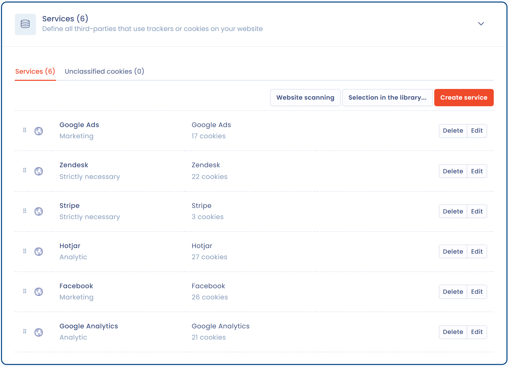
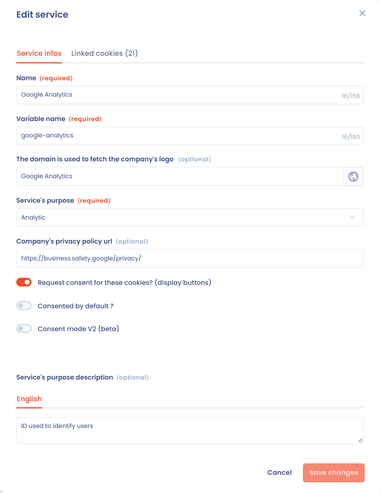

# Cookies classificeren op toestemmingscategorie

In haar [ontwerpaanbeveling](https://www.cnil.fr/fr/la-cnil-lance-une-consultation-publique-sur-son-projet-de-recommandation-cookies-et-autres-traceurs) over cookies en andere trackers (in het Frans) raadt de CNIL aan de cookies op uw website op te sommen en in te delen naargelang ze toestemming vereisen of niet.


Meer informatie over de aanbevelingen van de CNIL over cookies vindt u in het artikel "[De aanbevelingen van de CNIL over cookies uitgelegd aan uw baas](https://www.dastra.eu/fr/article/recommendations-CNIL-cookies-expliquees-a-votre-boss/104)" (in het Frans).


In Dastra is de categorie van een cookie de categorie van de dienst waartoe het behoort: u kiest het **doel** van elke dienst en alle cookies ervan nemen dat over. De beschikbare categorieën zijn:

* **Strikt noodzakelijk**: cookies die van nature van toestemming zijn vrijgesteld, bijvoorbeeld sessie- of toestemmingscookies;
* **Voorkeuren**;
* **Analyse van het publiek**;
* **Marketing en gebruikerservaring**;
* **Sociale netwerken**;
* **Andere**.


[De doeleinden van cookies](purposes.md)


## Het doel van een dienst kiezen

1. Open de banner: **Toestemming voor cookies** > **Banners** en klik daarna op de banner.
2. Klap de sectie **Diensten** uit.
3. Klik op de dienst die u wilt classificeren. Kies op het tabblad **Basisinformatie** een waarde in het veld **Doel van deze dienst**.
4. Bevestig en klik daarna op **Opslaan**.

<figure><figcaption>
Het doel van elke dienst staat onder de naam ervan
</figcaption></figure>

<figure><figcaption>
Het veld "Doel van deze dienst" in het formulier van een dienst
</figcaption></figure>

Een dienst kan niet worden opgeslagen met het doel **Niet geclassificeerd**: kies een van de bovenstaande categorieën.


U bepaalt per dienst of toestemming moet worden gevraagd, met de optie **Toestemming vragen voor deze cookies? (knopweergave)**. Voor de categorie **Strikt noodzakelijk** is die optie uitgeschakeld.



Een cookie die de scan heeft gevonden maar die niet aan een dienst is gekoppeld (niet-geclassificeerde cookie), wordt nooit in de openbare banner getoond. Voeg hem toe aan een bestaande dienst of maak er een dienst van: zie [Niet-geclassificeerde cookies verwerken](scan.md#niet-geclassificeerde-cookies-behandelen).


Zodra al uw cookies tot een dienst behoren die per categorie is geclassificeerd, kunt u de banner configureren.


[De cookietoestemmingsbanner instellen](configure.md)

