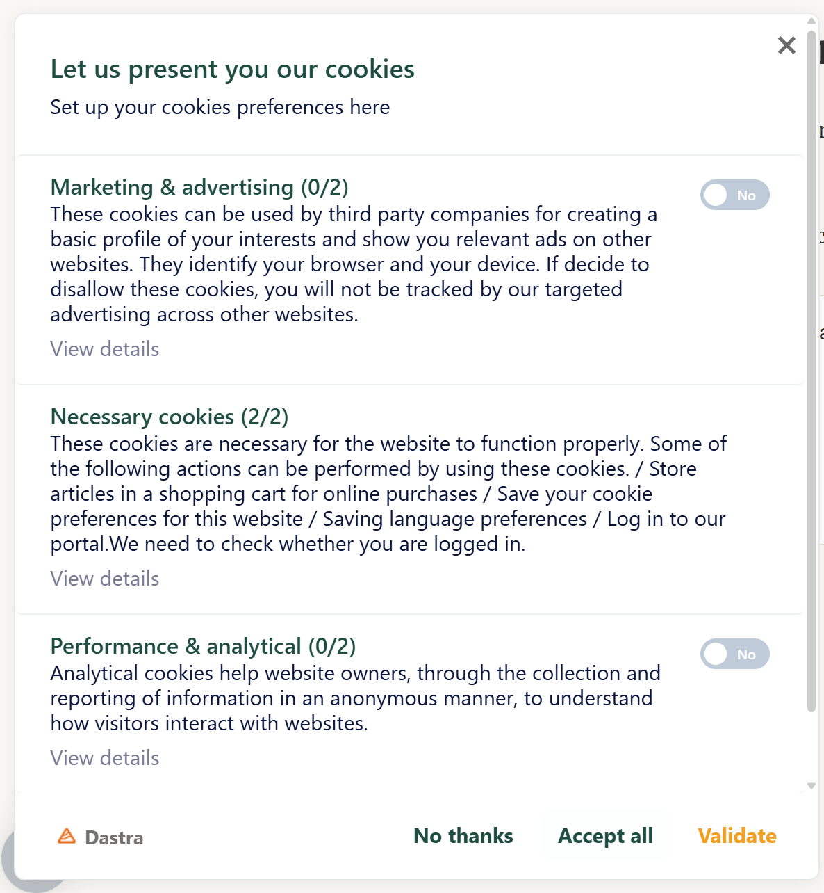
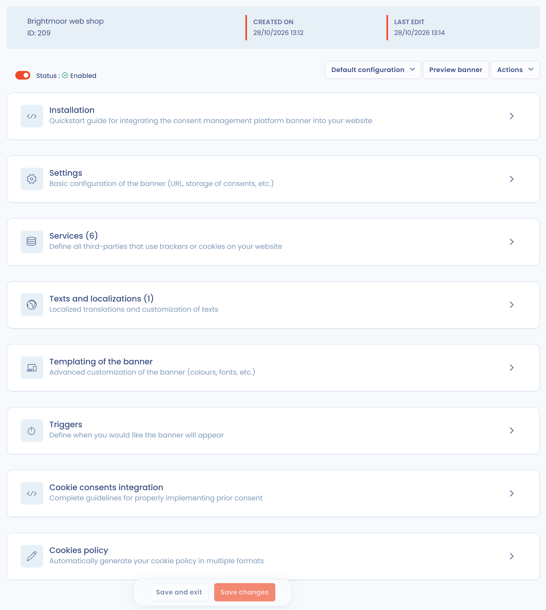

# De cookietoestemmingsbanner instellen

Met Dastra stelt u op uw website een cookietoestemmingsbanner in die de aanbevelingen van de CNIL (de Franse gegevensbeschermingsautoriteit) over cookies en andere trackers volgt.

## Waaruit de cookietoestemmingsbanner bestaat

De banner bestaat uit meerdere elementen:

* een zwevende knop "cookies", die zichtbaar blijft zodat bezoekers hun keuzes kunnen wijzigen;
* een uitklapbaar introductievenster;
* de lijst van de cookies die de site gebruikt, per doel.

<figure><figcaption><p>De zwevende knop</p></figcaption></figure>

<figure><figcaption><p>Het introductievenster</p></figcaption></figure>

<figure><figcaption><p>De lijst van cookies per doel</p></figcaption></figure>

## Vereisten

Om de banner in te stellen moet u eerst de cookies op uw website **identificeren** en per doel **classificeren**. De module **Toestemming voor cookies** brengt alle stappen samen, van deze vereisten tot de code die u moet installeren.

Om de cookies op uw website te scannen, gaat u naar de volgende pagina:


[De op uw website geplaatste cookies scannen](scan.md)


Om cookies op toestemmingscategorie te classificeren, gaat u naar de volgende pagina:


[Cookies classificeren op toestemmingscategorie](classify.md)


## De bannereditor openen

1. Klik in het menu op **Toestemming voor cookies** > **Banners**.
2. Klik op de banner die u wilt bewerken.

De editor is één pagina met inklapbare secties: **Installatie**, **Configuratie**, **Diensten**, **Teksten en vertalingen**, **Uiterlijk van de widget**, **Triggers**, **Integratie van toestemming** en **Cookiebeleid**. De secties **Installatie** en **Configuratie** bestaan alleen voor de standaardconfiguratie: een [geogerichte variant](geo-targeting.md) toont ze niet.

<figure><figcaption><p>De bannereditor</p></figcaption></figure>

Bovenaan de editor:

* met de schakelaar **Status** zet u de banner aan (**Actief**) of uit (**Uitgeschakeld**);
* de keuzelijst met varianten toont **Standaardconfiguratie** en laat u [een geogerichte variant maken](geo-targeting.md);
* **Voorbeeld** toont de banner op een pagina van uw website (zie [De integratie van een banner testen](../integration/test.md)). De knop is uitgeschakeld zolang er geen enkele URL is ingevuld in **Geautoriseerde URL's (CORS)**;
* **Opslaan** en **Opslaan en stoppen** publiceren uw wijzigingen;
* het menu **Acties** geeft toegang tot **Het verzamelen van bewijs van toestemming opnieuw instellen** en **Verwijderen**.


Om een banner te dupliceren, gebruikt u het menu rechts van de banner in de lijst met banners.


## Naslag van de instellingen

### Configuratie

De sectie **Configuratie** bevat de basisinstellingen van de banner.

<figure><figcaption><p>De sectie "Configuratie"</p></figcaption></figure>

| Instelling | Doel |
| --- | --- |
| **Kies een naam voor deze widget** | Naam van de banner in de lijst. |
| **Geautoriseerde URL's (CORS)** | Verplicht veld. Vul het adres in van elke website die de banner toont, in de vorm `https://www.example.com`, zonder pad. Het adres moet exact overeenkomen met de oorsprong van de site: `www.example.com` en `example.com` zijn twee verschillende adressen. Een oorsprong die in deze lijst ontbreekt, is de eerste oorzaak van een banner die niet verschijnt. |
| **Automatisch cookiebeleid genereren?** | Als deze optie is ingeschakeld, biedt de banner een link naar het cookiebeleid dat Dastra genereert. Anders vult u het adres van uw eigen beleid in bij **Voer een geldige url van het cookiebeleid in**. |

Het blok met geavanceerde instellingen bevat de volgende opties.

| Instelling | Doel |
| --- | --- |
| **Preview-modus** | Schakelt de cache van de configuratie en het verzamelen van statistieken uit. Laat deze optie in productie niet ingeschakeld. |
| **Schakel de bannerweergave uit (alle cookies met standaardtoestemming worden geactiveerd)** | Toont geen banner: alle diensten worden toegepast met hun standaardtoestemming. Gebruik deze optie alleen voor gebieden zonder voorafgaande toestemmingsplicht. |
| **Activeer de Global Privacy Control (GPC)** | Weigert automatisch niet-essentiële cookies voor bezoekers van wie de browser het GPC-signaal verstuurt. Zie [US Privacy](us-privacy.md). |
| **Bewijs van toestemming opslaan** | Als deze optie is uitgeschakeld, bewaart Dastra geen bewijs van toestemming en geen weergavestatistieken. |
| **Levensduur van toestemmingscookie (standaard 180 dagen)** | Van 1 tot 365 dagen. Na afloop wordt de banner opnieuw getoond. |
| **LocalStorage inschakelen voor cookies op basis van toestemming** | Slaat de keuzes op in de `localStorage` van de browser in plaats van in een cookie. De toestemming wordt dan niet gedeeld tussen subdomeinen. |
| **Cookie domein (standaard het subdomein van de pagina)** | Beschikbaar bij opslag in een cookie. Vul bijvoorbeeld `.example.com` in om de toestemming te delen tussen alle subdomeinen. |
| **Naam van de cookie voor de opslag van toestemming (standaard 'consent-eu')** | Naam van de cookie, of van de `localStorage`-sleutel, die de keuzes van de bezoeker bevat. |

### Diensten

De sectie **Diensten** toont de diensten die in de banner zijn gedeclareerd. Klik op **Scannen van cookies** om de site opnieuw te scannen, op **Selectie in de bibliotheek...** om een dienst uit de Dastra-bibliotheek toe te voegen, of op **Voeg een dienst toe** om er een te maken. Zie [Cookies classificeren](classify.md) en [Cookies scannen](scan.md).

### Teksten en vertalingen

In deze sectie voegt u talen toe en bewerkt u de teksten van de banner. Zie [Taalbeheer](../integration/languages.md).

### Uiterlijk van de widget

Hier stelt u het uiterlijk van de banner in. Het voorbeeld rechts wordt tijdens het bewerken bijgewerkt.

<figure><figcaption><p>De sectie "Uiterlijk van de widget"</p></figcaption></figure>

| Instelling | Doel |
| --- | --- |
| **Positie van de widget** | Vijf posities: **Linksboven**, **Rechtsboven**, **Gecentreerd**, **Linksonder**, **Rechtsonder**. |
| **Primaire kleur**, **Popup achtergrondkleur**, **Kleur hoofdtekst**, **Kleur van de titels**, **Kleur van de knoppen**, **'Accepteer knop' kleur** | Kleuren van de banner. |
| **Naam van het lettertype (u kunt de naam van een lettertype op uw site plaatsen)** | Lettertype van de banner: een standaard webfont of een lettertype dat op uw website is geïnstalleerd. |
| **De widgetknop aanpassen** | Vervangt de openingsknop door een afbeelding naar keuze, bij voorkeur vierkant. Zodra de afbeelding is geüpload, biedt **Knoopvorm** de keuze uit **Cirkel**, **Afronding** of **Vierkant**. |
| **Toon de knop "Doorgaan zonder te accepteren"** | Voegt deze knop toe aan de banner. |
| **De vaste knop tonen om het paneel altijd te openen** | Houdt de zwevende knop zichtbaar na het eerste scherm. |
| **De knop tonen om het widget te sluiten (toestemming wordt de volgende dag opnieuw gevraagd)** | Voegt een sluitkruis toe. Verborgen wanneer de knop "Doorgaan zonder te accepteren" is ingeschakeld. |
| **Dastra copyright verbergen** | Hangt af van uw abonnement (Premium). |
| **Aangepaste CSS** | CSS-regels die op de banner worden toegepast. Zie [Geavanceerd ontwerp](../integration/design.md). |

### Triggers

Triggers bepalen wanneer de banner verschijnt:

* **Scroll hoogte als % van het paginaformaat (0% = bovenkant van de pagina)**: de banner verschijnt zodra de bezoeker dit percentage van de pagina heeft gescrold;
* **Tijd voor het activeren**: vertraging (in milliseconden) voordat de banner wordt getoond.


Een te hoge scrollwaarde voorkomt dat de banner verschijnt wanneer de bezoeker op de pagina aankomt. Laat beide waarden op 0 staan om vanaf de eerste pagina toestemming te verzamelen.


### Integratie van toestemming

Voor elke dienst genereert deze sectie de codefragmenten die u in uw pagina's plaatst om cookies daadwerkelijk te blokkeren: HTML-integratie, aangepaste JavaScript en Google Tag Manager. De sectie bevat ook een checklist. Zie [Cookies blokkeren](../integration/blocking/README.md).

### Het verzamelen van bewijs van toestemming opnieuw instellen

De actie **Het verzamelen van bewijs van toestemming opnieuw instellen** in het menu **Acties** genereert de versiesleutel van de banner opnieuw: bezoekers die al een keuze hebben gemaakt, zien de banner bij hun volgende bezoek opnieuw. Gebruik deze actie nadat u een dienst hebt toegevoegd. Het bewijs dat al is verzameld, wordt niet verwijderd.


Deze actie heeft geen effect wanneer bij **Cookie domein (standaard het subdomein van de pagina)** een domein is ingevuld, omdat de keuze dan tussen meerdere subdomeinen wordt gedeeld.


## De bannercode op uw website invoegen

Zodra de banner is geconfigureerd, installeert u de door Dastra gegenereerde regels code.

1. Open de sectie **Installatie** van de banner.
2. Klik op de kaart **JavaScript**.
3. Kopieer de gegenereerde code.
4. Voeg de code in vóór de afsluitende `</body>`-tag van elke pagina van uw website.

<figure><figcaption><p>De gegenereerde integratiecode</p></figcaption></figure>

Vraag uw webmaster om deze stap uit te voeren. Zodra de code is geïnstalleerd, verschijnt de banner op uw website. De knop **Kopiëren** kopieert de code en een tweede fragment toont hoe u de banner opnieuw opent vanaf een knop op uw site. Zie [Snel aan de slag](../integration/quickstart/README.md).


U kunt Google Tag Manager gebruiken om deze code dynamisch op elke pagina in te voegen.



De gegenereerde code hangt af van de hostingregio van uw organisatie. Kopieer de code altijd uit de toepassing.


## Het cookiebeleid genereren

De sectie **Cookiebeleid** van de banner genereert uw cookiebeleid automatisch op basis van de configuratie van de banner: diensten, cookies, doeleinden en bewaartermijnen. Kies eerst de taal in het veld **Lokaal** en daarna de indeling:

* **Kopieer link**: het adres van een openbare pagina die het beleid toont;
* **Html**: de HTML-code van het beleid, om te kopiëren;
* **Script**: een fragment dat u in de pagina van uw beleid plaatst. Het laadt de Dastra-SDK, die het beleid toont en automatisch bijwerkt wanneer u de banner wijzigt;
* **Afwaardering** (Markdown), **PDF-bestand (.pdf)** en **Woord (.docx)**: documenten om te downloaden.

Om de scriptindeling te gebruiken, voegt u het volgende element toe aan uw pagina en vervangt u de waarden door die u in de toepassing ziet:

```html
<div id="dastra-cookie-policy" data-widgetid="{your_widget_id}" data-lang="{lang}"></div>
<script src="https://cdn.dastra.eu/sdk/dastra.js?key={your_public_key}" async></script>
```

De sectie is beschikbaar zodra uw wijzigingen zijn opgeslagen. Elke taal van de banner levert een beleid in die taal op. Als u **Automatisch cookiebeleid genereren?** inschakelt in de sectie **Configuratie**, verwijst de banner zijn bezoekers naar dit beleid.

<figure><figcaption><p>De indelingen van het cookiebeleid</p></figcaption></figure>
