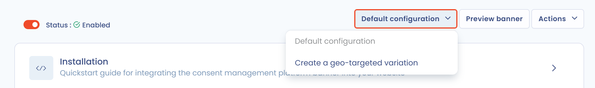

# Geogerichte varianten

## Overzicht

Met de toestemmingsmodule van Dastra maakt u geogerichte varianten van uw cookiebanner. Elke variant is een aangepaste versie van de banner (uiterlijk, teksten, getoonde diensten) die automatisch wordt weergegeven op basis van de geografische locatie van de gebruiker, bepaald via het IP-adres.

Deze functie is vooral nuttig voor organisaties die in meerdere landen of regelgevingszones actief zijn, omdat de verplichtingen rond cookietoestemming sterk per rechtsgebied verschillen (AVG en e-privacyrichtlijn in Europa, CCPA in Californië, LGPD in Brazilië enzovoort).


Waarom dit juridisch van belang is

Een banner die in Frankrijk conform is, is dat niet noodzakelijk voor een gebruiker in Californië (opt-out in plaats van opt-in) of in het Verenigd Koninkrijk (na de Brexit heeft de ICO eigen richtlijnen). Met geogerichte varianten past u uw banner aan elke juridische context aan, zonder extra banners aan te maken.


Varianten zijn afhankelijk van uw abonnement: het keuzemenu voor varianten is uitgeschakeld als de functie niet in uw abonnement zit.

***

## Een geogerichte variant aanmaken

### 1. De configuratie openen

1. Klik in het menu op **Toestemming voor cookies** > **Banners** en klik daarna op uw banner.
2. Open rechtsboven in de editor het keuzemenu dat **Standaardconfiguratie** toont. Het somt de bestaande varianten op.
3. Klik op **Maak een geogerichte variant**.

<figure><figcaption>
Het keuzemenu voor varianten
</figcaption></figure>

### 2. De variant een naam geven

Vul een beschrijvende naam in bij **Geogericht variatielabel** (maximaal 80 tekens), bijvoorbeeld `Banner - California (CCPA)` of `Banner - EER`.

### 3. De geografische zones selecteren

Kies bij **Landen of geografische regio's waarop de banner zich richt** de landen of regio's waarop de variant van toepassing is. In de lijst kunt u zoeken.

Dastra biedt twee snelkeuzes onder **Voorselecteren**:

* **EU/EEE**: selecteert alle landen van de Europese Economische Ruimte.
* **Allemaal adequaat land**: selecteert de landen die de Europese Commissie krachtens artikel 45 van de AVG als adequaat erkent.

De lijst is per land georganiseerd en u kunt ook regio's binnen een land als doel kiezen (bijvoorbeeld Franse regio's of Amerikaanse staten). Zo maakt u bijvoorbeeld een variant die alleen voor Californië geldt, binnen een algemenere banner voor de Verenigde Staten.


Voorrangsregel voor varianten

Kunnen meerdere varianten op dezelfde gebruiker van toepassing zijn (bijvoorbeeld een gebruiker in Île-de-France met een variant "Frankrijk" en een variant "Île-de-France"), dan krijgt de meest specifieke variant (de regio) voorrang op de algemenere (het land).


### 4. De variant aanpassen

Zodra de variant is aangemaakt, opent ze in de editor. U kunt het volgende aanpassen:

* **Uiterlijk van de widget**: kleuren, indeling, knoppen;
* **Teksten en vertalingen**: teksten die aan de lokale juridische context zijn aangepast;
* **Diensten**: u beperkt of breidt de lijst van getoonde trackers uit;
* **Triggers**: weergavevoorwaarden die specifiek zijn voor de variant.


Een variant neemt de volgende instellingen over van de standaardbanner: de toegestane URL's, het genereren van het cookiebeleid, de naam, het domein en de levensduur van de toestemmingscookie, de opslagmodus, de voorbeeldmodus en de versiesleutel. Om ze te wijzigen opent u de **Standaardconfiguratie**.


### 5. De weergave van de banner uitschakelen (optioneel)

In de sectie van de variant kunt u met de optie **Schakel de bannerweergave uit (alle cookies met standaardtoestemming worden geactiveerd)** instellen dat gebruikers in de doelzone geen banner te zien krijgen.

Is de optie ingeschakeld, dan krijgen de betrokken bezoekers geen toestemmingsvenster te zien. Alle cookies worden dan geactiveerd met hun standaardtoestemming, zoals die per dienst is ingesteld.


Alleen voor zones zonder voorafgaande toestemmingsplicht

Deze optie is bedoeld voor landen waar de lokale regelgeving geen actieve toestemming vereist voordat cookies worden geplaatst (bijvoorbeeld bepaalde landen buiten de EER zonder gelijkwaardige e-privacywetgeving). Gebruik ze nooit voor gebruikers in de EU of de EER, in het Verenigd Koninkrijk of in een ander rechtsgebied dat opt-in vereist.



De standaardtoestemming van elke dienst stelt u in bij de sectie **Diensten** van de banner. Controleer die waarden voordat u deze optie inschakelt.


***

## Typische gebruikssituaties

| Situatie | Aanbevolen configuratie |
| --- | --- |
| Europese site met Amerikaans verkeer | EER-variant (strikte opt-in) en variant VS/Californië (CCPA, opt-out) |
| Franse site met een Duitse dochteronderneming | Variant Frankrijk en variant Duitsland met teksten die aan de eisen van de BfDI zijn aangepast |
| Wereldwijde site met minimale conformiteit buiten de EER | Standaardbanner voor de hele wereld en een variant conform de AVG voor de EER |

***

## Technische werking

Dastra bepaalt de locatie op basis van het IP-adres van de bezoeker, zonder dat u iets hoeft te configureren. De locatie dient om te kiezen welke variant wordt getoond. De toestemmingscookie van de bezoeker bevat de locatie niet, maar het gedetecteerde land en het IP-adres worden samen met het [bewijs van toestemming](consent-proof.md) vastgelegd.


Om de weergave van een variant vanuit uw browser te testen, gebruikt u een VPN in de doelzone.

