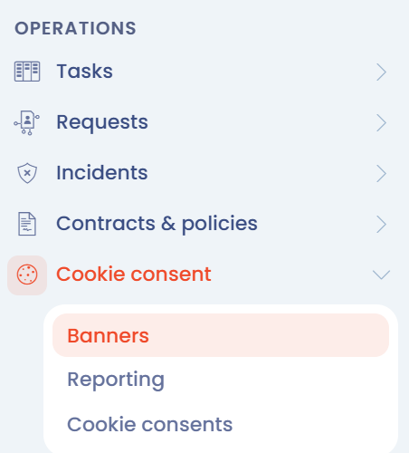
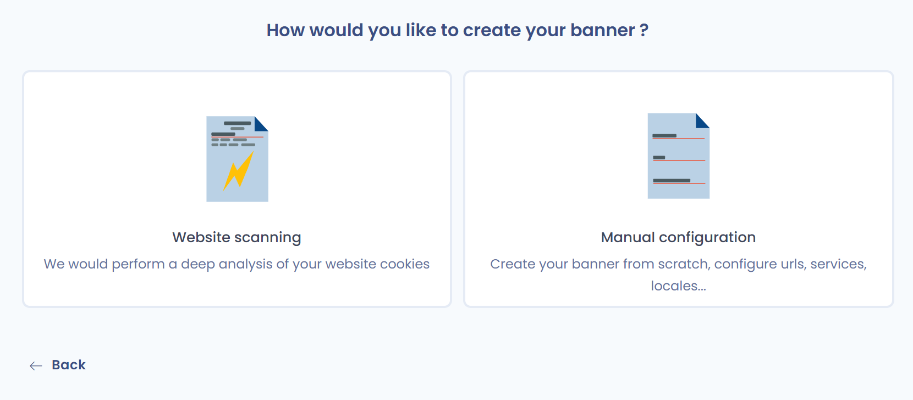

# De op uw website geplaatste cookies scannen

Dastra scant de cookies die op uw website zijn geplaatst met de functie voor het scannen van cookies in de module **Toestemming voor cookies**. De scan is het vertrekpunt voor het aanmaken van uw banner.

## Toegang tot de scanfunctie

Meld u aan bij uw Dastra-werkruimte. Hoe u dat doet, leest u op deze pagina:


[Handleiding](../../../getting-started/tutorial/README.md)


1. Klik in het menu op **Toestemming voor cookies**. De lijst met banners verschijnt.
2. Klik op **Creëer een widget**.

<figure><figcaption>
De module "Toestemming voor cookies" in het menu
</figcaption></figure>

<figure><figcaption>
De knop "Creëer een widget"
</figcaption></figure>

Dastra vraagt **Hoe wilt u uw banner maken?** U kunt kiezen uit twee mogelijkheden:

* **Analyse van de website**: Dastra analyseert de cookies van uw website en stelt een banner voor met de diensten die het heeft gevonden;
* **Handmatige configuratie**: u maakt de banner vanaf nul aan en geeft zelf de URL's, diensten en cookies op.

<figure><figcaption>
De keuze tussen "Analyse van de website" en "Handmatige configuratie"
</figcaption></figure>

Kies **Analyse van de website** om verder te gaan op deze pagina.

## De op uw website geplaatste cookies scannen

1. Voer het adres van uw website in bij **Voer je domeinnaam in (bijv. https://www.github.com)**, bijvoorbeeld `https://www.example.com`. Laat u `https://` weg, dan voegt Dastra het toe.
2. Klik op **Valideren**.

<figure><figcaption>
Het adres van de te scannen website invoeren
</figcaption></figure>


De scan moet uw website kunnen openen. Blokkeert een authenticatie of een firewall de toegang, dan meldt Dastra dat: gebruik dan **Handmatige configuratie**.


De scan doorloopt maximaal 20 pagina's van uw website om een zo betrouwbaar mogelijke cookieanalyse te verzamelen. Tijdens de analyse verschijnt een voortgangsbalk.

<figure><figcaption>
De scan is bezig
</figcaption></figure>

Wanneer de scan klaar is, verschijnen de resultaten: de diensten die in de cookiedatabase van Dastra zijn herkend, de gevonden cookies en de verdeling ervan per categorie. Klik op **Opnieuw scannen** om de analyse opnieuw uit te voeren, of op **Maak het widget** om de banner met deze resultaten aan te maken.

<figure><figcaption>
De scanresultaten
</figcaption></figure>

Zodra de cookies van uw website zijn gescand, kunt u ze classificeren.


[Cookies classificeren op toestemmingscategorie](classify.md)


***

## Niet-geclassificeerde cookies behandelen

De scan vergelijkt de gedetecteerde cookies met de dienstenbibliotheek van Dastra. Een cookie die met geen enkele dienst overeenkomt, is een niet-geclassificeerde cookie: hij is aan geen enkele dienst gekoppeld, wordt nooit in de openbare banner getoond en bezoekers kunnen er dus geen toestemming voor geven.

In de scanresultaten toont een waarschuwingsbadge het aantal niet-geclassificeerde cookies (bijvoorbeeld "3 niet-geclassificeerde cookies") naast de samenvatting van de scan. Deze cookies staan gegroepeerd in het tabblad **Niet-geclassificeerde cookies**, naast de tabbladen **Diensten**, **Cookies gevonden** en **Uitsplitsing van cookie categorieën**.

<figure><figcaption>
Het tabblad "Niet-geclassificeerde cookies" van de scanresultaten, met de badge die hun aantal toont
</figcaption></figure>

Selecteer een of meer cookies met de selectievakjes (het selectievakje in de kop selecteert de hele lijst) en kies daarna een van de beschikbare acties.

### Cookies toevoegen aan een bestaande dienst

1. Selecteer de cookies en klik op **Toevoegen aan een bestaande service**.
2. Kies in het veld **Doelservice** de dienst waaraan u de cookies wilt koppelen.
3. Bevestig.

Alle geselecteerde cookies worden in één keer aan de dienst toegevoegd. Een cookie die al in de dienst staat (dezelfde naam en hetzelfde domein) wordt niet een tweede keer toegevoegd.

### Een dienst aanmaken op basis van een selectie

1. Selecteer de cookies en klik op **Een nieuwe service aanmaken**.
2. Het formulier voor de dienst opent, vooraf ingevuld op basis van het meest voorkomende domein onder de geselecteerde cookies (naam van de dienst, domein en logo) en met de geselecteerde cookies erin.
3. Controleer de voorgestelde gegevens, vooral het doeleinde van de dienst, en sla op.

Alleen de cookies die in de dienst blijven, verdwijnen uit de lijst met niet-geclassificeerde cookies.

### Cookies verwijderen

Selecteer de cookies, klik op **Verwijderen** en bevestig. De cookies worden uit de lijst met niet-geclassificeerde cookies verwijderd.

### Een cookie uit een dienst halen

Vouw in het tabblad **Diensten** van de scanresultaten de cookielijst van een dienst uit en klik op het prullenbakpictogram naast de cookie (tooltip "Verwijderen van deze service", gevolgd door de verwijzing naar de niet-geclassificeerde cookies). De cookie wordt van de dienst losgekoppeld en verhuist naar het tabblad **Niet-geclassificeerde cookies**.

Na elke actie worden de tellers van de tabbladen, de badge en het verdelingsdiagram meteen bijgewerkt.

### Niet-geclassificeerde cookies behandelen vanuit de bannereditor

U hoeft niet elke cookie te behandelen voordat u de banner aanmaakt: onbehandelde cookies blijven aan de banner gekoppeld en kunt u later behandelen. In de bannereditor toont de titel van de sectie **Diensten** het aantal niet-geclassificeerde cookies, en het tabblad **Niet-geclassificeerde cookies** van die sectie biedt dezelfde acties: **Verwijderen**, **Toevoegen aan een bestaande service** en **Een nieuwe service aanmaken**.

Zijn alle cookies aan een dienst gekoppeld, dan toont het tabblad de melding "Alle cookies zijn geclassificeerd".

### Een bestaande banner opnieuw scannen

Klik in het tabblad **Diensten** van de bannereditor op **Scannen van cookies** om de site opnieuw te scannen. In de resultaten markeert een groen vinkje (tooltip **Al in uw configuratie**) de diensten die al in de banner zijn opgegeven. Gedetecteerde cookies die overeenkomen met de cookies van een reeds opgegeven dienst, ook een eigen dienst, worden aan die dienst gekoppeld en verschijnen niet bij de niet-geclassificeerde cookies.


Niet-geclassificeerde cookies worden nooit in de openbare banner getoond. Koppel elke cookie die uw website daadwerkelijk plaatst aan een dienst, zodat bezoekers er toestemming voor kunnen geven.


***

## Beperkingen en goede praktijken

### Cookies die na toestemming worden geplaatst (opt-in-diensten)

Een cookiescanner doorloopt uw site standaard zonder toestemming te geven. Cookies die pas na opt-in worden geplaatst (analyse, marketing enzovoort) worden dus nooit geactiveerd en kunnen niet worden gedetecteerd.

Uitzondering: als de Dastra SDK al op uw site is geïntegreerd, kan de scanner de toestemmingsbanner omzeilen en alle daadwerkelijk geplaatste cookies verzamelen, ook die van opt-in-diensten. De scan levert dan zonder handmatige tussenkomst een volledig resultaat.

Is de Dastra SDK nog niet aanwezig op de gescande site, dan moet u opt-in-diensten handmatig toevoegen via de dienstenbibliotheek.

### Handmatig toegevoegde diensten: overtollige cookies

Wanneer u een dienst uit de Dastra-bibliotheek toevoegt (bijvoorbeeld Google Analytics, Meta Pixel), importeert Dastra de volledige lijst met cookies die die dienst in al zijn mogelijke configuraties kan plaatsen. Uw implementatie gebruikt waarschijnlijk maar een deel daarvan.

Verwijder de cookies die uw specifieke implementatie niet daadwerkelijk plaatst. Cookies opgeven die u niet gebruikt, misleidt bezoekers en kan vragen oproepen bij een nalevingsaudit.

Om te bepalen welke cookies u bewaart, vergelijkt u de resultaten van de geautomatiseerde scan (die detecteert wat daadwerkelijk wordt geplaatst) met de uit de bibliotheek geïmporteerde lijst en verwijdert u de items die niet in de scan voorkomen.
