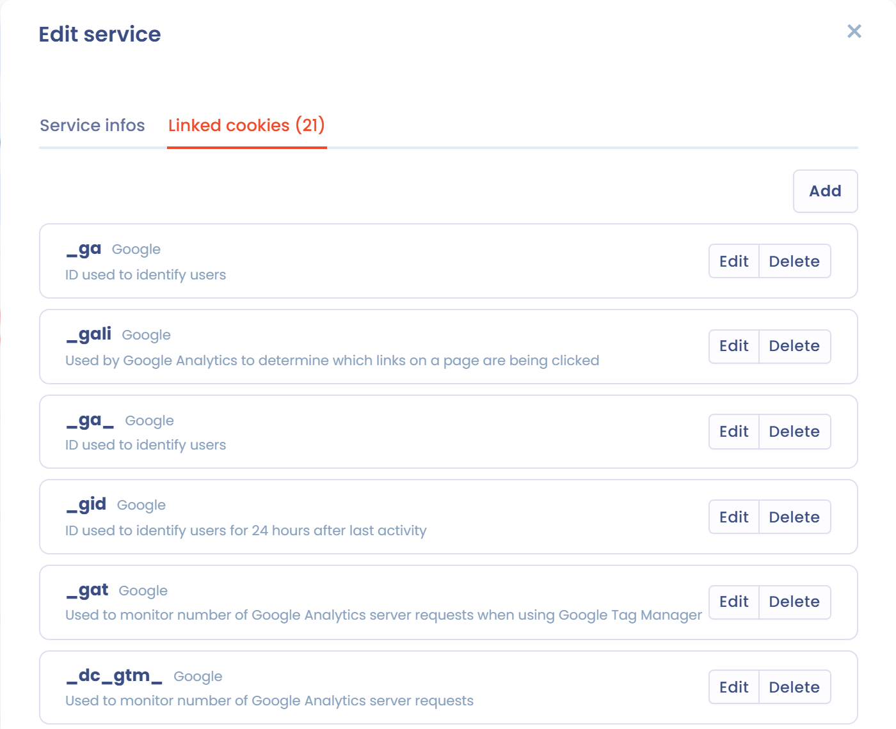

# Cookies blokkeren

Om cookies effectief te blokkeren zijn er verschillende methoden: cookies verwijderen, een codefragment blokkeren, aangepast JavaScript of Google Tag Manager.

## Cookies verwijderen

Deze methode is het snelst in te stellen, maar ook het minst betrouwbaar. Voert u in de sectie **Diensten** van de banner de namen in van de cookies die bij elke dienst horen (tabblad **Bijbehorende cookies** van de dienst), dan verwijdert de SDK deze cookies automatisch zodra een weigering voor de dienst wordt vastgelegd.

<figure><figcaption><p>De cookies die aan een dienst zijn gekoppeld</p></figcaption></figure>

Deze methode werkt in sommige gevallen, maar kan de betrouwbaarheid van hulpmiddelen van derden verstoren, vooral van webanalysehulpmiddelen. Gebruik haar naast een van de onderstaande methoden.

## Een codefragment in de pagina blokkeren

Met deze methode schakelt u een trackingcodefragment volledig uit.

Vervang in de HTML-code van uw pagina het volgende fragment:

```html
<script>
  alert("hello, I'm a tracking javascript tag");
</script>
```

Door:

```html
<script data-consent="{your-service-slug}" type="dastra/script">
  alert("hello, I'm a tracking javascript tag");
</script>
```

Vervang `{your-service-slug}` door de identificatie van de dienst, die u vindt in het veld **Naam van de variabele (belangrijk voor integratie van toestemming)** van het dienstformulier:

<figure><figcaption><p>De identificatie van de dienst</p></figcaption></figure>

Heeft de bezoeker de dienst geaccepteerd, dan wordt de inhoud van het script automatisch uitgevoerd.

Om een extern script te laden voegt u het attribuut `src` toe: de browser downloadt het pas na toestemming.

```html
<script data-consent="{your-service-slug}" type="dastra/script" src="https://example.com/tracker.js"></script>
```


Deze methode heeft neveneffecten: de syntaxiskleuring van de meeste code-editors herkent het type `dastra/script` niet. Het script wordt nooit uitgevoerd als de Dastra-banner niet laadt.


### De door de toepassing gegenereerde codefragmenten gebruiken

Voor elke dienst genereert de sectie **Integratie van toestemming** van de banner kant-en-klare codefragmenten en een checklist. Er zijn drie tabbladen: **Html integration** (het fragment hierboven), **Custom javascript** (het blokkeren in pure JavaScript, hieronder) en **Google tag manager** (de gebeurtenissen die u in Google Tag Manager koppelt).

## Blokkeren in pure JavaScript

In JavaScript kunt u luisteren naar de gebeurtenissen die op `window` worden afgevuurd om toestemming te verzamelen en specifiek gedrag af te handelen, afhankelijk van of cookies worden geaccepteerd of geweigerd. Deze methode geeft u meer flexibiliteit:

```html
<script>
  (function () {

    /*
     * Trigger a custom service tag with the expected cookies
     */
    function customTagsTrigger() {
      /* If the vendor provides a specific function to make the service work without cookies, call it here.
       * Otherwise, copy the default code snippet provided by the vendor. */
    }

    /*
     * Handle the global scope consent event.
     * If the user consented to the vendor's cookies, this event is fired on each page load
     * where the cookie consent banner is installed.
     */
    window.addEventListener('dastra:consent:{your-service-slug}', function () {
      /* The visitor opted in to the vendor's cookies */
      customTagsTrigger();
    });

    /*
     * Handle the global scope refused event (optional)
     */
    window.addEventListener('dastra:refused:{your-service-slug}', function () {
      /* The vendor's cookies are refused */
    });

  })();
</script>
```

## Google Tag Manager

Zie de volgende pagina:


[Google Tag Manager](google-tag-manager.md)


## Herinnering: de levenscyclus van toestemming

<figure><figcaption><p>Levenscyclus van toestemming</p></figcaption></figure>

## JavaScript-gebeurtenissen

De banner vuurt verschillende gebeurtenissen af op het element `window` van de pagina. De toestemmingsgebeurtenissen worden bij elke paginalading afgevuurd, wanneer de banner de reeds opgeslagen keuzes toepast, en daarna telkens wanneer een keuze wordt opgeslagen.

| Naam van de gebeurtenis | Opmerkingen |
| --- | --- |
| `dastra:consent:<service slug>` | Wordt afgevuurd wanneer de dienst wordt geaccepteerd, door de bezoeker of standaard (strikt noodzakelijke diensten worden niet geraakt). Staat de dienst op "standaard toegestaan", dan wordt de gebeurtenis afgevuurd vanaf de eerste paginalading. |
| `dastra:refused:<service slug>` | Wordt afgevuurd wanneer de dienst niet wordt geaccepteerd: standaard als er geen toestemming is gegeven, of na een uitdrukkelijke weigering. |
| `dastra:consents:ready` | Wordt afgevuurd wanneer de opgeslagen toestemming (standaard de cookie `consent-eu`) is gelezen en de eerste gebeurtenissen zijn afgevuurd. |
| `dastra:consents:updated` | Wordt afgevuurd bij elke paginalading en telkens wanneer keuzes worden opgeslagen (geaccepteerd, geweigerd of aangepast). Het detail van de gebeurtenis bevat de lijst met toestemmingen. |
| `dastra:consents:any_refused` | Wordt afgevuurd wanneer ten minste één opgeslagen toestemming een weigering is, bij elke paginalading en telkens wanneer keuzes worden opgeslagen. |
| `dastra:consents:all_accepted` | Wordt afgevuurd wanneer geen enkele opgeslagen toestemming een weigering is, bij elke paginalading en telkens wanneer keuzes worden opgeslagen. |
| `dastra:consents:closed` | Wordt afgevuurd wanneer de bezoeker de banner sluit met het sluitkruisje. |
| `dastra:gpc:applied` | Wordt afgevuurd wanneer de banner niet-essentiële cookies automatisch weigert vanwege een signaal van Global Privacy Control of Do Not Track. Zie [US Privacy: CCPA, GPC en DoNotTrack](../../banner/us-privacy.md). |


Omdat de gebeurtenissen `dastra:consent:*` en `dastra:consents:*` ook bij het laden van de pagina worden afgevuurd, registreert u uw listeners voor het herladen binnen `dastra:consents:ready`. Zie [Google Tag Manager](google-tag-manager.md).


Om op elke toestemmingsupdate te reageren, kunt u ook `dastra.addConsentDastraListener(callback)` gebruiken: de functie wordt bij elke gebeurtenis `dastra:consents:updated` aangeroepen.

## Veelgestelde vragen

### Kan ik een script blokkeren per categorie in plaats van per dienst? (bijvoorbeeld `data-consent="analytics"`)

Nee. Het attribuut `data-consent` verwacht een **service slug**, geen categorie-slug. Met `<script data-consent="analytics" type="dastra/script">` alle diensten van een categorie in één instructie blokkeren, wordt niet ondersteund.

De reden: een gebruiker kan sommige diensten binnen een categorie accepteren en andere in dezelfde categorie weigeren. De banner beheert toestemming op het niveau van de dienst, niet van de categorie.

Om een script te laden afhankelijk van de vraag of een hele categorie is geaccepteerd, gebruikt u de programmatische API:

```javascript
window.addEventListener('dastra:consents:updated', function () {
  if (window.dastra.cookieConsent.consent.getPurposeConsent('Analytical')) {
    // load your analytics scripts here
  }
});
```


`getPurposeConsent` geeft alleen `true` terug als **alle** diensten van de categorie zijn geaccepteerd. Heeft de banner geen enkele dienst in die categorie, dan gooit de aanroep een fout: vang die af, bijvoorbeeld met een `try ... catch`.

